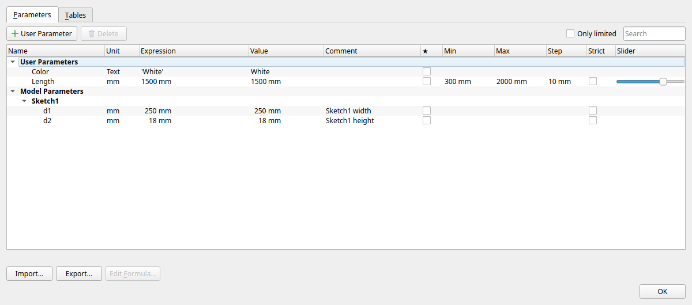
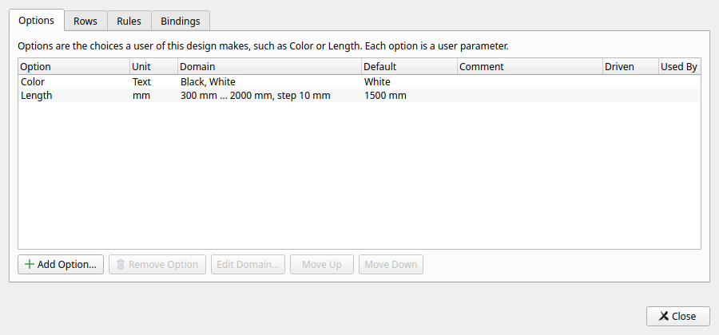
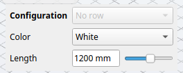
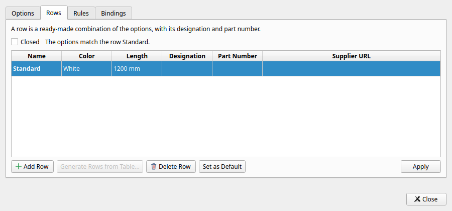
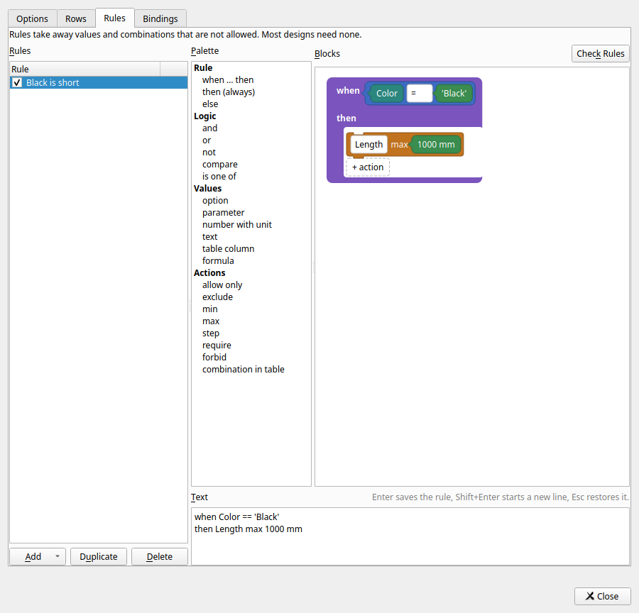
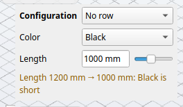

# MitCad user guide

MitCad is an open-source parametric desktop CAD application for Windows,
Linux and macOS (Apple Silicon, macOS 14.4 or newer). It has the MIT
licence. This guide tells you how to install MitCad and how to use it.
The chapters that follow describe the window, the commands, sketches,
features, components, files, libraries, import and export, outputs and
preferences.

The window has the toolbar at the top and the browser
on the left. The timeline is at the bottom and the command panel is on
the right. The orientation cube is in the top right corner of the view.
The toolbar has tabs (Solid, and Sketch in sketch mode) and groups
(Create, Modify, Assemble, Construct, Inspect, Insert, Select). A click
on a group's name opens a menu of all its commands. **S** opens command
search: type the start of a command's name and press Enter.

## Connect an AI assistant

With a design open, choose **Help › Connect AI Assistant…**, click the
assistant indicator, or choose **Connect AI Assistant…** in
**Preferences › AI Assistants**.

1. Choose the assistant: **Claude Desktop**, **Claude Code**,
   **ChatGPT / Codex** or **Other**. The dialog starts with the one chosen
   last, or else the first one installed on this computer. In its lines
   ChatGPT / Codex is called Codex (**Ready to connect Codex**).
2. Press the button beside the state line. The line names the next step
   and the button does it:

   | State line | Button | What to do |
   |---|---|---|
   | *Assistant* was not found on this computer | **Get Claude Desktop** or **How to install** | Install it from the page that opens, then come back. If it is installed after all, press **Connect anyway** (Claude Desktop, ChatGPT / Codex) |
   | Ready to connect *assistant* | **Connect** | MitCad sets the connection up |
   | Approve MitCad in Claude Desktop, then start a new chat | **Open in Claude Desktop again** | Approve the extension in Claude Desktop; the button opens it again if needed |
   | Install Claude Desktop first, in red | **Get Claude Desktop** | No application on this computer took the extension and Claude Desktop was not found (also after **Open Claude Desktop** found it gone): install Claude Desktop, then choose it again |
   | Install the extension in Claude Desktop | **Show in Explorer** (**Show in Finder** on macOS), and **Open Claude Desktop** | Claude Desktop is installed but does not open the extension by itself (Claude Desktop from the Microsoft Store). The line below says where: **In Claude Desktop: Settings › Extensions › Advanced settings › Install Extension…, then choose** the saved `mitcad-desktop.mcpb`, which the button shows (do not double-click it). Approve and enable the extension, then start a new chat |
   | Start a new Claude Code session to use MitCad / Restart ChatGPT or start a new Codex session to use MitCad | none | Start a new conversation in the assistant |
   | ✓ Connected: *assistant* | **Disconnect** | Work with the assistant; **Disconnect** keeps the design and its unsaved changes |
   | A short message saying what went wrong, in red | **Try again** | Do what the message says, then try again |

   Connected shows for the assistant that is connected, by its name
   (**Claude Desktop**, **Claude Code**, **Codex**; another assistant by
   the name it gives itself). With another assistant chosen, a quiet line
   names it (**Also connected: …**), and **Disconnect** then ends only the
   chosen assistant's connection and names it (**Disconnect Claude Code**;
   with **Other**, the assistant's own name).
   For **Other**, **Copy configuration** copies the settings to paste into
   your assistant's settings.
3. The line **Folder for designs:** names the folder the assistant can
   open designs from and save them to (with its subfolders). **Connect**
   (or **Connect anyway**, **Copy configuration**) allows that folder;
   **Change…** picks another first. Without an allowed folder, the
   assistant can only save a design that already has a file. The allowed
   folders are listed in **Preferences › AI Assistants**.

**Advanced** shows what sets the connection up by hand: the
**Configuration** (the settings to paste) and the **Command** that
registers MitCad (**PowerShell command** on Windows), each with its own
**Copy** button, and the **Codex settings file** with **Change…** (for
ChatGPT / Codex; a file other than `config.toml` takes the configuration
only). When several MitCad windows are open, **Copy
Command for This Window** gives a command that connects to this window
only. The dialog checks the installations and the connection every
second.

Connect never changes unrelated settings: it backs up the assistant's
settings first, changes only MitCad's entry, and asks before it replaces
a connection to another MitCad installation. Settings managed by an
administrator are not changed. See [the MCP guide](mcp.md#connect-from-mitcad)
for the details of each assistant.

**The assistant indicator.** Beside the project indicator, the assistant
indicator shows whether AI assistants are connected to the window: **No
assistant** with a hollow dot (the window accepts them), **Claude Code
connected** with a coloured dot (one assistant; **2 assistants connected**
with several), or **Assistants unavailable** with a struck-through dot
(the window cannot accept them, for example when MitCad was started with
`--no-mcp`). It is in the title row of the Floating layout, in the status
bar of the Docked layout and in the toolbar of the native macOS window.
Its tooltip gives the details, with the window's instance id and port.

With no assistant connected, a click on the indicator opens **Connect AI
Assistant**; its arrow, or a right click, opens its menu. Otherwise a
click opens the menu. With assistants unavailable, the menu says why
first. With assistants connected, it lists each (its name, the name and
version the client gave itself, and the time it connected) and has
**Disconnect *assistant*** (**Disconnect All** with several). It always
has **Connect AI Assistant…** and **Folders for Designs…** (**Preferences ›
AI Assistants**), and with several MitCad windows open **Copy Command for
This Window** (a command that connects to this window only).

## Chat with an AI agent

**View › Chat** (Ctrl+Shift+L, ⌘⇧L on macOS, or its button beside the
assistant indicator) opens the chat panel: write what you want, for
example "a 30 × 20 × 10 mm box with the top edges rounded 2 mm", and your
own Claude Code or Codex changes the open design through MitCad's tools
while you watch. The panel finds an installed agent by itself; when it is
missing, **Install Claude Code** (**Install Codex**) opens its setup page,
and when it is not signed in, **Sign in to Claude** (**Sign in to
ChatGPT**) starts its own sign-in.

- With both agents installed, the header chooses between them; the other
  one starts a new conversation and stays chosen next time. **Model**
  below it sets the model the agent uses (**Default model**, the ones the
  agent names, or a name you type), from the next message on.

- **Enter** sends, **Shift+Enter** starts a new line; **Selection** (on
  by default) and **View** say what goes with the message. While the
  agent works, the button is **Stop** (Esc).
- The agent's calls are rows in the conversation; calls in a row between
  two of its sentences are one row (**3 calls (1 failed) · *the latest
  call***) that opens to them. Saving, opening,
  exporting and undoing what was there before the message ask first with
  a card: **Allow once**, **Always allow** or **Deny** (**Preferences › AI
  Assistants › Chat** sets what asks).
- Each message is one undo step, **AI: *its first words***: one **Undo**
  takes it back. If you change the design yourself meanwhile, the
  agent's changes stay separate steps.
- The conversation is kept with the design in your own data folder (not
  in the design file) and shown again when you open the design.

See [the chat panel](ai-chat.md) for the setup, the approvals, privacy
and the history.

## Installation

MitCad runs on Windows, Linux and macOS. On macOS it needs Apple Silicon
and macOS 14.4 or newer. The website is
[mitcad.org](https://mitcad.org/). The downloads are on
[the releases page](https://github.com/mitcad/Mitcad/releases) on
GitHub. MitCad is under active development. A release comes as a Windows
installer, a Linux AppImage and a macOS disk image.

Each release on GitHub has these files:

| File | Content |
|---|---|
| `mitcad-<version>-windows-x64.exe` | The Windows installer |
| `mitcad-<version>-windows-x64.zip` | The portable `.zip` for Windows |
| `Mitcad-<version>-x86_64.AppImage` | The Linux AppImage |
| `Mitcad-<version>-macos-arm64.dmg` | The macOS application disk image |
| `update-manifest.json` | The signed manifest for automatic updates |

MitCad checks once a day for a signed release and offers to install it.
The user or an administrator can set the checks to off. These
installations update themselves:

- The installation of the Windows installer
- An AppImage in a writable folder
- A macOS application bundle in a writable folder

Other installations only announce a new release:

- The portable `.zip`
- Unbundled development builds
- System packages
- Read-only installations
- On macOS, an app in a read-only disk image, on an App Translocation
  path or quarantined in Downloads

The startup log gives the reason. On macOS, copy the app to a writable
Applications folder first. MitCad does not ask for elevation to replace
a bundle that the current user cannot write. Refer to
[Updates](#updates) and [updates.md](updates.md).

### Windows

MitCad needs OpenGL 2.1 or newer on Windows. The installer runs as the
user. It installs in one of two scopes:

- **just for me** (the default): into `%LOCALAPPDATA%\Programs\Mitcad`,
  with the Start menu shortcut, the `.mitcad` file type and the
  uninstall entry under `HKCU`. This scope does not need administrator
  rights, so there is no UAC prompt.
- **for all users**: into `Program Files\Mitcad`, registered under
  `HKLM`. Only this choice asks for elevation: the installer starts
  itself again elevated.

The page *Choose Users* after the licence offers the choice. It starts
on *For all users* only when MitCad is installed for all users and not
for the current user. The installer first uninstalls an earlier version
in the same scope. It runs that version's own uninstaller silently, in
place.

A silent install uses these switches:

| Switch | Effect |
|---|---|
| `/S` | Installs just for the current user |
| `/S /AllUsers` | Installs for all users |
| `/CurrentUser` | Says the default (just for the current user) explicitly |
| `/D=<dir>` | Sets the folder in both scopes. Put it last, without quotes |

A silent install whose `/D` folder is the folder of the installation
for all users stays for all users. The updater of an earlier release
runs such an install.

The installer writes the scope into `<dir>\installation.ini`
(`[Installation]`, `Scope=user` or `all`). The uninstaller and the
automatic updates read this file. An installation without the file is
from an earlier release, which was for all users. The uninstaller
removes only the files and the keys of its own scope. For all users it
elevates as the installer does.

The installer has these exit codes:

| Exit code | Meaning |
|---|---|
| 0 | Done |
| 1 | Cancelled |
| 2 | Aborted (also when the installer could not uninstall the earlier version) |
| 740 | Elevated, but still without administrator rights |
| 1223 | Elevation refused |

The portable `.zip` has the same files as the installer. It does not
update itself. It only announces a new release.

### Linux

The AppImage is built on Ubuntu 24.04 and needs glibc 2.39 or newer:
Ubuntu 24.04 or newer, or a distribution based on them. It brings its
own Qt and does not use the system's.
Without FUSE, run it with `--appimage-extract-and-run`. At each start
the AppImage writes its desktop file and its icons into `$XDG_DATA_HOME`
if they differ, so docks show the icon. In the desktop file, `Exec` is
the AppImage and `StartupWMClass=Mitcad`. The AppImage has no GTK. Thus
it uses the `xdgdesktopportal` platform theme unless
`QT_QPA_PLATFORMTHEME` is set. An AppImage in a writable folder updates
itself.

### macOS

MitCad needs Apple Silicon, macOS 14.4 or newer and OpenGL 4.1 core.
Apple has deprecated OpenGL, but it is present. The release is an
application disk image (`.dmg`). Copy the app to a writable
Applications folder. An app in a writable folder updates itself. An
app that runs from the read-only disk image, from an App Translocation
path or as a quarantined bundle in Downloads only announces a new
release. The startup log gives the reason.

## Quick start

This procedure makes a body from a sketch and gives it a fillet.

1. Select **Create Sketch** (Alt+S, or command search S). Click the XY
   plane. The view turns to the plane.
2. Press **R** (2-Point Rectangle). Click the first corner at the origin.
   Type the width `40`, press Tab, type the height `25` and press Enter.
   Typed values become dimensions and parameters (`d1`, `d2`).
3. Press **Ctrl+Enter** to finish the sketch.
4. Press **E** (Extrude). Extrude takes the latest profile. Type `20` and
   press Enter. You can also drag the arrow in the view.
5. Press **F** (Fillet). Click the top face. A face is all its edges.
   Type the radius and press Enter.
6. To change a dimension, open **Change Parameters** (in Modify or in the
   Edit menu). Double-click a value and type `50` or the expression
   `d2 * 2`. MitCad recomputes the design, and the fillet stays on the
   same edges.
7. To edit a feature, double-click it on the timeline. A sketch opens in
   sketch mode. An edit is one undo step (Ctrl+Z).

You can also open a `.f3d` or `.f3z` design with **File › Open** (or
Import). Refer to [.f3d import](#f3d-import) for the import, its
progress dialog and its report.

## The window

The window has the toolbar at the top, the Browser on the left, the
timeline at the bottom and the command panel on the right. The
orientation cube is in the top right corner of the view. The sections
that follow describe the layouts of the window, the view, selection,
the command panels and long computations.

On macOS, the keys that say Ctrl in this guide are Cmd keys (Cmd+N,
Cmd+S, Cmd+Z and so on). Refer to [Shortcuts](#shortcuts) for the
other keys that differ on macOS.

### Layouts

The **Layout** setting on the Display page of Preferences selects how
MitCad arranges the window:

- **Floating** (the default): the panels are cards over a full-window
  3D view.
- **Docked**: the panels are in docks around the 3D view.

Tools › Preferences has a page for each kind of setting. Refer to
[Preferences](#preferences).

The layout takes effect when MitCad starts. After a change, MitCad asks
if you want to restart now. Restart Now closes the window as a quit
does and starts MitCad again with the design open. If the design has
unsaved changes, MitCad saves it or asks about it first. Cancel keeps
MitCad open. Later keeps the choice for the next start. On the command
line, `--chrome=docked|floating` overrides the setting for one run.

On macOS the Floating layout follows the system's own apps. In the
Floating layout on macOS, the title bar row and the toolbar's
groups are a bar at the top. On Windows and Linux only the menu bar is
a bar at the top, and the 3D view starts directly below it. There the
title bar row floats over the top of the view without a card. Its
controls and the design's name each have a small box of their own.
Each of the toolbar's groups is a card of its own in a row below the
title bar row. A click, a drag or the wheel between and beside these
cards works in the view.

The other cards always start below the bar and the floating rows, at
any window size. The parts of the Floating layout are:

- **Title bar row:** Undo and Redo, the workspace tabs as a segmented
  control, the design's name and the command search. Under it the toolbar's
  groups are capsules. A click on
  a group's name opens a menu of all its commands. In a narrow window
  the groups at the right show only their names.
  Finish Sketch is in the ribbon and the Sketch Palette while editing a sketch.
- **Cards:** the Browser (upper left, collapsible), the Command panel
  (upper right, only while it has content to show) and the Timeline
  (along the bottom) float over the 3D view. The Projects panel, when
  shown, is a card above the Browser. View › Browser, View › Timeline
  and View › Projects show and hide them. Fit and Home put the design in
  the area that the cards leave free. A click beside a card reaches the
  view.
- **Browser background** (Preferences › Display, in this layout only):
  **Card** puts the Browser on its card. **Rows** leaves the card out.
  Then each row, and the Browser's header, has a small box of its own,
  as wide as its content. The design shows between and beside the rows.
  A click, a drag or the wheel there works in the view (select, orbit,
  zoom).

  Only the boxes belong to the Browser. Its scroll bar is at the left,
  beside the rows. The change applies at once.
- **The Browser's height** follows its rows. The Browser grows as
  folders open, down to the Timeline, and only then scrolls. It shrinks
  as folders close.
- **Messages** show for a few seconds in a capsule above the Timeline.
  Update and remote notices show under the toolbar (on Windows and
  Linux in a card under the groups). MitCad does not show the remote's
  state. The remote's commands are in File › Project.
- **Glass:** on macOS 26 and later the cards are Liquid Glass. With
  `--no-glass`, or on older systems, they are translucent panels.
- **Settings** (MitCad › Settings, Cmd+,) is a window with the same
  pages as Preferences elsewhere, as panes. Changes apply at once. There
  is no OK. Typed cache budgets apply when editing finishes; arrow buttons
  apply immediately. Camera and background controls follow changes made
  through View while Settings is open. Cmd+W closes the active tool window;
  in the design window it closes the design. The background can follow
  the system's appearance.
- **Sheets:** questions and dialogs about the design hang from the
  window's title bar.

### View and navigation

The mouse scheme sets how you pan, orbit and zoom. Tools › Preferences
selects the scheme. The schemes are:

- Default: the middle mouse button + drag pans. Shift + the middle
  button orbits. The wheel zooms at the cursor.
- Alt with the left, middle or right button: orbit, pan and zoom.
- The middle button pans, and F4 + the left button orbits.
- The middle button orbits, Ctrl + the middle button pans and Shift +
  the middle button zooms.
- The right button orbits, and the middle button pans.
- **Trackpad** (the default on macOS): a two-finger scroll pans.
  Alt (Option) + scroll orbits. Shift or Ctrl (Cmd) + scroll zooms.
  Alt + left drag and the right button orbit. Shift + Alt + left drag
  and the middle button pan. A right click, or Control + click on a
  Mac, still opens the context menu.

In every scheme a pinch zooms about the fingers. A two-finger rotation
rolls the view (not with a constrained orbit). A two-finger double tap
fits everything. A two-finger orbit has a 1.3× motion gain. Pan, zoom
and mouse drags keep their own sensitivity.

The **orientation cube** turns the view. A click on a face, an edge or
a corner of the cube turns the view there. Drag the cube to orbit. The
house returns to the home view. The right button opens the cube's menu:
Home, Camera (Orthographic, Perspective: the camera's projection, as in
View › Camera), Set Current View as Home, Reset Home, Fit.

The cube is dark glass over a dark background and frosted light glass
over a light background. Its face names are printed on it. The faces,
edges and corners light up in the accent colour under the pointer. The
house is the small capsule above the upper left corner of the cube.

**Preferences › Display › Orientation cube** sets how the cube is drawn:

- **Follow the View** (the default): as the camera draws the model. With
  a perspective camera the cube is in perspective too, and in its corner
  you also see the sides that face the middle of the view.
- **Orthographic**: always orthographic, so it keeps its square shape in
  the corner, also with a perspective camera.
- **Perspective**: always in a perspective of its own, as if you looked
  straight at it, also with an orthographic camera.

The cube keeps its size and place in the corner with each choice, and a
click on it turns the view to what you clicked.

The **View menu** has the standard views, Look At, Fit, the camera, the
display styles, the background, Grid and Snaps, and the named views.
The display styles are Shaded, Shaded with Visible Edges Only, Shaded
with Hidden Edges, Wireframe and Wireframe with Hidden Edges. Named
views are stored in the design. MitCad remembers the settings.

View › Visual Style › Rendered shows the bodies path traced: refer to
[The rendered view](#the-rendered-view) for the render environment, the
lights and Render Image.

#### 3D mouse

A 3D mouse (a 6-DOF device such as a SpaceMouse or a Space Navigator)
moves the view. Orbit, pan and zoom work together. The **Navigation
mode** sets what follows the cap:

- **Object** (the default): the model follows the cap. Push the cap to
  the side or lift it, and the model moves the same way. Pull the cap
  toward you, and the model comes closer; push it away to zoom out.
  Tilt, twist or roll the cap, and the model turns the same way, about
  the same centre as the mouse's orbit.
- **Camera**: the camera follows the cap. Push the cap to the right, and
  the camera moves right (the model goes left). Push the cap away, and
  the camera moves forward: in perspective it moves toward the model, in
  orthographic it zooms in. Tilt or twist the cap, and the camera turns
  the same way about the orbit's centre.
- **Fly**: the camera moves as in Camera mode but turns in place, as
  when you look around inside a building. In orthographic projection Fly
  works as Camera.

With **Lock horizon** on, Z stays upright and the view does not roll:
the roll axis does nothing. Lock horizon belongs to the 3D mouse alone;
the mouse's **Constrained orbit (Z stays up)** does not change it.

In sketch mode the 3D mouse only pans and zooms, in the direction of its
Navigation mode. The first button fits everything and the second button
goes to the home view.

The **3D Mouse** tab of Tools › Preferences › Navigation has the
settings:

- **Use a 3D mouse** turns it on or off.
- **3D mouse speed** sets how fast the view moves.
- **Navigation mode** is Object, Camera or Fly.
- For each axis, **On** lets the axis move the view, and **Reverse**
  turns its direction around from what the Navigation mode does.
- **Lock rotation** and **Lock translation** stop all turning or all
  panning and zooming. **Dominant axis only** uses only the axis that
  you push the most. **Lock horizon** keeps Z upright. These work in
  every Navigation mode.
- The button table sets the command of each button: Fit, Home, a
  standard view, Look At, Orthographic or Perspective, or None.

The tab also shows whether MitCad found a 3D mouse. MitCad needs no
driver from the device's maker:

- On Windows, MitCad reads the device directly. If the maker's driver
  is installed, set it to send nothing of its own to MitCad, so that the
  view does not move twice.
- On Linux, MitCad uses the spacenavd service. Install and start
  spacenavd; MitCad finds it also when it starts later.
- On macOS, MitCad reads the device directly. If the maker's driver is
  installed and running, it can keep the device to itself; then quit
  the driver to use the device in MitCad.

### Selection

A click selects. Ctrl or Shift adds to the selection or removes from
it. A drag from left to right selects what lies inside the window. A
drag from right to left also selects what the window crosses. In a
design with components, a drag that starts on a body drags the
component, or MitCad says why it does not. Refer to
[Components](#components).

The filters of the Select group limit what you can select. Sketch mode
has its own filters. Refer to
[Selection in sketch mode](#selection-in-sketch-mode). A selection that
you make before a command goes into the command's input.

MitCad highlights under the pointer what a click would select. A face
shows see-through in light blue, with its boundary drawn, so that its
shading still shows. In a command, the highlight has the colour of the
command's input. An edge or a vertex shows in the same colour. Geometry
in front of it hides the highlight.

The right mouse button opens the commands that fit the selection.
Refer to [The context menu](#the-context-menu).

The selection card also shows a Create row under the selection's text.
The row has up to four buttons. Each button starts its command with the
selection as its input, as the ribbon does. Extrude is always the first button when it
can take the selection. The other buttons depend on what you select:

| Selection | Buttons |
|---|---|
| Profiles | Extrude, Revolve, Sweep, Loft (two or more profiles only) |
| A planar face | Extrude, Create Sketch, Hole |
| A cylindrical face | Thread, Pulley, Gear, Bearing |
| Sketch curves or edges | Pipe |
| Bodies | Rectangular Pattern, Circular Pattern, Mirror, Combine (one body only) |
| A plane | Create Sketch |

A command is shown only when it can use all of the selection. When no
command can use it, for example a mix of a face and a profile, the row
is hidden.

### Command panels

A command's panel on the right shows the command's inputs. The view
shows the selections in the colour of the input, and the preview
follows the inputs. Distances and angles also have handles in the view.
While dragging, the blue handle follows the pointer continuously. The small
marker labelled **Snapped** and the value field show the rounded value that
will be kept on release. Dragging an Extrude's distance or start offset
also shows the extrusion at once in see-through amber with dashed edges:
a provisional shape, drawn while the exact preview of that value is still
computed, which replaces it when it is ready. The automatic operation and
the bodies it affects follow the exact preview; OK always keeps the exact
result of the last value. Dragging a handle of Move/Copy's Free Move,
Translate, Rotate (the ring about the axis) or Point to Position (an arrow
along each axis to the position) moves the bodies or components with the
pointer at once; the
exact preview is computed when you stop for a moment or release the
button, and OK keeps it. Typing a value keeps the precision you enter.
A preview that fails shows in red, and OK does not accept it. Enter is
OK, and Esc is Cancel. While you edit a feature, the timeline rolls
back to before the feature.

A value field takes an expression with units (`20`, `2 in`, `d1 * 2`).
The value of an expression, or an error, shows below the field; a
number, with or without its sign and unit (`-8 mm`), is its own value
and shows nothing there, so the panel does not move while you drag an
arrow past zero. Numbers take a decimal
comma or a decimal point: `1,5 mm` is `1.5 mm` and shows as `1.5 mm`.
A comma directly between two digits is a decimal comma. Any other comma
separates the arguments of a function, and `;` always does. Thus
`max(a, b)`, `max(1, 5)` and `max(1; 5)` have two arguments, but
`max(1,5)` is `max(1.5)`.

There are no thousands separators: `1,000` is 1, and `1 000` is an
error.

### Long computations

To open a large design, or to change it, can take a while. The window
continues to draw. After a moment a progress dialog shows the feature
that MitCad computes, how many features there are and the time so far.
**Cancel** (or Esc) stops the computation in a fraction of a second,
also inside a long feature. It also undoes what started the
computation: an open leaves the previous design. A command, a
parameter change, Undo or Redo leaves the design as it was.

A command's panel stays open, and OK tries again. While the progress
dialog shows, the window takes no other input.

## Commands and shortcuts

The shortcuts in this chapter are the defaults. You can change them in
Tools › Keyboard Shortcuts. Click a command's Shortcut cell (or select
its row and press Enter) and press the new key; Delete clears a
shortcut, and the row's right-click menu also has Reset to Default. The
search field filters by command or shortcut (Down goes to the first row
found), and the context list shows the keys of one context: Model
(outside sketches), Sketch, or Command Panel (while a command's panel is
open), each command as one row whose key works in that context only. The
selected command stays selected when you change the context. With all
contexts shown, the Context column says where each key works; commands of different contexts
can share a key, a sketch command and a model command for one. A command
that works in several contexts, such as Command Search, Undo or Extrude,
has a row with its contexts (All, or for example Model, Sketch) and
expands into a row per context. A key given on the command's row is its
key in every one of them; a key given on a context's row is its own
there, and the command's row then shows Varies. To make S draw a spline
in sketches, for example, give Command Search F3 in its Sketch row and S
to Fit Point Spline: S still opens the search in the model. When two
commands that work in the same context get the same key, OK says so ("S
is used by both Command Search and Fit Point Spline in a sketch") and
selects the row to change. The keys that cannot be changed are listed
in grey and marked (reserved): Ctrl+F under Search Timeline, and Enter
for OK, Esc for Cancel and the others after the commands. A command
cannot take them ("Ctrl+F is reserved for Search Timeline"). Ctrl+F, F2
(Rename) and Delete work while the Browser or the timeline has the
keyboard focus. Ctrl+C, Ctrl+X and Ctrl+V are reserved in the model and
in command panels; in a sketch they are Copy, Cut and Paste of sketch
geometry.
Help › Keyboard and Mouse Overview lists all
shortcuts. Commands without a shortcut are in command search (S) and in
the menus of the groups.

### Shortcuts

| Command | Key | Action |
|---|---|---|
| Command Search | S | Find a command by its name or by a keyword |
| New Design, Open, Close | Ctrl+N, Ctrl+O, Ctrl+W | New Design makes a new design. In the current project, which the Projects panel names, the design belongs to that project ([Versions](#versions)). Outside projects it is an untitled design. Open opens a design, or imports a file as a new design. Close closes the design |
| New Project, Open Project, Open from Cloud, Project Settings | | In File › Project. Make, open, clone or configure a Local or Cloud project ([Versions](#versions)) |
| Projects | | Show or hide the Projects panel ([Versions](#versions)) |
| Save, Save As | Ctrl+S, Ctrl+Shift+S | Save a `.mitcad` design. In a project, Save also saves a version |
| Save to Project | | Save the design in a project, as Save As does ([Versions](#versions)) |
| Save with Description | Ctrl+Alt+S | Save, and record a version with a description that you write |
| Version History | Ctrl+Shift+H | Show the versions of the design. Compare, open or restore a version, or save a copy of it |
| Sync | Ctrl+Alt+Y | Get the newer versions of the remote and send your versions (a Cloud project) |
| Undo, Redo | Ctrl+Z, Ctrl+Y | Undo or redo. This includes a dimension change and a drag of the timeline marker |
| Fit | F6 | Fit the design to the view. If something is selected, Fit shows the selection. If some bodies are isolated, Fit shows only the isolated bodies |
| OK, Cancel | Enter, Esc | Accept or cancel a command. Esc also clears the selection |
| Create Sketch | Alt+S (Option+S) | Select a plane or a planar face, or select it before the command. Available outside a sketch |
| Finish Sketch | Ctrl+Enter | Go back to the 3D view |
| Line | L | Draw lines one after another. Drag from the last point for a tangent arc |
| 2-Point Rectangle | R | Also 3-Point Rectangle, Center Rectangle and the rounded rectangles |
| Center Diameter Circle | C | Also 2-Point, 3-Point, 2-Tangent and 3-Tangent circles |
| Sketch Dimension | D | A length, a distance, an angle, a radius or a diameter. A distance is horizontal, vertical or aligned. A horizontal or vertical distance can also be signed. The angle is the one on the side where you put the value. A dimension can also go to a body edge or corner, in the sketch plane or not, to the axes of the sketch and to its origin |
| Trim | T | Remove the part of a curve between intersections (also Extend) |
| Offset, Project, Move/Copy | O, P, M | In a sketch: offset a curve, make a projection, move. Project is also in the context menu of a face, an edge or a vertex |
| Construction | X | Change the selected curves to construction geometry and back |
| Delete | Delete | Delete the selected sketch geometry, constraints and dimensions |
| Copy, Cut, Paste | Ctrl+C, Ctrl+X, Ctrl+V | In a sketch: copy or cut the selected sketch geometry with its constraints and dimensions, and paste it into this or another sketch ([Copy, Cut and Paste](#copy-cut-and-paste)) |
| Extrude | E | Extrude profiles, also directly from sketch mode, or one planar face of a body. Set the direction, the extent, the taper, a thin wall and the Operation ([Extrude](#extrude), [Thin Extrude](#thin-extrude)) |
| Hole | H | Click a face for the hole positions. Types: simple, counterbore, countersink, counterdrill, taper, thread, clearance for a screw size ([Hole](#hole)) |
| Fillet | F | Round edges or faces, in several radius sets ([Fillet](#fillet)) |
| Press Pull | Q | Offset a face, fillet an edge or extrude a profile ([Press Pull](#press-pull)) |
| Move/Copy | M | Move bodies or components: a free move with handles, a move along axes, a rotation, or a move from point to point |
| Measure | I | Measure a distance, an angle, a length, an area or a position. Also whole bodies ([Inspect: Measure, Annotations and Section Analysis](#inspect-measure-annotations-and-section-analysis)) |
| Rename | F2 | Rename a browser row. On the timeline, use the context menu |
| Search Timeline | Ctrl+F (Cmd+F) | Available when the timeline or the browser has the keyboard focus. Find features by name, type, component and status ([Timeline filter and search](#timeline-filter-and-search)). Also Edit › Search Timeline |

**Keys on macOS.** On macOS the shortcuts use these keys:

| On Windows and Linux | On macOS |
|---|---|
| Ctrl in a shortcut (Ctrl+N, Ctrl+S, Ctrl+Z, ...) | Cmd (Cmd+N, Cmd+S, Cmd+Z, ...) |
| Redo: Ctrl+Y and Ctrl+Shift+Z | Redo: Shift+Cmd+Z |
| Fit: F6 | Fit: F6 and Cmd+0 |
| Delete: the Delete key | Delete: the Delete key and the delete key (Backspace) |
| Create Sketch: Alt+S | Create Sketch: Option+S (⌥S in the menus) |

On macOS, Cmd+, opens Settings and Cmd+Q quits MitCad. These two
commands and About are in the application menu. The Window menu has
Minimize (Cmd+M), Zoom and Bring All to Front.

### The Solid tab

The Solid tab holds the commands for solid modelling in groups. The
commands of the Build tab (frames of slot profiles) are in [Build
tab](#build-tab). The other commands of the Solid tab are listed below,
in menu order.

**Create:** the menu has sections with lines between them, and two
submenus.

- Create Sketch
- From profiles:
  - Extrude ([Extrude](#extrude), [Thin Extrude](#thin-extrude))
  - Revolve
  - Sweep ([Sweep](#sweep))
  - Loft ([Loft](#loft))
  - Rib
  - Web
  - Emboss ([Emboss and Wrap Onto](#emboss-and-wrap-onto))
- On the faces of a body:
  - Hole ([Hole](#hole))
  - Thread ([Thread](#thread))
  - Plastic Feature ([Plastic part features](#plastic-part-features))
- Primitives:
  - Box, Cylinder, Sphere, Torus, Coil ([Placing a feature](#placing-a-feature))
  - Helix ([Helix](#helix))
  - Pipe
- Patterns ([Patterns](#patterns)):
  - Pattern › Rectangular Pattern, Circular Pattern, Pattern on Path,
    Pattern at Points
  - Mirror
- Machine Elements ›
  - Gear ([Gears](#gears))
  - Pulley ([Pulleys](#pulleys))
  - Bearing ([Printable bearings](#printable-bearings))
  - Gear Pair, Belt Drive ([Gear Pair and Belt Drive](#gear-pair-and-belt-drive))

The ribbon has buttons for Create Sketch, Extrude, Revolve and Hole. The
command search finds every command by its name, also the commands in the
submenus.

**Modify:**

- Press Pull ([Press Pull](#press-pull))
- Fillet ([Fillet](#fillet))
- Chamfer ([Chamfer](#chamfer))
- Shell
- Draft
- Scale
- Combine
- Offset Face
- Replace Face
- Split Face
- Split Body
- Move/Copy
- Move Face ([Move Face](#move-face))
- Align
- Delete Face
- Appearance ([Appearances](#appearances))
- Edit Appearances ([Appearances](#appearances))
- Edit Materials ([Materials](#materials))
- Change Parameters ([Parameters and
  expressions](#parameters-and-expressions))
- Configurations ([Configurations](#configurations))

Fillet, Chamfer, Shell, Draft and Replace Face obey the *Tangent Chain*
option ([Tangent Chain](#tangent-chain)).

**Split Face** and **Split Body** cut with a **Splitting Tool**: a plane,
a face, a body or sketch curves. With **Extend Splitting Tool** (on by
default), a face is extended along its surface so that it cuts through
the whole body. A plane always cuts through the whole body. While the
option is on, the view shows the tool as the split uses it: an orange,
see-through surface across the bodies, a little past their edges. It
shows where the cut runs and which bodies it goes through. Turn the
option off, and the view shows only the face that you selected.

**Surface:** Surface Extrude, Surface Revolve, Surface Sweep, Surface
Loft, Patch, Stitch, Thicken, Offset Surface, Ruled Surface, Extend and
the other surface features ([Surface modelling](#surface-modelling)).

**Assemble:** everything that builds an assembly ([Joints and
constraints](#joints-and-constraints), [Motion studies and contact
sets](#motion-studies-and-contact-sets), [Motion links](#motion-links)):

- New Component
- Joint
- As-Built Joint
- Joint Origin
- Rigid Group
- Drive Joint
- Constraint
- Contact Set
- Motion Link
- Animate Joint
- Motion Study
- Insert Component
- Insert from Library

**Construct:**

- Planes: Offset Plane, Plane at Angle, Tangent Plane, Midplane, Plane
  Through Two Edges / Three Points / Edge and Point, Plane Tangent to
  Face at Point, Plane Along Path, Plane Normal to Path at Point, Offset
  Plane Through Point
- Axes: through a cylinder, cone or torus, perpendicular at a point,
  through two planes, through two points, through an edge, normal to a
  face at a point
- Points: at a vertex, through two edges, through three planes, at the
  centre of a circle or sphere, at an edge and a plane, along a path

**Inspect:** Measure, Interference, Section Analysis, Print Analysis,
Physical Properties ([Inspect: Measure, Annotations and Section
Analysis](#inspect-measure-annotations-and-section-analysis), [Print
Analysis](#print-analysis)).

**Insert:** Insert Mesh, Insert DXF, Import.

### The context menu

The right mouse button opens the context menu. The menu holds the
commands that fit the selection, Edit (of a feature) and Repeat (the
last command). The commands are in submenus by kind: **Solid**, **Build**
(on Build parts) and **Construct**.

In a submenu, the first commands are the ones that the selection alone
completes. On a face these are Press Pull, Fillet, Chamfer, Shell,
Offset Face and Delete Face. Then **More** holds the commands that need
more selections: Draft, Hole, Joint and Loft. **More** also holds Box,
Cylinder and the other creation commands that would only stand on the
face. Commands for surface bodies (Untrim, Unstitch, Reverse Normal and
others) show on surface bodies only.

**Move/Copy** is an entry of the menu itself, near Edit, when the
selection is bodies or components (not in Solid). It starts with them
selected. Select a body or a component in the Browser, then right-click
it in the view: the selection stays, and the menu is the one of the body
or the component. A face of a body that is not selected selects the
face, and a face has no Move/Copy.

**Delete** removes a whole thing, in one undo step. The thing is one
of these:

- A Build member, with what it added
- Its spacing set
- The body
- The component (its occurrence)
- The feature that made the face

## Create features

The Create group of the Solid tab makes features from sketches and from
other geometry. The sections that follow give the options of these
features.

### Extrude

**Extrude** (E) extrudes profiles. You can start it directly from sketch
mode. In the panel you set the profiles, the direction, the extent, the
taper, a thin wall and the Operation. The thin wall is the Thin Extrude
type ([Thin Extrude](#thin-extrude)). The **Wrap Onto** option of the
Extrude panel wraps profiles onto a cylindrical or conical face ([Emboss
and Wrap Onto](#emboss-and-wrap-onto)). For an Extrude with **Operation:
Cut** in an assembly, refer to [Cutting across
components](#cutting-across-components).

While you make a new extrusion, MitCad selects the Operation from where
the solid lies: Join where it touches a body, Cut where it goes into one,
New Body where it touches none, until you select one yourself. When you
edit an extrusion, its Operation stays as it was saved, also when Flip,
Start or a distance moves the solid into a body or out of it; select
another Operation yourself to change it.

**Two Sides and Start: Offset.** With **Direction: Two Sides**,
**Distance** goes along the sketch normal from the start and **Distance
2** the other way. A negative distance ends on the other side, so the
solid lies on one side of the sketch without touching it: **Distance**
50 mm and **Distance 2** −30 mm give a solid from 30 mm to 50 mm along
the sketch normal. You can also drag an arrow across the sketch plane to
get a negative distance. The two ends must not meet or cross: 50 mm and
−50 mm is refused. A taper still widens or narrows the solid as measured
from the sketch plane. Join, Cut and Intersect work with such a solid
too. **Start: Offset** is another way to get a solid that does not touch
the sketch. The extrusion then starts at that offset from the sketch
plane, and its distances are measured from there. Extrusions saved
before this change, and imported ones, keep their solids: a negative
distance there goes its own way by its size.

**To Object in another component.** The object of To Object or of
Start: Object can be a face or a body of another component, picked
where an occurrence shows it. The extrusion then follows that object
and both occurrences ([Components](#components)).

**A planar face as the profile.** Extrude also takes a planar face of a
body as its profile, with no sketch. Select the face and press **E**.
Or right-click the face and select Solid › Extrude. Or select the face
in Profiles. The face's whole area goes along the face's own normal,
holes included. This also applies to a slanted face. A positive
distance goes out of the material, and MitCad selects Join for you. A
negative distance, or Flip, goes into the material (Cut). New Body is
also available. Two sides, symmetric distances and a start offset from
the face work as for profiles. Tapers, To Object and All do not work.

This works on any body, also on a body imported without its history.
The extrusion keeps its reference to the face. When an earlier feature
moves or resizes the face, the extrusion follows. If the face is gone,
the extrusion fails and says so. It does not take another profile. If
the selected face is not planar, or if it is a face of a mesh body, the
panel refuses it.

A face goes into Profiles alone. While Profiles holds sketch profiles, a
click on a face does not go in, and the status bar says what to do: to
start the extrusion at that face, click Start Object first, then the
face; to extrude the face itself, clear Profiles first.

### Thin Extrude

**Thin Extrude** makes walls along the curves of the profiles. It also
takes sketch curves instead of profiles. Open chains and closed chains
are permitted. To use sketch curves, first set the type to Thin Extrude.
Then select the curves in Profiles.

An open line, an open arc or an open chain of them gets a wall along it.
The wall is square at its ends. Side 1 is on the outside of the bend of
the chain, and Side 2 is on the inside. For a straight chain, Side 1 is
on the right of the first selected curve, in the direction in which you
drew the curve. Center puts half of the wall on each side. A closed
chain gets walls in the same way as the outline of a profile.

### Emboss and Wrap Onto

**Emboss** raises sketch profiles from a face by a depth, or sinks them
into the face. The letters of a text are profiles too. On a planar face
the profiles go straight out of the material or into it. If you select
no face, they go straight out from the sketch plane or into it.

On a cylindrical face, Emboss wraps the profiles round the cylinder. It
lays them out by their length along the cylinder, and does not project
them. Thus the letters keep their widths, and their walls stand square
to the face. A sketch on a plane parallel to the axis of the cylinder
wraps onto the side that faces the sketch. For a plane through the axis,
the profiles wrap onto the side to which the normal of the plane points.
The wall of a bore also takes profiles. Emboss then raises them into
the hole. The profiles must stay in one turn.

On a conical face (a cone or a countersink), Emboss lays the profiles
onto the development of the cone. Thus lengths, angles and areas on the
cone are those of the sketch. Emboss raises the profiles along the
normals of the cone.

The **Wrap Onto** option of Extrude does the same from the Extrude
panel. Select a cylindrical or conical face. Extrude wraps the profiles
(a text, an inserted SVG logo) onto the face and grows them by the
distance out of the material. With Flip and Cut, Extrude engraves them
into the material. The text stays a sketch text. Thus you can still edit
its string.

### Helix

**Helix** turns sketch profiles about an axis while they rise along the
axis, as a screw moves. Examples are the profile of a thread and a
twisted ridge. Give one of these pairs of values:

- The revolutions and the pitch
- The revolutions and the height
- The height and the pitch

The helix is right-handed or left-handed. A Growth moves the profiles
out from the axis by that distance on each turn. A negative Growth
moves them in. Thus Growth widens the helix into a cone or a spiral.

### Sweep

**Sweep** starts where the path meets the profile. *Distance 1* is
the part of the path beyond the profile that the sweep covers, from 0
to 1 (1 is all of it). If the profile lies inside the path, or at its
far end, the path also runs on before the profile. *Distance 2* then
shows: the part of the path before the profile, also from 0 to 1. Both
are 1 for a new sweep, so it covers the whole path both ways from the
profile. Set Distance 2 to 0 to sweep only forwards from the profile.
On a closed path the sweep goes once round; Distance 1 less than 1
covers that part of it. **Pipe** has Distance 1 only: its section is at
the start of the path.

**Sweep** can obey a *Guide Rail* as well as the path. *Rail Point* says
where the rail meets the profile. This is on the plane square to the
path. Or it is at the same fraction of the length of the rail as of
the path. An optional *Second Rail* (sketch curves or edges)
turns and sizes the profile with the line between the two rails.

### Loft

Each end of a **Loft** has a *Start Condition* or an *End Condition*.
The condition is one of these:

- Free
- For a profile: a Direction. MitCad measures the *Takeoff Angle* from
  the normal of the profile. A positive angle points outwards
- For a face: Tangent or Smooth to the faces next to it
- For a point: a sharp tip, or a rounded (tangent) tip

### Hole

**Hole** (H) makes holes. **By Pick**, the hole goes where **Place On**
puts it (see [Placing a feature](#placing-a-feature)): click a face, and set
its distances from two edges of the face; or select a point, or a shaft
or a hole to drill along its axis. **From Sketch**, the holes are at
sketch points. A hole is one of these types: simple, counterbore,
countersink, counterdrill, taper or thread.

**Flip**, next to the placement, turns the hole round.

A hole made on a face in an earlier version opens on its face. If you do
not move it, it is saved as it was. If it has several positions,
**Earlier Positions** keeps them until you choose By Pick.

An imported hole can be placed at distances from two edges of its face,
on a plane, or along a shaft. It opens with that placement: **From Two
Edges** (with *Edge Offset 1* and *Edge Offset 2*), **On a Plane**, or
**Along a Shaft** (with *Offset*, from the face it is measured from).
Change the distances there, or choose By Pick to place it again.

A counterdrilled hole has a counterbore whose floor is a cone down to
the hole. A tapered hole has a Taper Angle. The wall leans in as the
hole goes deeper.

A hole tapped with a taper pipe thread (NPT, or ISO 7-1 *Rc*) is
*Tapered* by default. It then keeps its *Diameter*: that is the tap
drill, which the size fills in. The thread tapers the bore from the
hole's mouth, 1:16 on the diameter, from its minor diameter at the
mouth until it meets the drilled bore. This happens also when the
thread is cosmetic. A hole saved by an earlier version stays as it was
(not tapered, its bore the size's minor diameter) until you check
*Tapered*.

A tapped hole has a *Direction*, right hand or left hand, and can take a
custom thread with a number of starts, as Thread does (below). Its bore
is the thread's minor diameter.

**Clearance holes.** With *Hole Tap Type* **Clearance** the hole is for
an ISO metric screw: choose its *Screw Size* (M1.6 to M24) and its *Fit*
(Fine, Normal or Coarse, the series of ISO 273; Normal by default). The
size fills in the fields:

| Field | What the size gives | M6, Fit Normal |
|---|---|---|
| Diameter | the clearance hole of ISO 273 for the fit | 6.6 mm (Fine 6.4, Coarse 7) |
| Counterbore Diameter and Depth | the counterbore for the socket head of an ISO 4762 screw (DIN 974-1), deep enough to put the head just below the face | 11 mm, 6.4 mm |
| Countersink Diameter and Angle | the countersink for the 90° head of an ISO 10642 screw (or ISO 15065's, where that is larger), so that the head is at the face | 13.44 mm, 90° |
| Counterdrill Diameter, Depth and Angle | as the counterbore, with a 90° cone | 11 mm, 6.4 mm, 90° |

M24 has no countersink in the tables, so a countersink keeps its
values. A tapped hole's countersink is filled in too: just over the
thread's major diameter, at 90° (6.6 mm for M6x1).

A field the size fills keeps following the size, the fit and the hole
type until you type a value in it. Your value then stays when the size
changes, and so does an expression (`d1 + 2`). Choosing a *Hole Tap
Type* fills in every field again, except expressions. When you edit a
clearance hole, it opens with its screw size and fit, and the values you
typed stay as they are. The hole keeps its values as numbers, so a
change to the tables in a later version does not change it. Holes made
in earlier versions open as they were.

### Thread

**Thread** makes a thread that is cosmetic or modelled. The options
below apply to it.

The first cylindrical face suggests the size, whether you select it
before Thread (for example from the view's context menu) or pick it in
the panel. A shaft gets the ISO metric coarse size of its diameter and
class 6g. A hole gets the size whose tap drill it is and class 6H: a
5 mm hole gets M6x1 6H. Once the faces are known, *Class* offers only
the classes of their side, and a new size or designation keeps the
class on that side.

A taper pipe thread (*Thread Type* NPT, or ISO Taper Pipe Threads with
*R* sizes for shafts and *Rc* sizes for holes) is *Tapered* by default:
1:16 on the diameter. It starts at the free end of the face: the mouth
of a hole, or the end of a shaft. If both ends or neither is free, it
starts at the end that *Thread Location* names. Its size sets the
diameters there. From there they shrink into a hole and grow along a
shaft. Even a cosmetic tapered thread changes the geometry: it tapers
the bore, or the shaft's end, to the thread's cone. MitCad can model
tapered NPT threads; ISO 7-1 threads are cosmetic only. Tapered threads
have no end chamfers, so the panel does not offer *Chamfer Ends*. A
thread saved by an earlier version stays as it was, straight, until you
check *Tapered*.

*Thread Type* **Custom** makes a thread of your own size, for example a
longer pitch than any standard has for a 3D-printed part. Type its
*Major Diameter* and *Pitch*; a shaft you pick fills in its diameter.
Both can be expressions, so the thread follows your parameters. A
custom thread has the 60-degree profile, no designation and no class.
It is cosmetic or modelled like a standard size, with the same
clearances and end chamfers. The pitch must leave the thread a core.

A modelled custom thread can have several *Starts*, as threaded rods and
jar lids do. The grooves are evenly spaced round the axis, a pitch
apart, and each one rises by the lead, the starts times the pitch, in a
turn. A two-start thread of pitch 1.5 mm advances 3 mm a turn. A
trapezoidal size with a lead, such as `Tr10x4(P2)`, has its starts in
its designation (2 here) and is modelled with them.

Trapezoidal threads (ISO 2904, the lead screws of linear drives) can be
modelled. MitCad cuts the 30-degree profile of ISO 2901 with its flat
crests and roots, and the standard's clearance at the roots: the
screw's root is a little deeper than the nut's crest, and the nut's root
a little wider than the screw's crest, so the two clear each other.

*Chamfer Ends* cuts a cone at the free ends through which the thread
runs out. Examples are the tip of a shaft and the mouth of a hole. Thus
the first turn starts on the cone, without a knife edge. MitCad
chamfers an external thread to below its minor diameter. It
countersinks an internal thread past its major diameter. Ends inside
the face, or against more material, get no chamfer. *Ends* selects both ends, the start or
the end. The start is the end from which the thread location measures.
By default it is the high end.

The size of the chamfer comes from the thread size. The cone is at 45
degrees to the axis. It goes a tenth of a pitch inside the minor
diameter of a shaft, or a tenth of a pitch outside the major diameter
of a hole. This size obeys a change of the thread size. Or you give the
size as an angle and a diameter.

The *Extra clearance* of a modelled thread makes it fit looser. Its
size, its class and its pitch stay. There are two clearances:

- *Radial clearance* is per side, along the radius. It moves the whole
  profile away from the material. Thus it enlarges an internal thread
  and shrinks an external one. It is not a diameter: 0.2 mm changes each
  diameter by 0.4 mm.
- *Flank clearance* is on each flank. MitCad measures it perpendicular
  to the flank, not along the axis, and it is not a scale factor. MitCad
  applies it after the radial clearance. It thins the teeth of an
  external thread or widens the groove of an internal thread. The pitch
  and the flank angle stay.

A fine pitch has small teeth, so it takes less flank clearance. The
crest must stay at least a fiftieth of the pitch wide. An internal M6x1
takes at most 0.0996 mm, an external M6x1 at most 0.0455 mm. A
trapezoidal thread's steeper flanks leave wider crests: an external
Tr10x2 takes up to 0.334 mm. The panel's
default, the parameter `thread_flank_clearance` (0.1 mm), is a fit for
your printer and serves threads of every size: where a thread's pitch is
too fine for it, MitCad uses the largest flank clearance that the thread
takes, and the parameter keeps its value. A number that you type is
used as it is. If it is too large, the thread fails, and the message
says the largest value that fits.

Clearances on both mating bodies add up. MitCad does not change the
other body.

### Patterns

The pattern commands are Rectangular Pattern, Circular Pattern, Pattern
on Path, Pattern at Points (Solid tab, Create › Pattern) and Mirror
(Create, after the Pattern submenu).

**Rectangular Pattern** and **Pattern on Path** have a Distance Type
and a Direction Type:

- Distance Type Spacing: the length is the distance from one copy to
  the next. Distance Type Extent: the length is the distance from the
  first copy to the last. The length row shows Spacing or Extent.
- Direction Type One Direction: the copies go along the direction.
  Direction Type Symmetric: the copies go to the two sides of the
  original. Rectangular Pattern hides Flip for a symmetric direction.

Circular Pattern has Symmetric. With Symmetric, the total angle is
centred on the original. A full turn does not change. When you edit a
pattern, its panel shows the options that the pattern has, also for an
imported pattern.

**Pattern on Path** repeats its objects along a path. The path is a
sketch line, an arc or a circle, or lines and arcs of one sketch that
are joined end to end. MitCad goes along the path from the free end of
the first curve.

**Pattern at Points** repeats Features, Bodies or Components at sketch
points, construction points or vertices. To make the pattern:

1. Select the source objects.
2. Select the Target Points.

Every target receives one more copy with the orientation of the source.
The originals stay. The targets stay linked to their geometry. Thus, if
you move a point, MitCad updates its copy. Components stay occurrences of
the same definition. Features replay their operations. To repeat a hole
and its finishing features as one group, select them together. Then
MitCad repeats the group and does not copy the resulting body. For
Bodies and Features, first activate the component that owns the
sources. Use Components to repeat placed occurrences from other
components.

The preview marks the shared **Automatic anchor**. The anchor goes to
each target. The rules for the anchor are these:

- Components: the centre of the bounding box of their origins
- A feature group that contains holes: the centre of the bounding box
  of all hole placement points, on their start surface. Finishing
  features do not change it
- Other feature groups: the bounding box of their tools
- A group that contains only finishing features: the modified bodies
- Bodies: the bounding box of all selected bodies

These group rules do not depend on the order of selection. Under
**Additional options**, set Anchor to **Selected point** to select a
different anchor. Set Anchor to **Automatic** to go back to the rules. A
group keeps its relative positions. You cannot select a repeated target
reference twice. Coincident targets, and targets at the anchor, cause
an error. MitCad does not silently omit a copy. Edit the timeline
feature to change the sources, the targets or the anchor.

## Modify features

The Modify group of the Solid tab changes bodies that exist. The
sections that follow give the options of the commands that have them.

### Press Pull

**Press Pull** (Q) acts on the selection:

- It offsets a face
- It rounds an edge
- It extrudes a profile

If you select a face of a fillet, Press Pull opens that fillet.

### Move Face

**Move Face** moves faces of one body together by a rigid motion. You
select the motion as in Move/Copy:

- Free Move with its handles
- Translate
- Translate Along an axis or an edge
- Rotate about an axis or an edge
- Point to Point
- Point to Position

Each face keeps its surface, moved. The faces around it extend or
shorten along their own surfaces up to it. Thus an end face pushed out
makes the block longer. A top face turned about one of its edges tilts
the top. Sometimes the faces around cannot follow the motion: a face
would vanish, split or no longer meet its neighbour. Then MitCad
refuses the motion, and the panel says why.

Rotate's ring turns about the axis that the faces turn about, as in
Move/Copy. So dragging the ring turns the faces the way the ring shows,
even about a circular edge.

The panel's note and the selection card of its timeline item say what
it moves, for example "MoveFace1: 2 faces of Body1, translate (-1.856,
0, -0.361) mm". A double-click on the item edits it. This also applies
to an item that the `.f3d` import made for a file's moved faces.

### Fillet

**Fillet** (F) rounds edges in sets. If you select a face, Fillet rounds
all the edges of that face. Each set has its own Radius Type:

- Constant
- Chord Length: the width of the rounding across the edge
- Variable: a start radius and an end radius, and Mid Radii at
  positions from 0 at the start to 1 at the end
- Asymmetric: a distance on each face. The first distance is on the
  Reference Face
- Spline: control radii along the chain. The Knots run from 0 to 1, and
  each end is repeated degree + 1 times. The number of knots is the
  number of control radii plus the degree plus one. If Knots is empty,
  the knots are evenly spaced, with a degree of 3 at most.

The Radius field holds the first of these values.

*All Edges* rounds every edge of a body. Turn it on, then select the
body in the Body field that replaces Edges. The fillet also rounds the
edges that you add later, for example when you change a sketch. A fillet
with All Edges has only one set. Chamfer has the same option.

In Fillet and Chamfer, click a selected face or edge again to remove it,
including while the preview is visible. The Edges input's ✕ clears that
input; a list item's ✕ removes only that item. Near a selected face's
boundary, the hover and click still target its edge. Click the face's
middle to remove the face.

Each set has arrows in the view, on its first edge. The arrows drag the
set's own values, as the fields do. The arrow of a constant Radius
points into the rounding.

### Chamfer

**Chamfer** bevels edges in sets, in the same way as Fillet. Its Corner
Type sets what occurs where three bevelled edges meet:

- Chamfer: a small face of its own
- Miter: the bevels continue until they meet
- Blend: a smooth patch

Each set has arrows in the view, on its first edge. The arrows drag the
set's own values, as the fields do. The arrow of an Equal Distance
points into the middle of the bevel. With Two Distances or Distance and
Angle, the arrow of Distance runs along the face that Distance is
measured on. That face is the Reference Face, or else the edge's first
face. Flip takes the other face. The arrow of Distance 2 runs along the
other face. You type the angle.

### Tangent Chain

*Tangent Chain* is an option of Fillet, Chamfer, Shell, Draft and
Replace Face. It is on by default. With the option on, Fillet and
Chamfer also take the edges that continue a selected edge smoothly.
Shell, Draft and Replace Face also take the faces that are joined to a
selected face through smooth edges. The hover then shows the whole
chain before the click. With the option off, the hover shows only the
edge or the face under the pointer.

### Cutting across components

For a new **Extrude** with **Operation: Cut**, **Affected components**
lists the components that the current tool intersects. The names
include their assembly paths. Bodies that the root owns show under the
root. Uncheck a component to keep all its bodies unchanged. Or expand
its row to exclude single bodies. Hover over a row, or give it the
focus, to identify its geometry. The list scrolls independently of the
other command fields.

The preview obeys the checked targets. Exclusions stay when you change
the distance, the start, the direction or the profile. They also stay
for targets that are temporarily outside the cut. MitCad automatically
checks new eligible targets that the tool intersects, except what the
view hides. A component starts unchecked if its light bulb is off, if a
light bulb above it is off, or if Isolate leaves it out. A hidden body
of a shown component also starts unchecked.

The rows of hidden targets say **(hidden)**. You can still check them.
When you edit a cut, it keeps its choices, whatever is hidden later.
**Select none** means no targets, and it disables OK. **Select all**
explicitly clears the exclusions. The saved feature keeps its choices
when you edit it, reopen it, undo it or redo it.

Repeated occurrences of a shared component definition show disabled, with
a reason. Linked read-only components also show disabled, with a reason.
This cut cannot change only one occurrence of a shared definition. The
active component is different: a cut made inside it changes its own
definition, like its other features. So it can cut its own bodies even
when the component has several occurrences, and every occurrence shows
the result. Its row says so. Older
cuts keep their **Local bodies** scope when you edit them. When you open
an existing cut, MitCad does not add other component targets.

### Inspect: Measure, Annotations and Section Analysis

**Measure** (I) measures a distance, an angle, a length, an area or a
position. It also measures whole bodies. Use Measure for distances and
angles between items. Measure gives positions and distances in the
coordinates of the design, also for the parts of components. When you
pick two parallel planar faces or planes, Measure also shows their
*Offset*: the distance between the two planes. The distance can be
longer than the offset when the faces do not overlap.

The *Selection Filter* of the Measure panel says what a click picks.
With *Faces, Edges and Vertices* (the default), the bodies come first:
where a shown sketch's point or line lies on a body's corner, edge or
face, for example a sketch in the middle plane of a body extruded to
both sides, a click picks the body's vertex, edge or face, and the
highlight under the pointer shows it before you click. A sketch's curves
and points are picked where no body is under the pointer; while you edit
a sketch, its own curves and points are picked as before. *Sketch Curves and
Points* picks only sketch geometry, also where it lies on a body.
*Bodies* picks whole bodies.

Measure also works with axes. When you pick a round face, a circle, an
arc or a construction axis, the panel shows its axis: the centre and the
direction. The view draws the axis as a line while Measure is open.
Measure gives the angle between any two picks with an axis, an edge
direction or a plane. When one of the picks has an axis, Measure also
shows the *Axis distance*: between two parallel axes their distance,
between skew axes the length of the shortest line between them, from an
axis to a vertex or a parallel plane the distance square to the axis.
Between two circles or arcs, Measure also shows the distance of their
centres.

The Measure panel keeps a *History* of the measurements you take, newest
first. Each row shows what you picked and the main values. Click a row to
show that measurement again. *Copy* copies the row you clicked, *Copy All*
copies all rows as tab-separated text, for example into a spreadsheet.
*Clear* empties the history. The history stays while the design is open,
also when you close and open Measure again. It is not saved with the
design. A row whose geometry is gone is grey.

**Annotations.** To keep a measurement in the design, click *Keep* in
the Measure panel, or click a row of the history and then *Keep Row*.
The measurement becomes an *annotation*: a dimension drawn in the view
as on a drawing
(ISO 129 style, millimetres). MitCad names it after
what it shows (`Distance1`, `Angle1`, `Offset1`, `Diameter1`, …).
Sketch curves and points cannot be kept: with them picked, *Keep* is
greyed out and its tooltip says so; pick the body's corners or edges
instead. With
one face, edge or vertex picked, *Note…* adds a *leader note* instead:
an arrow to the pick and a text of one or more lines.

**Hole callouts.** Pick a hole in the Measure panel — its wall, its
counterbore's or countersink's face, or its rim — and click *Hole
Callout*. MitCad writes the hole as a drawing does, from the hole
feature, in the symbols of ISO 129-1: how many holes the feature has
(`4x`), the drill's diameter (`Ø6.6`) or a tapped hole's thread (`M8x1.25
- 6H`, a custom thread's size and number of starts), `THRU` or the depth
(`↧ 15`), and on a second line the counterbore (`⌴ Ø11 ↧ 6.8`) or the
countersink (`⌵ Ø12 × 90°`). The arrow points at the hole's edge where
you clicked it. The callout follows the hole: change its size, depth or
thread and the text changes too. A round face that is not from a hole
feature gets its diameter. To add a position frame under it, as on a
drawing, select it in the Annotations window and click *Add Frame…*.

**Datum labels and feature control frames.** For geometric tolerances
(ISO 1101), pick one face, edge, datum plane or datum axis in the
Measure panel and click *Datum Label…* or *Frame…* (not a vertex or a
point: they mark a feature). *Datum Label…* adds a *datum label*: a
letter in a square on a leader that ends in a filled triangle on the
pick (ISO 5459). MitCad
offers the first free letter, A, B, C …; it skips I, O and Q, and each
letter is used once. *Frame…* adds a *feature control frame* on a leader
with an arrow to the pick: a row of boxes with the characteristic's symbol
(straightness ⏤, flatness ⏥, circularity ○, cylindricity ⌭, profile of a
line ⌒ or of a surface ⌓, parallelism ∥, perpendicularity ⟂, angularity
∠, position ⌖, concentricity ◎, symmetry ⌯, circular ↗ or total runout
⌰), the tolerance zone's width, and the datum letters it refers to in
order. Tick *Cylindrical zone (Ø)* for the zone of an axis, and choose a
*Material condition* (Ⓜ maximum, Ⓛ least material) where the
characteristic takes them. A form tolerance (straightness, flatness,
circularity, cylindricity) refers to no datum; parallelism,
perpendicularity, angularity, concentricity, symmetry and runout refer to
at least one. To put a frame under a dimension instead, select the
dimension in the Annotations window and click *Add Frame…*: the frame
stands just below the dimension line and moves with the dimension. A
frame that refers to a letter no datum label has, of the model or of a
drawing, shows a warning in the window. When you change a datum label's
letter, the frames that refer to it follow, in the model and in the
drawings. A frame refers to single datum labels: common datums (A-B)
are not supported yet.

**How annotations look.** Annotations are drawn as a technical
drawing's dimensions are (ISO 129-1, ISO 3098, ISO 128, ISO 1101), on a
light and on a dark background alike: technical lettering in the style of
ISO 3098 type B (a bundled font) with no box behind it, crisp thin
lines, small closed filled arrowheads that lie in the annotation's plane
like its text, extension lines that start a little off the edge, corner
or face you picked and run a little past the dimension line. Feature
control frames and datum labels are outlined in the same thin lines, two
text heights high; the datum label stands on a short stem square to its
face, ending in a filled triangle on the face (on a flat face, on its
outline as you see it, the triangle's base along it), a note's or a frame's
leader on a face ends in a dot, one on an edge in an arrow. A selected
annotation is drawn in the selection's blue, one under the mouse in the
hover's blue, with the same thin lines and text; the faces and edges it
measures are not filled in.

- *Colour.* A new annotation is drawn in *Auto*: near-black on a light
  background or over a light body, a light grey over a dark background:
  a line takes the one that shows over what it crosses, a text the one
  for what lies behind most of it. In its editor or with *Colour…*
  in the Annotations window choose *Auto*, *Black*, *Dark Grey* or
  *Custom…* for any other. Designs saved by older versions, whose
  annotations took orange, blue, green, magenta, violet and amber in
  turn, open with those in *Auto*; a colour an annotation has of its own
  stays and is offered in the list. Snapshots and Render Image draw *Auto*
  for the background of the picture itself.
- *Text height.* All texts of a design's annotations are one height in
  millimetres, lying in the annotation's plane, so they grow and shrink
  with the model as you zoom, like the lines. *Auto* takes 2.5, 3.5, 5, 7
  or 10 mm by the size of the design. Choose another with *Text Height…*
  in the Annotations window. On screen a text stays between about 9
  pixels (zoomed far out, so that it stays readable) and 16 pixels high
  (zoomed far in, so that it keeps the proportions of a drawing).
- *Reading direction.* A text reads from the bottom or from the right of
  the screen from any side you look at it: never upside down or
  mirrored; a vertical or nearly vertical dimension reads from bottom to
  top.

A dimension lies in a plane, not facing the screen: a length in a plane
of the part that holds it — a flat face at a picked point, or else a
coordinate plane through the points — the one most facing you when you
kept it; a radius in its circle's plane, an angle in the plane of its
sides; a diameter added in the view faces you as a note does, otherwise
in its circle's plane. A length's dimension line is placed outside the
body, on the side towards you when you kept it, six text heights clear
of its outline, so that its extension lines leave the body at its edge;
a length between two flat faces moves along them to their edge on that
side and to their far edge, so that it stands outside the part as on a
drawing. A second dimension parallel to it on the same side goes two
and a half text heights further out. A diameter is a leader from outside
the circle with its arrow on the rim, its text level on a short landing.
Notes, feature control frames and hole callouts put their text out of
the part the shortest way on an oblique leader (up and out to a side, or
down and out), with a short landing level with the first line, without
crossing those placed before it and off the dimension lines; their lines
are set flush left. A datum label stands on its stem off the face. A
frame added to a hole callout hangs under its lines, flush with them. *Automatic* in the editor places it so again. An annotation whose
plane you see edge on fades away. Drag the text of an annotation to move
it, or drag a length's dimension line (an angle's arc) to move it
farther from or nearer the measured points; a place you dragged it to is
kept. The places are kept relative to the picks, so the annotation
follows the model when it changes.

Double-click an annotation in the view to edit it: its name, kind,
prefix (Ø, R), decimals, your own text before or after the value or in
its place (`4 x`, `THRU`), its tolerance, colour, group and whether it
is shown. A tolerance is symmetric (`±0.1`), deviations (`+0.2` over
`-0.1`), limits (the largest and the smallest size, `10.1` over `9.9`;
type them as the sizes in the editor), or an ISO 286 fit code (`H7` for
a hole, `g6` for a shaft) whose deviations MitCad can show in brackets.
Fit codes cover sizes up to 500 mm, the grades IT5 to IT11 and the
common holes and shafts (C to S, c to s); a radius takes the fit of its
diameter. A tolerance shows the decimals it needs, whatever the value
shows. A right click on an annotation offers *Edit…*, *Hide*, *Delete*
and *Annotations…*. While a command or a sketch is open, a click on an
annotation goes to the model as any other click.

The editor also shows what the annotation points at and its plane. Click
*Pick Again…* beside a pick to choose another face, edge, vertex or
datum in the view, or *Pick…* beside the plane to lay the annotation in
a planar face's or a datum plane's plane; *Automatic* gives the plane
back to MitCad. The editor closes for the pick, a banner says what to
pick, and the editor opens again after it. Press Esc to cancel the pick.
A radius, a diameter and an angle have no plane to pick: they lie in
their circle's plane or in the plane of their sides. A frame under a
dimension stands in the dimension's place; to put it on a leader, set
*Placed* to *On its leader* and click *Pick Again…* or OK. When it
stood on a vertex, a point or a whole body, MitCad asks you to pick the
face, edge or axis its leader points at first.

The **Annotations** window (*View › Annotations…*, *Annotations…* in the
Measure panel, or the browser's *Annotations* folder) lists every
annotation: name, kind, value, tolerance, own text, colour, group and
whether it is shown. Search it, filter it by kind or group, and sort it
by any column. Select several rows to change their colour, group,
decimals or tolerance together, to show or hide them, or to delete them;
each change is one undo step. *Text Height…* sets the height of all the
design's annotation texts (*Auto*, 2.5 to 10 mm, or a height you type). Choose a group in the filter and click
*Hide Group* or *Show Group* to hide or show all of its annotations. A
row you select is highlighted in the view, and so are the faces, edges
or datums it points at, in its colour; double-click it to edit it.
When a pick of an annotation is gone, its row shows a warning and says
why; the annotation comes back when the pick does.

The design file saves the annotations and their text height. Designs
saved with measurement objects open with them as annotations, with the
same values. A design
with dimensions kept from the view needs this version of MitCad: Keep
stores the plane and the places you saw them in, which older versions do
not read.

*View › Export Snapshot* saves a picture of the view, 2 or 4 times as
large as the view or a width in pixels, optionally with a transparent
background, with the shown annotations drawn over it: all of them, none,
or the shown annotations of one group. *Render Image* also draws the
shown annotations over the image it saves.

Outside a command, the selection card shows measurements of the
selection. When you select an edge, the card shows its length. For a
circular edge the card also shows the radius and the diameter. For a
selected face the card shows its area. For a body the card shows its
area and its volume. The values update after edits and after undo.

The card lists up to eight items. Hover over the text to show their
full geometry references.

**Section Analysis** cuts the bodies at a plane and shows the area and
the outline length of the cut. Pick a planar face or a plane under
*Faces/Plane*. *Distance* moves the cut along the normal of the plane,
and *Flip* cuts away the other side. To cut at a slant, pick an *Axis*
(a straight edge, a sketch line, a construction axis or an origin axis)
and type an *Angle*, or drag the ring around the axis. The plane turns
about the axis by that angle, and Distance then moves the turned plane
along its own normal. You do not need a construction plane for a
slanted cut. An Angle needs an Axis, and the axis must not be along the
normal of the plane. OK keeps the section in the Analysis folder of the
browser; Edit Section Analysis opens it again with its axis and angle.
A design with a turned section needs this version of MitCad.

When the Distance puts the Section Analysis plane past every body, the
panel shows a warning instead of the zero area: "it cuts them all away"
when the view no longer shows the bodies, "it cuts nothing" when it shows
them whole. Change Distance, or turn on Flip to keep the other side.

**Section Analysis** draws a cap over every cut face. **Hide Above
Sketch** draws the same caps. Thin parallel lines at 45 degrees cover a
cap. A cap has the colour of the component that owns its body. This is
the colour of the band of that component in the Timeline. Thus you can
tell the components of an assembly apart on the plane.

The caps of the root component are orange. The lines are a darker shade
of the colour of the cap. From one component to the next, the lines
alternate between 45 degrees and 135 degrees. The lines stay in every
visual style. They also stay when MitCad draws the bodies in Component
Colors, by appearance or rendered. Small caps get fewer lines, closer
together. MitCad does not fill large caps with lines.

## Sketches

This chapter tells how you draw sketch geometry, how you constrain and
dimension it, and how you select it in sketch mode.

### Sketch mode

**Create Sketch** with nothing selected waits for a plane. A banner at
the top of the view says so. The banner stays until you select a plane
or a planar face, or until you press Esc. While **Create Sketch** waits,
other actions also say so.

The view always shows the origin planes for the pick, also when the eye
of the Origin folder in the Browser is off. The eye does not change:
when the pick ends, the view shows the origin as the eye says. The
planes lie behind the bodies for the pick. Where a face is in front of a
plane, or a plane runs through a body, a click selects the face. A click
on a plane where there is no face selects the plane. You can also click
**XY**, **XZ** or **YZ** in the Origin folder of the Browser.

Some faces cannot take a sketch: a cylinder, a thread or another curved
surface, or a face that the design policy leaves out. If you click such
a face, MitCad says why. Then select a planar face or a plane, or make
one with Construct.

A new sketch opens with the view looking at its plane and the design's
Z axis pointing up on the screen. This holds on the XZ and YZ planes and
on every face that is not horizontal. On the XY plane and on horizontal
faces the design's Y axis points up. The sketch's own x and y axes
follow the screen: x points right and y points up. Thus a Horizontal
line is horizontal on the screen. You look at the sketch from the side
of its plane that you sketch on: on XZ the design's X axis points left.
A sketch that you edit again keeps the orientation it was made with.

The Sketch tab has three groups:

- Create: the sketch curve tools (refer to [Sketch curve tools](#sketch-curve-tools))
- Modify: fillet, chamfer, Trim, Extend, Offset, Move/Copy, Edit
  Pattern, Edit Offset, Edit Text, construction, centre line,
  Convert to Sketch Geometry, Delete, Cut, Copy and Paste (refer to
  [Copy, Cut and Paste](#copy-cut-and-paste))
- Constraints: the constraint buttons (refer to
  [Constraints](#constraints))

The sketch palette is on the right of the view. It shows the degrees of
freedom, the options and the constraint buttons. The options are
construction, signed distances, snap to grid, options to show
dimensions, constraints and profiles, Hide Above Sketch and Look At.

*Hide Above Sketch* cuts the bodies at the sketch plane. Thus other
parts of a body do not hide a sketch on a face below them. You cannot
select the cut bodies while they are cut. MitCad draws the faces where
it cuts the bodies in a colour of their own, with hatches, as in Section
Analysis. The bodies stay cut while the panel of a sketch command is
open and its preview is shown (Offset, Mirror, the patterns, Project,
sketch Fillet and others). The option stays on for the next sketch.

The sketch's X and Y axes run across the view through the sketch's
origin. The origin has a ring. The sketch always shows its origin and
axes, also when the eye of the Origin folder is off, as it is in a new
design. The sketch does not change the eye, so the Origin folder is as
before when you finish the sketch. The same holds when you edit a sketch
again. The tools snap to the sketch's origin and onto its axes, and
Sketch Dimension and the constraints can use its origin and axes (refer to
[Dimensions](#dimensions)). They belong to the sketch: you cannot select
them outside the sketch or as the geometry of a body.
A sketch can have an origin that is not the design's: a sketch on a
face or a construction plane, or in a component put elsewhere. Such a
sketch names the place of its origin in the design beside the origin.
It also marks the design origin as seen along the sketch's normal.

Above the status badge, the view shows the position of the pointer in
the sketch's coordinates. The position is in the design's length
unit. It is the point where a tool snaps the pointer.

The colours of the geometry tell its state:

| Geometry | Colour |
| --- | --- |
| Fully defined geometry | Black |
| Free geometry | Blue |
| Construction geometry | An orange dashed line |
| Projected geometry | Purple |

MitCad draws fully constrained geometry dark, or light on a dark
background. This also applies to the sketches shown when you do not
edit a sketch. Thus one look tells you which sketches are fully
constrained. Fully constrained curves and centre lines have a thin
outline in the background's tone: dark under light lines, light under
dark lines. Thus they stay readable where they cross a body's face. When
you drag a point or a curve, it moves as far as the constraints permit.
When you drag one of several selected curves or points, the whole
selection moves together and keeps its shape, as far as fixed geometry
and constraints to other geometry permit. A drag that starts on geometry that is not selected moves only
that geometry. The drag is one undo step.

While a tool is active, the pointer is a slim cross with the tool's
icon. A small square in the centre gap of the cross shows that the
point snaps to geometry.

You can type values while you draw. Fields show next to the cursor. Tab
moves between the fields. Enter accepts them. Typed values become
dimensions. This also applies to expressions.

The fields stay clear of the pointer, so a click always places the next
point where the pointer is. A field takes clicks of its own (also on its
**fx** button) after you type into it or move to it with Tab. Until then,
a click on it places the point there, as a click in the view does.

Some commands start with a selection, for example Offset, Fillet and
Extrude. As soon as you have made the necessary selections, such a
command gives the keyboard to its first value field, with its text
selected. Thus you can type the number without a click. Clicks in the
view continue to work. A field that you clicked into keeps the
keyboard.

While the selection takes more items, for example Fillet's edges or the
profiles, the next click in the view adds the next item. In that case,
the labels of dimensions and values show only after you type in the
field. Also, the view does not move when the preview shows a design's
first body.

Sketch mode has these limits:

- You cannot add constraints to the curves of an offset of an ellipse
  or a spline.

### Sketch curve tools

The Create menu of the Sketch tab groups the sketch curve tools:

| Entry | Tools |
| --- | --- |
| Line | the line tool (lines end to end, with tangent arcs) |
| Rectangles | 2-Point, 3-Point and Center Rectangle, 2-Point and Center Rounded Rectangle |
| Circles | Center Diameter, 2-Point, 3-Point, 2-Tangent and 3-Tangent Circle |
| Arcs | 3-Point, Center Point and Tangent Arc |
| Other Geometry | Ellipse, the polygons, the slots, the splines and Point |
| Text | Text, QR Code |
| Patterns | Rectangular Pattern, Circular Pattern and Mirror |
| References | Project, Intersect, Clean Up Projections and Clean Up Stale Projections (references from the bodies) |
| Sketch Dimension | Sketch Dimension |

On the toolbar, Line and Sketch Dimension are buttons. Rectangles,
Circles and Arcs are split buttons. The button starts the default tool.
The arrow of the button opens the other variants.

| Split button | Default tool |
| --- | --- |
| Rectangles | 2-Point Rectangle |
| Circles | Center Diameter Circle |
| Arcs | 3-Point Arc |

The keyboard shortcuts and the command search reach every tool as
before.

A polygon (Circumscribed, Inscribed or Edge Polygon) stays regular. Its
construction circles keep the sides equal and the corners evenly
spaced. Thus when you drag a corner, the whole polygon rotates, moves or
changes its size, and it does not skew. The same occurs when you rotate
the polygon with Move/Copy (Rotate). MitCad refuses a dimension that
would make the polygon irregular.

The centre, the size and the orientation of a polygon stay free until
you constrain them. To constrain them, fix the centre or set its place,
dimension a circle or a side, or make a side horizontal.

**Rounded rectangles.** 2-Point Rounded Rectangle and Center Rounded
Rectangle draw a rectangle with rounded corners, as 2-Point Rectangle
and Center Rectangle do. After the first click, a third field, Corner
Radius, follows Width and Height (Tab moves to it). If you do not type a
radius, the tool uses the last radius that you used with it, at first
2 mm. The result is four lines and four arcs that are tangent to them.
The lines are horizontal and vertical, the arcs are Equal, and one
radius dimension sets all four. Change that dimension and all four
corners change. The sharp corners stay as points on the lines, so a
typed width or height measures the whole rectangle from corner to
corner. Thus a rounded rectangle is fully constrained by its width, its
height, its radius and its position. MitCad refuses a radius of half the
shorter side or more, and tells why.

**Closed splines.** Fit Point Spline draws a smooth curve through the
points that you click. Press Enter or double-click to end it. To close
it, click its first point again (after at least three points). The
preview shows the closed curve and a ring on the first point when a
click there closes the spline.
A closed spline is one curve without ends. It is smooth where it closes,
with no corner. It is one profile, so you can extrude it. Offset makes a
closed curve around it, and Trim keeps the rest of it between the curves
that cross it.

**Insert Point on a spline.** To add a point to a spline, right-click
the spline where the point must go and choose **Insert Point**. You can
also select the spline and then double-click it at that place. This is
one step that Undo takes back.

- A Fit Point Spline gets a new fit point at that place, between its two
  neighbours along the curve. The curve still goes through all its fit
  points. Between the neighbours of the new point, the curve can change
  its shape a little.
- A Control Point Spline gets a new control point, and its shape does
  not change. The control points next to the new one move a little to
  keep the shape. The shape changes only when you drag a point.
- Closed splines work the same way. The existing points keep their
  constraints and dimensions.

**Extend** (Modify) extends a curve at one end. The extended end obeys
these rules:

- If the end reaches the end of another curve, or any existing point,
  the end joins it.
- If the end reaches the middle of a curve, the end stays on that
  curve.
- A projected point holds the extended end with a coincident
  constraint.
- The end keeps its point, its constraints and its dimensions. But the
  dimensions of its length do not stay. A distance to the end measures
  the new place.

A Coincident constraint between the ends of two curves makes the two
ends one point, as if you had drawn both curves from that point. Thus
Offset and chain selection see the corner as joined. If one end is
fixed, MitCad keeps that end. MitCad removes a distance between the two
ends. A point and a curve, a centre, a lone point or a projected point
stay a coincident constraint.

**Sketch Fillet** (Modify) rounds corners of lines with arcs that are
tangent to the lines. Select what to round in Lines or Corners:

- Two lines: the corner where they meet.
- More lines, for example a whole rectangle (also selected with a
  window): every corner where two of the lines end together.
- Corner points: the corner of the two lines that end at each point.

Each corner gets an arc. One radius dimension sets them all, and the
other arcs are Equal to the first. Undo takes back all the corners in
one step. The sharp corner stays as a point on both lines, and a length
dimension of a line becomes the distance to that point, so the
dimensions keep their meaning. If the radius does not fit on a line,
MitCad names the line and the largest radius that fits.

**Offset** (Modify) copies a chain of curves at a distance. With Chain
Selection, a click on one curve also takes the curves that are joined
to it end to end. Sometimes a curve lies on another curve, for example
the edge that two projected faces share, or an edge that an earlier
version of MitCad projected again after its face. Offset then uses the curve of the two that is joined to the other
curves, so that the whole outline is offset. If you select both curves,
Offset uses one of them, and the panel tells which. If the curves are
not one chain, the panel tells why: two ends at the same place that are
two points (a Coincident constraint joins them), or three curves that
end at one point. If an open chain stops where another curve ends on a
point of its own, the panel tells that too.

**Mirror** (Create › Patterns) copies the curves and points of Objects
to the other side of the Mirror Line. Each copy gets a Symmetry
constraint, so it follows its original when you change the original.
The copies share the points that lie on the line. The Mirror Line can
be a line of the sketch, also a construction line, or the sketch's x
or y axis: click the axis anywhere along the line drawn across the
view. If an axis is not yet in the sketch, MitCad adds it in the same
undo step. If Objects also contains the Mirror Line (for example after
a window selection), MitCad leaves the line out. When you select
objects before you click Mirror, Mirror Line is active at once.
Otherwise, click Mirror Line in the panel after you select the objects.

**Convert to Sketch Geometry** is in Modify and in the context menu of
projected geometry. It makes the selected projected curves and points
ordinary sketch geometry. They become free, and they no longer follow
their source. Projected curves that you do not convert can also use a
corner of a converted curve. Such a corner stays projected, and the
converted curve stays joined to it.

### Snaps and auto constraints

The cursor snaps to points, centres, the midpoints of lines and arcs,
quadrants, intersections, curves and the origin. With the snap to grid
option, it also snaps to the grid. A snap adds a constraint. When a
line is nearly horizontal, vertical, perpendicular, parallel or tangent,
it gets that constraint.

**On the axes:** every drawing tool also snaps onto the sketch's X and Y
axes, along their whole length across the view, with the marker of a
curve. Thus a circle's centre placed on an axis stays on it. A click
there holds the point on the axis with a Coincident constraint, as on a
construction line. This is one undo step with the rest of the click.
While the pointer only hovers, MitCad adds nothing. The sketch's own
curves and points and the origin win when they are under the pointer
too. With the snap to grid option, the point keeps to the grid along
the axis. A line drawn along an axis gets only the constraints it needs:
a line from the origin along the X axis is horizontal, and its end stays
on the axis. Horizontal and vertical are the directions of the axes, so
the line tool needs no axis to infer them.

**Point on a body:** the Point tool also snaps to the corners of visible
bodies that lie in the sketch plane. It also snaps to the middles of
their edges in the plane (lines and arcs). This includes the bodies of
other components. The marker and the hint are those of a point or a midpoint.
When a body and the sketch's own geometry are both under the pointer,
the sketch's geometry wins. While the pointer only hovers, MitCad adds
nothing.

A click projects the corner or the edge into the sketch, linked, as
Project does it. Then it adds the point and holds it on the projected
corner or at the middle of the projected edge. This is one undo step.
Thus the point follows the body when the design changes. If the sketch
already has a projection of the same corner or edge, MitCad uses that
projection again. A click on a corner that already has a point does
nothing.

**Auto constraint:** when the line, circle or arc tool has drawn its
first entity, the palette shows an *Auto constraint* section. The
section constrains each next entity of the same tool to a reference
entity. *Link to first* uses the first entity that the tool drew. *Link
to last* uses the entity drawn just before. *Link to last* is the
default.

Circles and arcs offer these constraints:

- *Equal* (radius)
- *Horizontal/Vertical alignment* (the centres level or plumb, whichever
  they are nearer to)
- *Concentric*

Lines offer these constraints:

- *Equal* (length)
- *Parallel*
- *Perpendicular*

Thus *Equal* and *Perpendicular* with *Link to last* draw square corners
with equal sides. MitCad makes the new entity where the checked
constraints put it. The preview shows the entity, with the reference
highlighted. The preview also shows while the pointer is over the
section. The entity gets the constraints in the same undo step. The
choices apply only to the entities drawn next and last, until the tool
ends.

If the sketch refuses a constraint, a dialog opens that lists the
constraint. *Cancel* removes the entity. *Accept* keeps the entity
without that constraint. Tangent circles and tangent arcs take no auto
constraints.

### Dimensions

Sketch Dimension (D) makes a dimension of the selected geometry. The
value fields that show while you draw also make dimensions (refer to
[Sketch mode](#sketch-mode)).

**The first dimension scales the sketch:** you can draw a sketch at any
size and then give it its true size with one dimension. When you add
the first dimension to a sketch, MitCad first scales the whole sketch
about the sketch origin so that the dimension holds. Then it adds the
dimension. For example, draw a rectangle 10 × 5 and give its long side
100: the rectangle becomes 100 × 50. The sketch keeps its shape and its
constraints. Text heights scale too. The scale and the dimension are one
undo step. A message tells the scale factor.

- This applies to a length, a distance, a radius or a diameter. It does
  not apply to an angle or to a driven dimension.
- MitCad scales only a sketch that has no other dimensions, offsets or
  rectangular patterns, no projected, intersected or linked geometry,
  and no fixed points other than the origin. In all other cases the
  dimension moves only the geometry that it controls.
- A value that you type while you draw makes the shape at that size.
  Thus it scales nothing unless the shape is not at that size.
- **Preferences › Sketch › Scale the sketch to its first dimension** sets
  this. It is on by default. Set it to off to keep the drawn size of the
  sketch.

**Angles:** Sketch Dimension (D) on two lines measures the angle on the
side where you put the value. The two lines, extended, make four angles
at their crossing. MitCad measures the angle that the pointer is in.
For a shape with the pointer inside it, that is the inner corner.

The arc and the value of an angle follow the pointer. Thus when you
move the pointer across a line, the dimension switches between the
angle and its supplement. The dimension keeps that side when its value
changes. When you move the value afterwards, only the text moves.

**Signed distances:** a horizontal or vertical distance is normally a
size. It is never negative, and MitCad keeps it on the side where the
point is. With the palette's *Signed distances* option checked, Sketch
Dimension makes such distances signed. The value is then the offset
from the first point selected. It is negative to the left of that point
or below it. MitCad shows the value with its sign (`+25.98`, `-15.00`).

Thus a point that you dimension from a centre with `r * cos(a)` and
`r * sin(a)` follows `a` through all four quadrants.

A negative value typed into a new horizontal or vertical distance also
makes it signed. The point goes to that side. The context menu of an
existing distance offers *Make Distance Signed* or *Make Distance
Unsigned*. The point stays where it is. A value on the negative side is
negated: `-30`, or `-(r * 0.6)` for an expression.

**Dimensions to bodies:** Sketch Dimension (D) also selects the edges of
visible bodies that lie in the sketch plane: lines, arcs, circles,
ellipses and splines. It also selects their corners and the centres of
their circles and arcs. This includes the bodies of other components.
It also works while Hide Above Sketch cuts the bodies. The edges and
corners highlight under the pointer as sketch geometry does. When both
are under the pointer, the sketch geometry wins.

MitCad adds nothing while you select. When it makes the dimension, it
projects the edge or corner into the sketch, linked, as Project does
it. The dimension attaches to the projection. This is one undo step. If
the sketch already has a projection of the same edge or corner, MitCad
uses that projection again.

Projected geometry is fixed. Thus a dimension to sketch geometry moves
that geometry, but a dimension between two projected edges is driven.

**Dimensions to bodies below or above the sketch:** Sketch Dimension (D)
also selects the edges and corners of visible bodies that are not in the
sketch plane. An example is the edge of a plate below a sketch on the top
of a cylinder. You select the edge where the view shows it. An edge
behind a face is not selected. The pointer
highlights the edge with a dashed line, and the curve or point that the
edge gives in the sketch plane. MitCad projects the edge onto the sketch
plane, linked, when it makes the dimension. The dimension attaches to the
projection, as for an edge in the plane:

- A line gives a line, and a circle parallel to the plane gives a circle.
- A corner gives a point.
- An edge that is perpendicular to the plane gives a point.

Edges and corners that you selected before you push D are used too. When
the same place in the view has an edge in the sketch plane and an edge
out of it, the edge in the plane wins. When the design changes, the
projection and the dimension follow the edge.

**The sketch's axes and origin:** Sketch Dimension (D) and the
constraint tools also select the sketch's x and y axes. They select an
axis anywhere along the line drawn across the view. They also select
the origin, also when nothing has been drawn there. Any sketch or body geometry under the
pointer wins.

| Selection | Dimension |
| --- | --- |
| A point and an axis | The point's distance from the axis (its y or x coordinate) |
| A line and an axis | The angle between them |
| The origin and a point | A horizontal, vertical or aligned distance, as between two points |

Constraints use the axes and the origin in these ways:

- Coincident puts a point on an axis or at the origin.
- Parallel, Perpendicular, Collinear and Tangent take an axis as a
  line.
- Symmetry mirrors about an axis.
- Horizontal/Vertical and Midpoint take the origin as a point.

The Mirror Line of Mirror also takes the x and y axes (refer to
[Sketch curve tools](#sketch-curve-tools)).

You can also select an axis or the origin before you start a tool, as
you select construction geometry: click it, and Ctrl+click to add other
geometry. For example, select a point and the y axis, then push
Coincident: the point goes onto the axis. Select a point and the x axis,
then push D: the dimension is the point's distance from the axis. A
selected axis also becomes the Mirror Line of Mirror. Selecting an axis
or the origin adds nothing to the sketch. Delete, Copy, Cut and
Fix/Unfix ignore them, and you cannot drag them.

The first time something refers to an axis or the origin, MitCad adds
it to the sketch as fixed construction geometry. This occurs in the
same undo step. Afterwards MitCad uses it again. It never bounds a profile. It is not
drawn apart from the axes themselves.

A double-click on a dimension edits its value. You can drag a
dimension's text. If a dimension would over-constrain the sketch,
MitCad adds it as driven, in parentheses. If a constraint would
over-constrain the sketch, MitCad refuses it with a message.

The value of a driven dimension is a read-only parameter (`d7`, kind
reference). You can rename it and use it in expressions of features
after the sketch. If you type a value into a driven dimension, it
becomes driving.

**Dimension names:** when you hover a dimension, MitCad shows its
parameter (`d3 = d1 / 2 → 20 mm (Sketch1 distance)`). The value editor
shows the name before the field (`d3 =`). If you type `width = 40`,
MitCad renames the parameter as it sets it. A click on another
dimension while the editor is open inserts that dimension's name. The
palette's *Dimension text* option shows each dimension's value, its
name, or both (`d3 = 20`).

A feature panel's value field shows the name of its own parameter after
the label (`Distance (d5)`). Its tooltip says what the parameter is, as
a dimension's tooltip does (`d5 = d1 / 2 → 20 mm (Extrude2 distance)`).
The field also takes `name = value`.

While a feature panel's value field has the keyboard, the view labels
the dimensions of the sketches it shows. It also labels the values of
the features before the one that the panel adds or edits
(`depth = 12 mm`). The labels are where the handles of those features
would be. The values of a fillet's or chamfer's sets are on the faces
that they made. A click on a label inserts its name at the field's
cursor.

**Imported designs:** a dimension that the file keeps driven gets the
file's own parameter of it as its read-only reference. Thus expressions
that use the parameter follow what the sketch measures.

### Constraints

The constraint buttons are in the Constraints group of the Sketch tab
and on the sketch palette. A constraint button applies to the selected
geometry. If nothing that fits is selected, the button lets you select
the geometry.

Equal, Parallel, Perpendicular, Collinear, Concentric, Tangent and
Coincident on more than two selected entities constrain the first
selected entity with each of the others. For example, you can make
several circles equal to a dimensioned one. Horizontal/Vertical on
several lines makes each line horizontal or vertical. The constraints
are one undo step.

If the selection is only part of what the constraint takes, the button
uses it as the first selections and lets you select the rest. For
example, select two circles, click Symmetry and then click the line or
the sketch's axis to mirror about.

If the sketch refuses some of the constraints, MitCad leaves them out
with a message. The sketch refuses a constraint that is already implied
or that conflicts. MitCad also refuses a constraint that would
over-constrain the sketch, with a message. When you click geometry that
a constraint tool does not take, the status line tells why.

Symmetry of two circles or arcs makes their radii equal. If dimensions
or an Equal constraint already fix both radii, Symmetry mirrors only
their positions. If another constraint on one of the circles then
becomes redundant, MitCad removes it and tells you, but it never removes
a dimension.

**Tangent at an end.** When the two curves share an end, or one of them
is a spline, Tangent and Curvature apply at the end where you pick each
curve. Pick each curve near the end where it should be tangent. While
you pick, the constraint's symbol shows that end. Thus a curve can be
tangent at both of its ends, to two curves or to the same curve twice.
A line or a circle that shares no end with the other curve stays tangent
wherever the two curves touch. A spline whose two ends are at one point
becomes smooth there when you pick it twice for Tangent. A closed spline
is smooth where it closes already. Tangents of older designs keep their
meaning.

Coincident between the ends of two curves joins them to one point
(refer to [Sketch curve tools](#sketch-curve-tools)). The constraint tools also
take the sketch's axes and origin (refer to [Dimensions](#dimensions)).
Equal Spacing keeps intervals equal (refer to
[Equal Spacing](#equal-spacing)).

**Inactive constraints and dimensions.** An inactive constraint or
dimension stays in the sketch, but it does not hold the geometry.
MitCad draws it pink, with dashed lines. Its tooltip tells why it is not
applied, for example "Not applied: not met in the imported file". An
import makes inactive the constraints and dimensions of a sketch that
the file's own geometry does not meet (refer to [.f3d
import](#f3d-import)). An inactive dimension keeps its value and its
parameter.

Right-click a selected inactive constraint or dimension and select
**Activate** to apply it. If the sketch cannot solve with it, or if it
over-constrains the sketch, MitCad does not activate it and shows the
reason. Then change the geometry or delete the constraints that are in
conflict, and try again. **Deactivate** in the same menu makes an
active constraint or dimension inactive. **Delete** removes it. An
equal spacing and its spacing dimension go together: the dimension of an
inactive equal spacing is drawn inactive too, and **Activate** on it
activates both.

### Projections

**Project** (P, in Create) projects references from the bodies into the
sketch. Projected geometry is linked: it follows its source when the
design changes. MitCad draws projected geometry purple. The Point tool
snaps only to edges and corners in the sketch plane. Sketch Dimension
also takes edges and corners that are not in the plane. The Point tool and
Sketch Dimension project corners and edges of bodies as Project does it
(refer to [Snaps and auto constraints](#snaps-and-auto-constraints) and
[Dimensions](#dimensions)).

Projected geometry obeys these rules:

- Projected geometry is fixed. A dimension to sketch geometry moves
  that geometry. A dimension between two projected edges is driven.
- If the sketch already has a projection of the same edge or corner,
  MitCad uses that projection again. This also applies to an edge of a
  face that you projected before, and to a face after one of its edges:
  the sketch gets no second curve on the edge, and the new curves end
  on the points that are already there. Thus the outline stays one
  chain for Offset. A face beside a face that you projected keeps its
  own line on the edge that they share, so that each outline stays one
  chain.
- **Convert to Sketch Geometry** makes projected geometry ordinary
  sketch geometry (refer to [Sketch curve tools](#sketch-curve-tools)).
- Project has selection rows of its own while it runs (refer to
  [Selection in sketch mode](#selection-in-sketch-mode)).

Project also takes the curves and points of other sketches: lines,
arcs, circles, ellipses, splines and points, also construction and
projected geometry. Click them in the view while Project runs, or select
a whole sketch in the browser to get all its curves. The sketch must come
before the edited sketch in the timeline. If you select geometry of a
later sketch, the panel shows the reason and OK is not available. You can
also select the sketches of other components.

- With *Projection Link* on, the projected curves follow the other
  sketch: when you edit it or change its dimensions or parameters, they
  move with it. If you delete a curve there, its projection keeps its
  last place and the sketch shows a warning, as for a body edge that is
  gone. With *Projection Link* off, you get fixed copies.
- The sketches can be on any planes. On the same plane you get exact
  copies. On a parallel plane you get the same shapes. On a plane at an
  angle, MitCad flattens the curves along the sketch normal, as for
  body edges: a circle becomes an ellipse, and a line across the angle
  becomes shorter.

**Intersect** (Create › References) adds the curves where the sketch
plane cuts the bodies and faces that you select. It adds points where
the sketch plane crosses the edges that you select. For a body, MitCad
cuts every face of the body. For example, a sketch through a shaft gets
the section of the shaft as a circle. Project is different: it flattens
edges onto the sketch plane.

- *Projection Link* is on by default. Then the curves and points follow
  the model when the design changes, as projected geometry does.
- You can also select the faces, edges and bodies of other components.
- If the sketch plane does not cut a selection, the panel shows the
  reason and OK is not available.
- Intersect is also in the context menu of a face or an edge, after
  Project. The command search also finds it with the word "section".

**Clean Up Projections** (Create › References) removes projected curves
that repeat another curve, and projected lines that lie on another
line. It keeps their constraints and dimensions on the curve that
stays. *Merge Overlapping Lines* also takes a projected line that lies
on a longer line, and unlinked lines that overlap. A merged line
follows one source only.

**Clean Up Stale Projections** is also a button on the sketch palette
while the sketch has stale projections. It removes the projected curves
that no longer match their source and that nothing uses. It trims the
projected curves that the profiles still use. It unlinks the
projections that cannot follow.

### Equal Spacing

**Equal Spacing** (Constraints) keeps the intervals between three or
more independent objects equal. It does not copy the objects. The
objects can be points, circles and arcs (their centres) and lines
(their midpoints), mixed as necessary.

Select how MitCad measures the intervals:

| Measurement | Interval |
| --- | --- |
| Horizontal | Along x |
| Vertical | Along y |
| Along a Line | Along a line that you select |
| Point to Point | The distances, as a chain that can bend |

Only successive intervals count (A-B, B-C, C-D). Equal Spacing aligns
nothing, and it makes no size equal. For example, an arc spaced by its
centre keeps its radius when the radius is dimensioned.

Horizontal, vertical and along spacings take the objects in their order
along the direction. When two objects are at the same place along the
direction, the panel names them. Then order the list and check Keep
Listed Order.

A point-to-point chain follows the order of the list. Objects selected
in the panel come in the order clicked. For a selection made before the
command, check Chain in Listed Order when the list is correct. The
preview draws the chain with the numbers 1, 2, 3.

Without a dimension, the intervals stay equal, but their size is free.
**Common Spacing Dimension** adds one dimension that sets every
interval. If you select three or more such objects and press Dimension
(D), Equal Spacing Dimension opens directly, with the current mean
interval. You can type over that value. When you edit that one value,
every interval changes. When you delete it, the intervals stay equal.

A double-click on the symbol of the equal spacing opens **Edit Equal
Spacing**. The command is also in the context menu of a right-clicked
symbol. It changes the objects, their order, the measurement and the
dimension. When you delete one of the objects, MitCad takes it out of
the chain. With fewer than three objects left, MitCad removes the
constraint.

Copies of a sketch pattern are spaced by the pattern. Change them with
Edit Pattern.

### Text, fonts and QR codes

Text letters are profiles: the letters are regions, and their openings
are holes. The copies of sketch patterns follow their originals. Edit
Text, Edit Pattern and Edit Offset change texts, patterns and offsets
later.

**Fonts** (Edit Text): the font chooser lists the bundled Droid Sans,
then the installed fonts, then the font files of the folders of
**Preferences › Fonts**. Each font has a preview. **File...** beside the
chooser selects any font file (`.ttf`, `.otf`, `.ttc`, `.woff`,
`.woff2`).

A text in a font file keeps the file's outlines, its path and its
licence note in the design. Thus the design looks the same on a
computer without the file. On such a computer, a new string or style
asks for the file again. MitCad finds a file of the same name in the
font folders by itself.

A font file is one face. Bold leaves it as it is: select the bold file.
Italic slants an upright font.

**Right-to-left and joined scripts:** Hebrew, Arabic and other scripts
join their letters or carry marks. MitCad shapes them as the font says,
with joined forms, ligatures and marks. They are read from right to
left. A line that mixes them with Latin text or numbers is ordered as
it is read. This works with font files and with installed fonts that
have the script. The bundled Droid Sans has neither Hebrew nor Arabic.

Joined letters overlap a little. Thus extrude the whole word.

**QR Code** (Create › Text) makes a QR code of a text or an address.
You set its module size, its error correction and its lower left
corner. The error correction is L, M, Q or H: about 7 to 30 % of the
code can be lost. The dark modules are profiles. Extrude started next
takes all of the code at once. Thus it extrudes or engraves the code as
one.

A double-click on the code opens Edit QR Code (content, module size,
error correction).

### Selection in sketch mode

While you edit a sketch, the **Selection Filter** button of the Select
group of the Sketch tab says what a click and a window select. Each row
cycles through three states when you click it:

- An empty square: the row cannot be selected
- A filled square: a click selects it
- A square with a cross: a click and a window select it, in both drag
  directions

Each sketch edit starts with these defaults:

| Row | Default |
| --- | --- |
| Sketch geometry, construction geometry, projected geometry | cross |
| Dimensions and constraints, profiles, visible body edges | square |
| Occluded body edges, body faces, body vertices, bodies, components, planes/axes/points | empty |

Thus a window selects the sketch's ordinary, construction and projected
geometry together, and nothing of the bodies. A click on a body edge in
sight selects it. A click on an edge behind faces does not. The view at
the moment decides if an edge is in sight. When you orbit, this
changes. For an edge that is partly hidden, the part that you click or
that is inside the window counts.

The rows only concern the edited sketch. You cannot select the geometry
of other sketches, except while Project runs, and you cannot select
hidden bodies. *Reset to
Defaults* restores the rows. The Solid tab's filters are kept apart.
They apply again after the sketch.

**Shift+click** also selects what empty rows hold, for example an edge
behind a face. While Shift is down, the highlight under the pointer
shows this. When you release Shift, the highlight goes back. Ctrl+click
adds or removes. Ctrl+Shift+click does both. Shift with a window adds
to the selection, but it does not go beyond the filter.

Shift with the other mouse buttons and the wheel navigates as before. A
right click offers the commands for what Shift+click would select. Thus
a face still offers Project.

**Project** (P) has rows of its own while it runs, shown in the same
control:

| Row | Setting |
| --- | --- |
| Visible body edges | cross |
| Occluded edges | empty |
| Faces and vertices | square |
| Other sketches' curves and points | cross |

You can change the rows while Project runs. Shift+click
reaches an edge behind faces. Project takes nothing but edges, faces and
vertices of the bodies, and curves and points of other sketches. OK and Cancel bring back the sketch's rows as they were. The
projected geometry then follows the projected geometry row.

### Copy, Cut and Paste

You can copy sketch geometry from one sketch to another sketch, or to
another place in the same sketch. Select points, curves and texts, then
use **Copy** (Ctrl+C) or **Cut** (Ctrl+X). Cut also deletes the
selection. Open the sketch that gets the geometry and use **Paste**
(Ctrl+V). The three commands are in the Modify menu of the Sketch tab and
in the context menu.

Paste shows the geometry at the pointer. The pointer holds the base
point, shown as a dot: the first point of the item that you selected
first. Click where the base point goes, or type X and Y in the boxes and
press Enter. Esc cancels the paste. The coordinates are the sketch's
own, so a sketch on another plane gets the same 2D coordinates. You can
paste into a design that is open in another MitCad window too. Undo
names the steps Cut and Paste.

The constraints and dimensions come with the geometry when they
reference only copied geometry or the sketch's origin and axes. The
others are left out, and MitCad says how many. A copy that is
dimensioned to the origin or an axis keeps those distances in the new
sketch too, so a click cannot move it away from them: in that direction
the preview stays where the copy was, and only the other value box is
shown. A copy that is dimensioned to the origin in both directions is
pasted at once where it was. A dimension keeps its expression
when the design has all the parameters that the expression uses.
Otherwise it gets the value. Projected geometry becomes ordinary sketch
geometry. Construction lines, centre lines, splines, arcs, ellipses,
points and texts stay what they are.

In a text box, Ctrl+C, Ctrl+X and Ctrl+V copy, cut and paste the text as
usual.

### Redefine Sketch Plane

**Redefine Sketch Plane** moves a sketch to another plane or planar
face. You can also move the sketch on its plane. Right-click the sketch
in the Browser or the Timeline, or a curve or profile of it in the view,
and select **Redefine Sketch Plane**. While you edit a sketch, the same
command is in the sketch's context menu, and it always moves the sketch
that you edit.

The panel has these inputs:

- **Sketch**: the sketch to move (not shown while you edit a sketch)
- **Plane**: an origin plane, a construction plane or a planar face. It
  starts as **Same Plane**: the sketch stays on its plane until you
  select another one. A face of another component is linked, as with
  Create Sketch.
- **Offset**: the distance along the plane's normal. **Flip** beside it
  turns the sketch over, to the other side of the plane.
- **Move X** and **Move Y**: the distances along the sketch's x and y
  axes on the plane
- **Angle**: the angle about the plane's normal, from the sketch's x
  axis towards its y axis

The values can be expressions with parameters, for example `Gap * 2`.
The sketch keeps them as its own parameters. Thus you can change them
again later in this panel or in the parameters table.

The preview shows the sketch and the features built on it in their new
places. The sketch geometry keeps its own coordinates. Extrudes,
revolves, holes and other features on the sketch follow it. Linked
projections and intersections are made again from the new plane. When
they cannot follow, the sketch palette says so. OK makes one undo step.
While you edit a sketch, the change is undone with the sketch edit.

On a new plane, the sketch opens upright, as a new sketch does. The
plane must be made before the sketch in the Timeline. If you select a
construction plane or a face of a later feature, the panel tells why it
cannot be used. To use such a plane, move the sketch after it in the
Timeline first.

## Browser, timeline and parameters

The Browser shows the structure of the design. The timeline shows its
features in the order of their construction. The parameters hold the
values that the sketches and features use. This chapter tells you how
to read and change each of them.

### Browser

The Browser is a tree. It shows these rows:

- Design Settings (the unit)
- Named Views
- Origin
- The root component
- Every occurrence with its bodies, sketches and construction geometry

The eye before the icon of a row shows and hides that row. You can undo
a change of the eye. A sketch hides by itself when a feature first uses
it. The sketch shows again when you delete the last feature that uses
it. The eye has priority over this automatic behaviour.

The eye of the Origin folder shows the design's origin in the view: its
point, its X, Y and Z axes and the XY, XZ and YZ planes. The design
saves the eye. A new design starts with it off. You do not need the
origin to start a sketch: Create Sketch always shows the origin planes
for the pick (refer to [Sketch mode](#sketch-mode)), and every sketch
shows its own origin and axes, whatever the eye of the Origin folder
says.

When you edit a feature, the view shows the sketches that the feature
uses, also hidden sketches. A hidden sketch is a little lighter. You can
select its profiles, curves and points for the inputs of the panel. When
you close the panel, the sketch hides again. To keep the sketch in the
view, click its eye while the panel is open. A new command, for example
Extrude, also shows the hidden sketch of the profile that it starts
with.

The radio button after the name of a component activates that
component. Press F2 to rename a row.

**Hide in the view.** In the view, the context menu of a face, an edge,
a vertex or a body has the entry **Hide**. It holds two entries:

- **Hide Body** hides the bodies of everything that is selected.
- **Hide Component** hides the occurrences that put these bodies in
  place. The bodies of the root have no such entry.

When there are several bodies or components, the entries count them
("Hide 3 Bodies"). These entries do what the eyes do. One Undo step
undoes them.

**The context menu of a row.** The context menu of a Browser row has
these entries:

- Edit
- Move/Copy (for bodies and components: the rows that are selected
  with the row, or the row alone)
- Show/Hide
- Isolate
- New Component
- Move Features into a Component
- Copy
- Paste
- Paste New
- Move to Component... (for a component: another parent). The joints,
  constraints, rigid groups and moves that put the component in place
  go with it.
- Ground
- Create Components from Bodies
- Move to Component (for bodies and sketches)
- Create Sketch
- Look At
- Rename
- Delete
- Find in Timeline
- Save As Mesh... (for bodies and components)
- Collapse All

**Collapse All** is the last entry of the menu of every row. It folds
the whole tree below the top row. The row that you clicked makes no
difference. Everything below the folded rows is folded too. The top row
(the root) stays open. Thus its children are in sight, and each of them
is folded.

Each row opens with its own arrow. Thus you open the tree again one
level at a time. The arrow of the top row still folds the top row.
Collapse All changes only what the Browser shows. It changes nothing in
the design, and no light bulb changes.

In the floating layout (the default), the **Browser background**
setting in Preferences › Display selects between the Browser's card
and **Rows**. Refer to [Layouts](#layouts).

**When a design opens.** A design that opens from a file opens with
its root active. The component that was active when the design was
saved makes no difference. This also applies to a version, a copy, a recovered
design and an import. This is not an Undo step, and it does not mark
the design as modified. A new design starts with its Component1
active, so its first sketch and feature go into Component1. This
applies to the untitled design at the start, to New, to the empty
design after Close, and to New Design in a project.

When the Browser tree is longer than the Browser, the design opens with
the root open. Every row under the root is folded. Thus the components
and folders of the root are in sight, and their arrows are closed. A
tree that fits in the Browser opens as it is. Later changes keep the
rows as you left them.

**Reorient Design.** **Reorient Design...** is in the root's menu and in
the command search. It turns the whole design by 90, 180 or 270 degrees
about the X, Y or Z axis of the origin. Or it turns the design so that
the XZ or YZ plane becomes XY. Use it for a design that was started on the
wrong origin plane.

Reorient Design is not a move of the bodies. The sketches, the
construction planes, axes and points, and every feature turn with the
design. MitCad rewrites their references to the origin planes and axes
to the turned ones. For example, a sketch on XY turned 90 degrees about
X lies on XZ. It faces the other way, and its geometry is turned, not
mirrored. Imported bodies get a Move after their base feature.
Components keep their places relative to the turned design. Named
views, section analyses and the lights put in the design turn too.

The design shows turned while the dialog is open. OK keeps the turn as
one undo step. Cancel takes it back. The names of faces and edges stay.
Thus everything built on them still finds them. Sometimes a feature
would fail, or a body would not land exactly where the turn takes it.
This occurs with a rule of the design axes that a feature cannot carry,
such as the direction in which a cylinder's axis is taken. Then the
dialog names the feature or the body, and OK stays off.

### Timeline

The timeline shows the features as icons. Each icon has the colour of
its component. A failed feature is red, and the icon shows its error. A
feature with a warning is yellow, and its tooltip shows the warning.
The tooltip also shows what an import says about a feature. Refer to
[Reading an imported timeline](#reading-an-imported-timeline).

When the features do not fit, a scroll bar shows under them. Turn the
mouse wheel over the timeline to scroll it: down moves to the newer
features on the right, up to the older ones on the left. A sideways
swipe on a trackpad scrolls it too.

Hover over a feature to preview its geometry in light blue without changing
selection. A folded group's cell previews its active members. Dashed boundaries
remain visible through solid bodies, so enclosed details can be located. Leaving
the timeline clears the preview. Selected features use the same indication
through solids and retain their usual blue shading on visible faces.

After a short pause, the tooltip shows the feature's kind, name, component and
main dimensions, using the same labels as its editor. A failed, suppressed or
rolled-back feature says **No geometry to show**. The selection card names the
selected timeline features and their components and shows their main dimensions.

A selected or hovered Fillet or Chamfer also shows the edges it picked, as
blue lines where they were before the feature rounded or bevelled them
away; the parts behind or inside the body are dashed. On a dark background
the lines are a lighter blue with a dark outline. Its own faces are then
shaded amber, so that they stand apart from the lines. The lines only show
where the edges were: they cannot be clicked, and nothing is rolled back or
rebuilt to show them. The selection card names how many edges the feature
picked and its size (for example, **12 edges; Radius: 2 mm**).

**Selection.** A click on a feature selects what the feature made:

- The bodies, the sketch or the construction geometry that the feature
  created
- For a feature that changes a body (fillet, chamfer, hole, shell and
  other such features), the faces that the feature made

Shift+click selects a run of features. These features highlight
nothing:

- A feature after the marker
- A suppressed feature
- A feature whose faces a later feature removed

A double-click on a feature edits it.

**The context menu of a feature.** The context menu of a feature has
these entries:

- Edit
- Rename
- Suppress
- Delete. MitCad asks you about the dependent features.
- Move to Component. For a component made from bodies, the entry is
  **Move the Features That Made It into the Component**.
- Roll History Marker Here

**The marker and the features.** Drag the marker to roll the design
back. Drag a feature to move it. If you drag a feature to a place that
is not permitted, the place shows in red with the reason.

**Failed features and warnings.** The status bar shows "n failed". A
click on it lists the failed features and goes to them. The yellow "n
warnings" is beside it. It lists the features with warnings. The
fallbacks, partial items and placeholders of an import are among them.
It goes to these features in the same way. In the Floating layout,
both are in the header of the Browser ([Layouts](#layouts)).

### Timeline filter and search

**The timeline filter.** The filter button is after the playback
buttons. It shows the features of some components only. The filter has
these choices:

- All Components
- Active Component. The filter obeys the radio button in the Browser.
- A component that you select from the list. Include Subcomponents adds
  the components that are put in it.

**Show in Timeline Only** on the Browser row of a component does the
same. The joints and rigid groups that put an occurrence of a shown
component in place stay in the timeline.

The other features take no room. A dotted mark stands for each run of
them. The marker still rolls back every later feature, shown or not.
Its tooltip says how many hidden features it rolled back. The playback
buttons step between the shown features only. A feature that you drag
lands directly before or after a shown neighbour. Find in Timeline on a
hidden feature shows all features again. The filter belongs to the
window. MitCad does not save it.

**The timeline search.** The search opens a field on the timeline.
Open it in one of these ways:

- Click the magnifier after the filter button.
- Press Ctrl+F (Cmd+F on a Mac) while the timeline or the Browser has
  the keyboard focus.
- Select Edit › Search Timeline.

The search finds the features whose name or type contains every word
that you type. Examples are "fillet2", "rounded edge", "fillet" and
"construction plane". A "quoted phrase" is one word. The search looks
only at the features that the timeline filter shows.

The matches are outlined in orange. They are also listed above the
field with the colour and the name of their component. This is
necessary because imported designs repeat names across components.

Move between the matches in these ways:

- Enter or Down goes to the next match.
- Shift+Enter or Up goes to the previous match.
- A click on a listed match goes to that match.

MitCad scrolls the match into sight and selects it. The selection is
the same as the selection of a click on the feature.

You can type filters in the same field. The filter menu of the field
also gives them:

| Filter | Finds |
| --- | --- |
| `in:Part` | The features of the components whose name contains the text. For a name with spaces, type `in:"Two words"`. |
| `is:failed` | The failed features |
| `is:warning` | The features with warnings and the notes of the import, as the yellow "n warnings" counts them |
| `is:suppressed` | The suppressed features |
| `is:rolled-back` | The rolled-back features |

Filters of one kind are alternatives: `is:failed is:warning` finds
either. Filters of different kinds all apply: `fillet in:Cover
is:warning` finds the fillets with a warning in the Cover components.

Press Esc to close the search. When you clear the search, MitCad brings
back the scroll position and the selection from before the search. But
if you selected something else in the meantime, MitCad keeps that
selection.

### Find in Design

Find in Design is a window beside the Browser. It finds components and
bodies by name, and it acts on all the matches at the same time.
Designs with thousands of elements need this. Open it in one of these
ways:

- Click the magnifier on the title row of the Browser.
- Select Edit › Find in Design.
- Use the command search.

**The search text.** MitCad matches the text anywhere in a name. The
case of the letters makes no difference. `*` stands for any characters,
and `?` stands for one character. Examples are `bracket*left` and
`plat?`.

**The list.** Components and Bodies select what the list shows.
"Visible only" or "Hidden only" narrows the list. The list changes with
the text as you type, after a short pause. It also changes with the
design when the design changes. Each row shows the name, the kind and
the place in the assembly. The window also shows a count such as "238
bodies, 12 components".

The search looks at the names of the design, not at the rows of the
Browser. Thus it also finds the branches that are folded or that were
never opened. A component that is put in place twice gives one row for
each place for each of its bodies. But the body is one body. Thus,
when you hide it, it is hidden in every place.

**Selection in the list.** When you select rows, MitCad selects them in
the view and in the Browser. Select All and Select None select the
rows of the list. A double-click on a row shows the row in the
Browser.

**The buttons.** The buttons act on the selected rows. When no row is
selected, they act on all rows.

| Button | Effect |
| --- | --- |
| **Show** | Shows the rows, as the eyes of the Browser do. One Undo step undoes it. |
| **Hide** | Hides the rows, as the eyes of the Browser do. One Undo step undoes it. |
| **Appearance...** | Opens Edit Appearances with the bodies as the targets. The targets of a component are its bodies. |
| **Select** | Makes the results the selection, for every command that takes a selection. |

The debug log records each action with its count, for example "hid 238
bodies".

### Parameters and expressions

A value that you type into a sketch dimension or a feature becomes a
parameter. For example, the width and the height of a rectangle become
the dimensions and the parameters `d1` and `d2`. The depth of an
extrude and the radius of a fillet are parameters too. The values of a
gear, for example its **Module**, **Teeth**, **Pressure Angle** and
**Face Width**, are also parameters. You can type expressions into
them, and you can change them later in the parameters.

**Change Parameters.** Open **Change Parameters** from the Modify group
or from the Edit menu. It lists the user parameters and the model
parameters with their expressions and comments. To change a value,
double-click it and type a number such as `50` or an expression such
as `d2 * 2`. MitCad computes the design again. A fillet stays on the
same edges. MitCad refuses a change that makes a cycle or has a wrong
unit. The refused change stays in the cell in red with the reason.
When you rename a parameter, MitCad updates the expressions that use
it.

**Change Parameters while you edit.** You do not have to finish a
sketch or close a feature panel to change the parameters. In a sketch,
open **Change Parameters** from Sketch › Modify or from the command
search. The sketch stays open, and its dimensions and geometry follow
each change at once. Undo in the sketch takes a change back. In a
feature panel, click the **Change Parameters** button at the right of
the panel title, or use the command search. The panel stays open
with your values, expressions and selections. MitCad calculates the
values in the panel and the preview again after each change. If you
rename a parameter, the expressions in the panel use the new name. A
change stays when you cancel the panel. When you click OK in the panel,
the change and the feature are two separate undo steps. You cannot
change the name or the expression of a value of the feature that you
edit in the parameter table. Change it in the panel. Click OK in the
parameter table to go back to the sketch or the panel.

**Aligned numbers.** In the **Expression** and **Value** columns, the
decimal separators of the numbers are on one vertical line. A whole
number such as `3 mm` has its separator after the last digit. The units
are in a column of their own, so a unit of another length does not move
the numbers. A formula such as `d1 * 2` stays a text. MitCad does not
change the value or the expression for this: when you edit a cell, you
see and change the whole text. If a column is too narrow for its
numbers, make it wider.

**Limits.** A parameter can have a minimum, a maximum and a step, so
that you do not need a formula such as `min(max(…))`. Type them into the
**Min**, **Max** and **Step** columns of Change Parameters. The minimum
and the maximum are expressions in the unit of the parameter and can
use other parameters, for example `Wall * 2`. The step is a positive
value, for example `1` for whole numbers or `0.2 mm`. Clear a cell to
remove the limit.

The value of a parameter with limits is the result of its expression,
limited to the minimum and the maximum and rounded to the step. The
steps start at the minimum (at zero without a minimum). A result
exactly between two steps goes to the upper step. The expression stays
as you typed it. The **Value** cell shows the result and the limited
value with a mark, for example `372 mm → 300 mm ▲max` (also `▼min` and
`◆step`). Its tooltip tells which limit took effect and where the limit
comes from. While you type an expression, the message line below the
table tells you at once if the value will be limited. Select **Only
limited** to see only the parameters whose value a limit changed.

Select **Strict** if a value outside the limits is an error: MitCad
then refuses such a value, as it refuses a wrong unit, and tells you
why. A parameter with a minimum and a maximum has a slider in the
**Slider** column. Drag it, or click its handle and use the arrow keys,
Home or End. Each change is one undo step.

If a feature limits the value that a parameter gives it, for example
the quantity of a pattern (1 to 10000, whole), the Min, Max and Step
cells show these limits in grey until you give the parameter limits of
its own. A feature panel field shows the same mark when its parameter
has limits, and so does the tooltip of a sketch dimension. The limits
are saved with the design and stay when you apply a configuration.

**Expressions with units.** A value field takes an expression with
units, for example `20`, `2 in` or `d1 * 2`. The value or an error
shows below the field. An expression can use the parameters of the
design and functions such as `max`, `sin` and `cos`. For example, a
point dimensioned from a centre with `r * cos(a)` and `r * sin(a)`
moves with `a` through all four quadrants.

**Decimal comma and decimal point.** A number takes a decimal comma or
a decimal point. `1,5 mm` is `1.5 mm`, and MitCad shows it as `1.5 mm`.
A comma directly between two digits is a decimal comma. Any other comma
separates the arguments of a function. A `;` always separates the
arguments. Thus `max(a, b)`, `max(1, 5)` and `max(1; 5)` have two
arguments, but `max(1,5)` is `max(1.5)`. There are no thousands
separators: `1,000` is 1, and `1 000` is an error.

**Formulas like in a spreadsheet.** An expression can use the functions
and the syntax of spreadsheet formulas. All expressions that you wrote
before work as they did.

- The case of a function name does not matter: `FLOOR`, `Floor` and
  `floor` are the same function. `PI` and `pi` are the same too. The case
  of a parameter name and of a unit matters: `d1` and `D1` are two
  parameters, and `MM` is not a unit. A parameter cannot have the name of
  a function in any case, for example `Max` or `Sum`. When an older
  design or an imported file has such a parameter, MitCad gives it a new
  name, for example `Max_1`, tells you so, and changes the expressions
  that use it.
- Inside parentheses a single `=` compares, as in a spreadsheet:
  `IF(GridX = 6; a; b)`. `==` also compares. At the start of a field,
  `width = 40` still names the parameter of the field.
- Rounding: `ROUND(x; 2)` rounds to two decimals, `ROUNDUP`,
  `ROUNDDOWN` and `TRUNC` likewise, and `INT(x)` rounds down to a whole
  number. `FLOOR(d1; 0.5 mm)` and `CEILING(d1; 0.5 mm)` round down or up
  to a multiple of 0.5 mm, `MROUND(d1; 5 mm)` to the nearest multiple.
  The decimals count in the default unit, for example in millimetres.
  Floating point noise does not change the result:
  `ROUNDUP(0.1 + 0.2; 1)` is 0.3.
- Numbers: `MOD(a; b)` is the remainder with the sign of `b`, and `%`
  stays the remainder with the sign of `a`. `QUOTIENT(a; b)` is the whole
  part of `a / b`. `EVEN(x)` and `ODD(x)` round away from zero to an
  even or odd number.
- Many values: `SUM`, `AVERAGE`, `MEDIAN` and `PRODUCT` take any number
  of values, for example `SUM(a; b; 5 mm)`. `CLAMP(x; 2 mm; 8 mm)` keeps
  `x` between two limits.
- Choices: `IFS(x < 10; 1; x < 20; 2; 1; 3)` takes the value after the
  first true condition. `SWITCH(n; 1; 10 mm; 2; 20 mm; 30 mm)` takes the
  value after the first match. When nothing matches, it takes the last
  value, here `30 mm`, if the count of values leaves one over.
  `CHOOSE(2; a; b; c)` takes the second value. `IFERROR(a / b; 0)` gives
  0 when `a / b` is an error, for example a division by zero. An unknown
  name or a wrong unit stays an error.
- Names in a formula: `LET(r; d1 / 2; PI * r ^ 2)` gives `d1 / 2` the
  name `r` for the rest of the formula. Such a name is not a parameter,
  and it cannot be the name of a parameter.
- Units: `VALUE(d1; "mm")` is the number of millimetres in `d1`, without a
  unit: 15 for 15 mm. `RADIANS(30)` is the angle 30 degrees and
  `DEGREES(PI)` the angle 180 degrees, so `SIN(RADIANS(30))` is 0.5.
  `PI()` is `PI`.

The function names are in English in all languages.

**Text parameters.** A parameter with the unit `Text` has a text as its
value instead of a number, for example the label `6qt` on a lid. In
**Add User Parameter**, choose the unit **Text**, or type a text
expression and leave the unit empty. Write a text in single or double
quotes: `'6qt'` or `"6qt"`. To put a quote of the same kind into the
text, type it twice: `'It''s'`. A text can use other parameters:

- `&` joins texts and numbers: `"Box " & GridX & "x" & GridY` gives
  `Box 6x4`. A number with a unit shows its unit: `"W" & Width` gives
  `W15 mm`.
- `TEXT(x; "0.00")` writes a number with two decimals, `TEXT(Width;
  "0.0 in")` in inches. `TEXT(VALUE(Width; "mm"); "0")` gives the number
  without the unit.
- `CONCAT(a; b; …)` joins like `&`. `LEFT(t; 2)` and `RIGHT(t; 2)` take
  the first or the last two characters, and `LEN(t)` counts the
  characters.
- `IF`, `IFS`, `SWITCH` and `CHOOSE` can choose texts, for example
  `IF(GridX > 4; "large"; "small")`, and `=` compares texts.

A text is never a number: MitCad refuses a text parameter in a length,
an angle or a count, and a number as the value of a text parameter. Use
`&` or `TEXT(…)` to make a text from a number. A text parameter has no
limits and no slider. A parameter can still be named `Text`, `Left` or
`Len`: these names are functions only before `(`.

**Sketch text from a parameter.** In **Edit Text**, type a text
parameter, for example `Label`, or a text expression, for example
`'Box ' & GridX`, into **Text Parameter**. The text then shows the value
of the parameter and changes with it, and so does an emboss or an
extrude of the text. An expression becomes a parameter of the sketch.
Clear **Text Parameter** to type the text yourself again.

**Driven dimensions.** The value of a driven dimension is a read-only
parameter (`d7`, of the kind reference). You can rename it, and you can
use it in the expressions of the features after the sketch. If you type
a value into a driven dimension, the dimension becomes driving.

**Parameter names.** When you hold the pointer over a dimension, MitCad
shows its parameter, for example `d3 = d1 / 2 → 20 mm (Sketch1
distance)`. The value editor shows the name before the field (`d3 =`).
If you type `width = 40`, MitCad renames the parameter and sets its
value at the same time. While the editor is open, a click on another
dimension inserts the name of that dimension. The *Dimension text*
option of the palette shows the value of each dimension, its name, or
both (`d3 = 20`).

The value field of a feature panel shows the name of its own parameter
after the label (`Distance (d5)`). Its tooltip says what the parameter
is, as the tooltip of a dimension does (`d5 = d1 / 2 → 20 mm (Extrude2
distance)`). The field also takes `name = value`.

**Labels in the view.** When you click into the value field of a feature
panel or type in it, the view shows labels on the dimensions of the
sketches that the view shows. A click on a label inserts the name of the
label at the cursor of the field. When a panel opens, its first value
field has the keyboard focus, but the view shows no labels until you
click into the field or type. The values of other features have no
labels: type their names (for example `depth`), with the help of the
parameter suggestions below.

**Parameter suggestions.** When you type part of a parameter name into
a value field, a list shows the parameters that match. This applies to
feature panels, sketch dimensions, the value fields of sketch tools and
the expression cells of Change Parameters. The list shows the user
parameters first, then the model parameters. Each row shows the name,
the value with its unit and the comment. Use Up and Down to move in the
list. Enter or a click puts the name into the field in place of what you
typed. The rest of the expression stays. Enter in the list does not
click OK. Esc closes only the list. If the field cannot use a
parameter, for example an angle as a length, the row is dimmed and the
list tells you why.

**The fx button.** Click **fx** at the right of a value field to see all
the parameters, also when the field is empty. Type to search the names
and the comments. The text in the field does not change until you choose
a parameter.

**Name a value or make a parameter.** Type `name = value` to give the
field's own parameter a name, for example `width = 30 mm`. When you type
a name that no parameter has, the list offers this form. The list also
offers **Create User Parameter**. It makes a new user parameter that is
independent of the field's own parameter. Give its value or expression
and its unit. MitCad refuses a name that exists already, an invalid
name, a wrong unit or an expression that the model refuses. The editor
then stays open with the reason. When the parameter is made, MitCad puts
its name into the field where you typed it. The new parameter is in
Change Parameters and in the lists at once. In a sketch, Undo takes it
back. In a feature panel it stays when you cancel the panel. The
right-click menu of a value field has the same actions.

#### Tables

A table keeps data that formulas look up, for example the sizes of
screws from a standard. Each column has a name and a unit, and each row
is one size:

| Size | d (mm) | dk (mm) | k (mm) |
|---|---|---|---|
| M3 | 3 | 5.5 | 3 |
| M4 | 4 | 7 | 4 |
| M5 | 5 | 8.5 | 5 |

A formula names a column as `Table.Column`, for example `Screws.dk`, and
looks a value up with a function:

- `XLOOKUP(Size; Screws.Size; Screws.dk)` finds the row whose `Size` is
  the value of the parameter `Size` (for example the text `'M5'`) and
  gives its `dk`: 8.5 mm. A fourth value is used when no row matches,
  for example `XLOOKUP(Size; Screws.Size; Screws.dk; 6 mm)`. A fifth
  value `-1` takes the next smaller row when no row matches exactly, `1`
  the next larger one.
- `MATCH(Size; Screws.Size)` gives the number of the row, and
  `INDEX(Screws.k; 3)` the cell of row 3, so
  `INDEX(Screws.k; MATCH(Size; Screws.Size))` gives `k` of the size.
- `MIN`, `MAX`, `SUM`, `AVERAGE` and `MEDIAN` also take a column of
  numbers: `MAX(Screws.dk)`.

A match is exact by default, and a text matches only with the same
capital and small letters: `'m5'` does not find `M5`. When no row
matches, the formula is an error, unless you give the value for that
case or use `IFERROR`. A number in a table has the unit of its column, so
a value from an `in` column comes into a millimetre parameter in
millimetres.

**Make and edit tables.** In **Change Parameters**, click the **Tables**
tab. The list at the left shows the tables of the design:

- **New** makes a table. Give it a name, for example `Screws`. A table
  cannot have the name of a parameter. The new table has a column `Key`
  for texts, a column `Value` for lengths and one empty row.
- In the header of the grid, each column has its name and a unit box.
  Type a new name and press Enter: the formulas that use the column
  follow. Open the unit box and choose a length, an angle, **no unit**
  or **Text**; the mouse wheel and the arrow keys do not change it. When
  you change from one length unit to another, the numbers change so that
  the values stay the same: 25.4 mm becomes 1 in. The status bar says
  so, and Undo brings the old numbers back.
- Click a cell and type. A cell of a number column takes a number in the
  unit of the column, or a number with another unit of its kind: `0.25 in`
  in a millimetre column is kept as 6.35. Enter keeps the cell, Enter
  again goes to the cell below, and Delete empties a cell. A cell
  that MitCad cannot take, for example a text in a column of numbers,
  stays in red with the reason, and the table does not change.
- **Add Row**, **Remove Row**, **Add Column**, **Remove Column** and the
  arrow buttons add, remove and move the rows and columns.
- **Rename** renames the table; the formulas follow. **Delete** deletes
  it. MitCad does not delete a table, or remove a column, that a
  parameter uses. The line **Used by** under the grid shows the
  parameters that use the table.

Each change is one step to undo. When you change a cell, the parameters
that use it and the design follow at once. MitCad refuses a change that
would make a formula fail, for example a row removed that a formula
looks up, and says which parameter would fail.

**Tables as CSV files.** **Export CSV…** writes the selected table to a
CSV file. The header has the name of each column with its unit in
brackets, for example `Size [Text],d [mm],dk [mm]`; `[]` is a number
without a unit. **Import CSV…** reads a CSV file into a table, for
example one that you saved from a spreadsheet. Before anything changes,
the **Import Table** window shows the table's name (the file's name;
you can change it), the columns with their units, the rows, the cells
that MitCad cannot take, and the parameters whose values change. A table
of that name is made, or replaced whole. A column without a unit in
brackets is a column of texts, or of numbers when all its cells are
numbers. A cell such as `0.25 in` in a millimetre column is kept in
millimetres. MitCad does not import a file with a cell that it cannot
take, or a file that would make a formula fail. Click **Import** to
import, or **Cancel** to keep the design as it is. The import is one
step to undo.

**Type a table's columns.** When you type the name of a table in a value
field, the suggestions list it with the parameters. Choose it, and the
list goes on with its columns after `Screws.`. The Formula Editor does
the same as you type, and it lists XLOOKUP, MATCH and INDEX with the
other functions.

### Formula Editor

The **fx** list includes searchable functions with descriptions and examples,
as well as the design's parameters. Choosing a function inserts its name and
parentheses; the caret stays inside them. While typing a function call, a
signature such as `FLOOR(value; [step])` highlights the current argument.
Select a sub-expression, or pause the pointer over it, to inspect its value
and unit. Formula errors identify the part that failed.

Choose **Edit Formula…** in the fx list or a value field's context menu for a
larger, multiline editor. In **Change Parameters**, select a parameter and
choose **Edit Formula…**. The function search includes names, descriptions
and examples. **Indent LET** adds whitespace to make a long formula easier
to read; it does not change the formula's meaning. As you type a name, the
editor lists the parameters, tables and functions that start with it, and
after a table's name and a dot its columns: Up and Down choose, Enter or
Tab puts the choice in, Esc closes the list. Ctrl+Enter is the same as
**OK**.

Templates insert ordinary formula text: **How many fit** inserts
`FLOOR(length / pitch)`, **Spacing for N items** inserts `length / (count - 1)`,
and the count and rounding templates insert `EVEN`, `ODD` or `MROUND`.
Replace the example names with your parameter names and continue typing.
There is no separate builder state: the text remains the formula.

For an existing parameter, **Minimum**, **Maximum**, **Step** and the strict
option edit its actual parameter limits. **Keep within limits** takes you to
these controls rather than inserting a clamping formula. Limits are saved
with the formula as one parameter edit; **Cancel** changes neither. A new
feature value needs to become a saved parameter before it can have limits.
An open feature editor still owns its own parameters, as in Change Parameters.

### Parameters as CSV files

You can save the parameters to a CSV file and read parameters from one,
for example to edit them in a spreadsheet or to use the same values in
another design.

**Export.** In **Change Parameters**, click **Export...** and choose a
file. MitCad writes one row for each parameter: `name`, `kind` (user,
model or reference), `unit` (empty for a number without a unit),
`expression`, `value` (a number in the unit of the parameter), `comment`,
`favorite` (`true` or `false`), and the limits of the parameter: `min`,
`max` and `step` as you typed them (empty when the parameter has none)
and `strict` (`true` or `false`). The file is UTF-8 text. Numbers have a
decimal point. A field with a comma is in quotes.

**Import.** Click **Import...** and choose a file. MitCad reads its own
CSV files and also the parameter table CSV of the `.f3d` application
(the header `Name,Unit,Expression,Value,Comments,Favorite`). Before
anything changes, the **Import Parameters** window shows each row of the
file and what the import does with it:

- **Add:** a new user parameter.
- **Change:** a parameter of the design with the same name gets the
  expression and the limits of the row. A user parameter also gets the
  unit, the comment and the star of the row. A parameter of a feature
  keeps its unit, its comment and its star; only its expression and its
  limits change. An empty `min`, `max` or `step` cell removes that limit.
  A file without these columns, such as the parameter table of the
  `.f3d` application, leaves the limits as they are.
- **Unchanged:** the parameter is already as the row has it.
- **Refused:** the row cannot be used, for example because its unit is
  unknown, its expression does not work and it has no value, a limit is
  wrong (for example a minimum above the maximum), or it changes the
  value of a driven dimension. The reason shows in the row.
- Rows with the unit `Text` are text parameters (see *Text parameters*
  under *Parameters and expressions*). When the expression of such a row
  does not work, the text in its `Value` column becomes the parameter's
  text.

The **Limits** column shows the limits of each parameter after the
import, and the **Value** column says when a limit changes the value.
A row can use a parameter of a later row. A name that MitCad cannot use,
such as `mil` (a unit), gets a new name such as `mil_1`, and the
expressions that use it follow. When an expression does not work (an
unknown name, a wrong unit, a circular reference), MitCad uses the number
in the `Value` column and says why. Click **Import** to import, or
**Cancel** to keep the design as it is. The import is one step to undo.
You cannot import while a sketch or a command panel is open.

### Values that follow parameters

A body's appearance and material, the appearance of a face, whether a
feature is suppressed, and whether a body or a component is shown can
follow parameters. One text parameter, for example `Color`, can then
switch the whole design between its variants: change it in Change
Parameters (or apply a configuration) and the looks, the materials and the
features follow.

- **Varies with** (in the **Appearances** and **Materials** windows, which
  **Appearance…** and **Material…** open for the selected bodies or
  faces): the panel above the buttons names them and shows what they have
  now (**Now:**). Choose the parameter in **Varies with**: the options of
  the configuration and the parameters with a list of allowed values (with
  none, **Add Option…** opens the Configurations window). A row per value
  appears, each with what the bodies have now, so nothing changes yet; the
  design's value now reads, for example, *Black (now)*. Click a row, then
  double-click an appearance (or a material) in the list, or press
  **Assign to row Black**: the row gets it at once, and the next row is
  next. After the last row, click a row to fill it again. Shift and Ctrl select several
  rows to fill with one pick, and **New** puts a new appearance straight
  into the row. An option whose values are not a fixed list has an
  **Other** row for every other value. Choosing **None** again keeps what
  the bodies show now. **Formula Editor…** edits the expression as text,
  for example `if(Length > 1 m; 'paint_red'; 'paint_white')`; such an
  expression shows as **Custom**, and **Replace with a table** turns it
  into rows. Bodies that differ are named in a **Mixed** line, and the
  first change gives them all the table shown. A name that no appearance
  or material has gives the body a warning (in its tooltip in the
  browser), and the body then has its default look. While a body follows
  an option, its **Appearance…** or **Material…** in the context menu is
  marked *fx*.
- **Suppress When…** (in the context menu of a feature in the timeline
  and the browser): a condition, for example `Holes = 'No'` or `Length <
  500 mm`. The feature is suppressed while it holds.
- **Show When…** (in the context menu of a body or a component): the body
  or the component is shown while the condition holds.

A body, a component or a feature that follows parameters has a small
*fx* on its icon in the browser and the timeline, and its tooltip shows
the expression. Setting the value by hand (Appearance…, Material…, Hide,
Suppress Features) ends it. **None** in Varies with or **Remove
Condition** in the dialog ends it too and keeps the value it gave. Each change is one
step to undo. A parameter that is followed cannot be deleted; renaming it
changes the expressions.

## Configurations

A configurable design stands for a family of products: a shelf in two
colours and any length from 300 to 2000 mm, a screw in its sizes. Whoever
uses the design chooses a value for each **option**, such as Color and
Length. **Rows** are ready-made combinations of the options, with a
designation and a part number. **Rules** take away the values and
combinations that are not allowed. A configuration only sets parameters:
an option is a user parameter, and everything that uses it (dimensions,
features, other parameters through their expressions) changes with it.

This chapter builds one example from the start to the end, a shelf:

| | |
|---|---|
| Options | **Color**: Black or White. **Length**: 300 mm to 2000 mm, in steps of 10 mm |
| Row | **Standard**: White, 1200 mm |
| Rule | **Black is short**: when Color is Black, Length is at most 1000 mm |

The steps say what you do, in the order you do it. What MitCad does
behind them is in [How MitCad applies rules](#how-mitcad-applies-rules)
at the end, and the window's other controls are in [More in the
Configurations window](#more-in-the-configurations-window).

### 1. When you need configurations

Use configurations when a design is made or sold in sizes or colours, and
the choice must stay valid: a chooser for each option at the top of the
browser, rows with their designation and part number for the parts list,
and rules that keep out the combinations that are not made. A design that
is inserted from a library offers the same choosers ([Components with
options](#components-with-options)).

If you only change a length now and then, you do not need them: change
the parameter in **Change Parameters**
([Parameters and expressions](#parameters-and-expressions)).

A configuration starts from user parameters. The shelf is a board whose
extrusion distance is the user parameter **Length** (`1500 mm`), and a
text parameter **Color** (`'White'`, unit **Text**) that the board's
appearance can follow ([Values that follow
parameters](#values-that-follow-parameters)). Make them in Change
Parameters first.



### 2. Make the options

1. Open **Configurations…** from the Modify group of the Solid tab (beside
   **Change Parameters**) or from **Edit › Configurations…**. The window
   has the tabs **Options**, **Rows**, **Rules** and **Bindings**. Each tab
   starts with a line that says what it is for; the Options tab's says
   "Options are the choices a user of this design makes, such as Color or
   Length. Each option is a user parameter." While the tab is empty, it
   says "No options yet. Add Option… makes a parameter an option."
2. Click **Add Option…**, choose **Color** and click **OK**. Do the same
   for **Length**. (With **New Parameter** in the same list you can make a
   new user parameter here: its name, unit and value.)
3. Give each option the values it can have. Double-click its **Domain**
   cell (or select the option and click **Edit Domain…**):
   - Color: **List**, with `Black` and `White` on lines of their own.
   - Length: **Range**, minimum `300 mm`, maximum `2000 mm`, step
     `10 mm`.
4. Keep the order: Color first, then Length. The options are chosen in
   this order, and an option's value can limit only the options after it,
   so put first the option that decides the most. Drag an option to its
   place, or select it and click **Move Up** or **Move Down**.

The domain is stored as the parameter's limits, so Change Parameters
shows it too. **Default** is the option's own value (1500 mm for Length).



### 3. Choose in the Configuration bar

Close the window. At the top of the browser, the **Configuration** bar
now has a chooser for each option, in their order: a list for Color, and
a field and a slider for Length. Type `1200` in the Length field and
press Enter: the board is now 1200 mm long.

Each choice is one step to undo, and the design is computed again at
once.



### 4. Add a row

A row saves a combination under a name, for the parts list and for a
quick choice. The Rows tab's line says "A row is a ready-made combination
of the options, with its designation and part number."; while the tab is
empty, it says "No rows yet. Add Row saves the options' values as a row."

1. Open **Configurations…** again and click the **Rows** tab.
2. Click **Add Row**. The new row, **Row1**, has the options' values as
   they are now: White and 1200 mm.
3. Double-click its **Name**, type `Standard` and press Enter.
4. Fill in **Designation**, **Part Number** and **Supplier URL** if the
   parts list needs them. Type a text without quotes (`White`) and a
   number with or without its unit (`1200` is `1200 mm` for a length).
5. Select the row and click **Set as Default**: its name turns bold, and a
   library component is inserted with this row.

The first box of the Configuration bar now chooses a row: **Standard**
sets White and 1200 mm at once. When the options match no row, the box
says **No row**. The line above the sheet names the row that the options
match now.



### 5. Add the rule

The shelf is not made longer than 1000 mm in black. The rule **Black is
short** says so. The Rules tab's line says "Rules take away values and
combinations that are not allowed. Most designs need none."; while there
are no rules, it says "No rules yet. A rule is, for example: when Color
is Black, Length is at most 1000 mm."

1. Click the **Rules** tab, then **Add** and **Empty rule**.
2. The new rule's name is ready to be typed: type `Black is short` and
   press Enter.
3. Click the **Text** under the blocks (or press Alt+T). While the rule is
   empty, the text shows an example made from your options. Type the
   rule, one line per part, with **Shift+Enter** between the lines:

   ```text
   when Color == 'Black'
   then Length max 1000 mm
   ```

   A text goes in single quotes (`'Black'`), and a number has its unit
   (`1000 mm`).
4. Press **Enter**. MitCad reads the lines and saves the rule, as one
   step to undo. Leaving the text saves it too, and **Esc** brings back
   the saved text instead.

The blocks above the text show the same rule, and the list on the left
shows it without a warning mark. If a line cannot be read (an option
that the design does not have, a number without its unit), MitCad marks
the line, the line under the blocks says where and why (for example
*Line 2, column 17: 1000 needs a unit: Length is in mm (1000 mm)*), and
nothing is saved until you correct it.

You can also start from a template. **Add › Limit a range when…** makes a
complete rule from the design's options at once, `when Color ==
'Black'` and `then Length max 2000 mm`, named *Limit Length when Color is
Black*, and saves it. Change `2000 mm` to `1000 mm` in the text and press
Enter (or double-click the number's block), and rename the rule
(double-click its name, or press F2). The other templates are in
[Rules](#rules).



### 6. When a choice breaks a rule

Close the window and choose **Black** in the Configuration bar. Length
was 1200 mm, which Black does not allow, so MitCad moves it to the
nearest allowed value, 1000 mm. A notice under the choosers and the
status bar say what moved and why: *Length 1200 mm → 1000 mm: Black is
short*. The board follows, and the Length slider now ends at 1000 mm.
The choice and its move are one step to undo.



- Choosing **White** again keeps 1000 mm: rules only take values away,
  they never set one back. Choose the row **Standard** to get 1200 mm.
- A value that a rule does not allow is not written. In the Rows tab, a
  row with Black whose Length you type as `1500` keeps its old value; the
  cell stays red, and its tooltip names the rule.
- A row that breaks a rule (for example because the rule came later) is
  marked in yellow in the cells the rule is about, with the rule in the
  tooltip.
- When no move can repair a choice (a rule that forbids a combination,
  for example), the choice is refused, and the message names the rule.

The shelf is done: two options, a row and a rule.

### More in the Configurations window

Every change in the window is one step to undo. A change that MitCad
refuses stays in its cell in red, and the cell's tooltip and the line
under the tabs say why. You cannot change the configuration while a
sketch or a command panel is open. The **Bindings** tab lists what follows
the options ([Values that follow parameters](#values-that-follow-parameters)).

#### Options

- **Add Option…** makes a user parameter an option, or makes a new one
  with **New Parameter** (its name, unit and value; unit `Text` for a
  text such as a colour name). **Remove Option** takes the option out of
  the configuration and out of the rows; the parameter stays.
- **Domain** is what the option can be before the rules: a **list** of
  values (`Black`, `White`; `300 mm`, `500 mm`, `800 mm`), a **range**
  (a minimum, a maximum and a step), a **table column**, or **free**. A
  text option is a list, a table column or free.
- A **table column** takes the option's values from a column of one of
  the design's tables ([Tables](#tables)): choose **Table Column** and the
  column, such as `Screws.Size`. The Domain cell then shows the column
  with its values (`Screws.Size: M3, M4, M5`). A text option takes a text
  column, a number option a number column. When you edit the table (or
  import it from CSV) and the option's value is no longer in the column,
  the option moves to the nearest value (for a text, to the default row's
  value or the column's first), and the status bar says so.
- **Default** is the option's own value: what the design has before a row
  or a chooser changes it. **Comment** is the parameter's comment.
- **Driven** marks an option whose expression is a formula of other
  parameters. Nothing chooses a driven option, and the rules never move
  it; the Configuration bar shows its value only.

#### Rows

- **Generate Rows from Table…** adds a row for each value of a table's key
  column, named by the value, that sets an option to it: choose the table,
  its **Key column** and the **Option** (an option, or a user parameter
  that becomes one), and click **Generate**. MitCad offers first the
  column that an option's values come from, and that option. Running it
  again after the table changed updates the rows of the same name instead
  of adding them twice, and keeps what you typed in them. It is one step
  to undo.
- **Delete Row** deletes the selected row. **Apply** sets the options to
  the selected row's values; when the rules move other options, the line
  under the tabs and the status bar say so.
- **Closed** allows only the rows' combinations (see [Closed
  tables](#closed-tables)).

#### Rules

The list on the left has each rule's name, a check that turns it on or
off, and a warning mark with the reason in its tooltip. **Duplicate**
copies the selected rule and **Delete** removes it. Double-click a name,
or press F2, to rename the rule.

**Add** opens a menu of ready-made rules. Each one but the empty rule is
complete at once, filled in from your options, and saved, and its name
says what it does; you then change its values. For the shelf:

- **Limit a range when…**: `when Color == 'Black'` / `then Length max
  2000 mm`, named *Limit Length when Color is Black*. It needs an option
  that is a number.
- **Allow only some values when…**: `when Color == 'Black'` / `then Length
  only 300 mm`.
- **Forbid a combination…**: `when and(Color == 'Black'; Length == 300 mm)`
  / `then forbid: Black with 300 mm is not made`.
- **Only the combinations of a table…**: `then combination in table Made
  (Color = Color, Length = Length)`. It needs a table in the design.
- **Empty rule**: a rule with nothing in it, to write yourself.

Type the new rule's name at once, or press Esc to keep the one it got.

**The text** under the blocks is the quickest way to write a rule (Alt+T
goes to it). It has a line per part: `when` and a condition, or `always`
(or no first line) for a rule that always applies; a `then` line for each
action; and `else` lines for the actions when the condition does not
hold. A condition compares options and other parameters: `Color ==
'Black'`, `Length > 1000 mm`, `and(Color == 'Black'; Length > 1000 mm)`,
`or(…)`, `not(…)`. The actions are, for example:

| Line | What it does |
|---|---|
| `then Length max 1000 mm` | at most 1000 mm (also `min` and `step`) |
| `then Color only 'Black'; 'White'` | allows only the values listed (also written `allow only`) |
| `then Color not 'Red'` | allows all but the values listed (also written `exclude`) |
| `then require Depth >= Length / 4: the shelf is too shallow` | the combination must meet the condition, else the message shows |
| `then forbid: Red is not made in XL` | the combination is refused with the message |
| `then combination in table Made (Color = Color, Length = Length)` | the options must be a row of the table Made |

Write a text in quotes (`'Black'`) and a length or an angle with its unit
(`1000 mm`). **Enter** saves the rule, **Shift+Enter** starts a new line,
**Esc** brings back the saved text, and leaving the text saves it too. A
line that cannot be read is marked, the line under the blocks says where
and why, and nothing is saved until you correct it. An empty rule's text
shows an example made from your options.

**The blocks** show the same rule, built from a palette of four groups.
**Rule**: *when … then* gives the rule a condition, *then (always)* takes
it away, and *else* adds actions for when the condition does not hold.
**Logic**: *and*, *or*, *not*, *compare* (=, ≠, <, ≤, >, ≥) and *is one
of*. **Values**: an *option* or another *parameter*, a *number with unit*,
a *text*, a *table column* and a *formula*. **Actions**: *allow only*,
*exclude*, *min*, *max*, *step*, *require*, *forbid* and *combination in
table*. Hover over a block to see what it does, with an example, such as
*max*: "Limits an option's largest value. Example: Length max 1000 mm."
An action comes with its values filled in from your options (*max* with
the option's largest value, *allow only* with its first value), so the
rule is complete and saved at once; change the value afterwards.

- Drag a block from the palette onto the rule. The place where it would
  go lights up on the way: a value or logic block fits only an empty
  place (or replaces a value), an action only between or after the
  actions of *then* or *else*. Drag a block within the rule to move it, or
  onto the palette to delete it.
- A new name, number or text block asks for its value at once; Enter
  confirms it and Esc cancels. Double-click a block (or click a field,
  such as an action's option or a comparison's operator) to change it. A
  formula block opens the **Formula Editor**; any part of a condition that
  has no block of its own is shown as a formula block, so every rule
  opens and nothing is lost.
- *Combination in table* asks for the table's name (MitCad completes the
  names of the design's tables); each option is then matched to the
  table's column of the same name. Click its columns to choose another
  column for an option. With a table Made of colours and lengths, only
  the combinations it lists are allowed, and each chooser offers only
  what the rows allow with the options before it.
- An edit in the blocks rewrites the text, and the text rewrites the
  blocks.

A rule with an empty (dashed) place, or an *else* without an action, is
not saved yet: the list marks it, and the line under the rule says, for
example, "Rule 1 and Rule 2 are not saved yet: fill their dashed
places." It is saved as soon as it is complete; Ctrl+Z in the tab takes
back such changes one by one.

Rules can also be set with the `set_configurations` command (from an AI
assistant over MCP, or with `mitcad-cli run`).

#### Options in Change Parameters

In **Change Parameters**, an option has the configurations icon before
its name, and its tooltip says that it is an option. When rules narrow an
option's range now, the narrowed minimum, maximum and step show in grey in
the **Min**, **Max** and **Step** columns, as a feature's own limits do,
and their tooltips name the rules. A value that you type there for an
option goes through the same rules as a chooser.

#### The Configuration bar

The bar shows while the design has options or rows. Its first box
chooses a row. Below it is a chooser for each option, in the options'
order: a list for an option with a list of values, a field and a slider
for a range, a field for a free option, and the value only for a driven
option. The choosers offer only what the rules allow now; when a rule
narrows a range, the slider ends at the new limit.

### How MitCad applies rules

**Rules only narrow.** A rule takes values away or refuses a
combination; it never sets a computed parameter. An option's allowed
values are its domain less what every rule that applies now takes away,
so the order of the rules does not matter, and two rules cannot fight
over a value. Computed values come from expressions (`if`, lookups in
tables).

**The choice order.** When you change an option (or a row, a parameter
that a condition uses, a table, or parameters from a CSV file), MitCad
goes through the options in the Options tab's order:

- An option keeps its value while it is still allowed.
- Otherwise it moves: a range to the nearest allowed value in its steps,
  a list of numbers to the nearest listed value, a list of texts to the
  default row's value when that is allowed, else to the first allowed
  value. When only one value is left, the option takes it.
- A driven option never moves; a rule that it breaks stays broken.

The change and its moves are one step to undo, and MitCad tells you what
moved and why (*Length 1500 mm → 1000 mm: Black is short*).

**Refusals.** When a rule still fails after the moves (a *require*, a
*forbid*, a *combination in table*, or a driven option), the change is
refused, and the message names the rule and gives its message. Nothing
changes.

**Where rules hold.** Everywhere a value is chosen: the Configuration
bar, the Configurations window's rows, Change Parameters, a CSV import,
applying a row, inserting a component from a library, the Build tab's
components, and the commands (MCP, `mitcad-cli`). An inserted component
whose option is bound to the parent design's parameters and breaks one of
the component's rules gets an error status that names the rule; the
parent's change is not refused.

#### Closed tables

**Closed** (in the Rows tab) allows only the rows' combinations, as a
table of sizes does: a screw comes only in the sizes listed. While the
table is closed, the Rules tab says "This table is closed: only its rows
are allowed, so rules are not needed." An open table (the default) allows
any combination that the rules allow, and a row is then a ready-made
combination only.

#### Check Rules

**Check Rules** (in the Rules tab) goes through the combinations of the
options and reports values that are never allowed, rules that never
apply, choices of earlier options that leave a later option no value,
rows that break a rule, and combinations that cannot be repaired. Up to 100 000
combinations are checked one by one; more are sampled, and the report
says so. With changes not saved yet, it says that the saved rules were
checked.

#### The keyboard

In the Rules tab, Alt+R goes to the list, Alt+A opens Add's templates,
Alt+U duplicates the selected rule, Alt+T goes to the rule's text and
Alt+K checks the rules. Alt+P goes to the palette, where the arrow keys or the first letters
choose a block and Enter puts it at the rule's focus (an empty place, or
after the focused action). Alt+B goes to the blocks: the arrow keys move
the focus, Enter edits it, Delete removes it, and the menu key or
Shift+F10 opens its menu (Edit, Edit as Formula…, Move Up, Move Down,
Delete; on the rule itself Add When, Apply Always, Add Else, Remove
Else).

## Appearances and rendering

An appearance gives a body or a face its colour and its surface values.
The shaded view shows only the base colour of an appearance. The
rendered view uses all of its values and the texture with all its maps.
This chapter describes the appearance library, the texture sources, the
rendered view, its lights, Render Image and the render device.

### Appearances

The **Modify** group of the Solid tab holds the commands **Physical
Material**, **Appearance** and **Edit Appearances**. **Edit
Appearances** shows the appearance library. **Appearance...** in the
context menu of a body shows the same library. When you selected several
bodies in the Browser (Ctrl+click) and open the menu on one of them,
**Appearance...** is for all the selected bodies; on a body that is not
selected, it is for that body only.

The library shows a preview of each appearance. An appearance has these
values:

- Base colour
- Metalness
- Roughness
- Specular
- Transmission
- Index of refraction
- Coat
- Emission
- Opacity

The library has these buttons:

- **New** copies the selected appearance into the design. Then you can
  change the values of the copy.
- **Assign** gives the selected appearance to the bodies for which you
  opened the library.
- **Assign to N bodies** (next to Assign) is available when faces are
  selected. It gives the selected appearance to the bodies that own the
  selected faces, and to the selected bodies. Each body gets it once, as
  its body appearance, in one undo step. The appearances of the faces
  themselves stay as they are.

A face can have an appearance of its own. The face appearance overrides
the appearance of the body. It follows the face as other face
references do. The shaded view shows the base colour of bodies and
faces. The rendered view uses every value of the appearance and the
texture with all its maps.

**View › Component Colors** gives each component one colour of its own
in the shaded and wireframe views. The colour is stable, and all
occurrences of the component share it. It temporarily replaces the
colours of the bodies and faces. Component Colors is a user preference.
It does not change the appearances, the exports or the design. If you
enable it in the rendered view, MitCad leaves the rendered view. If you
enter the rendered view, MitCad sets Component Colors to off.

### Materials

A material tells what a body is made of: its density, which gives the
mass, its appearance, and its print settings for 3D printing (the
filament type, the temperatures, the cooling, and so on). MitCad has
built-in materials: Steel, Stainless Steel, Cast Iron, Aluminum, Copper,
Brass, Titanium, ABS Plastic, PLA Plastic, Nylon, Polycarbonate, Glass
and Water.

A material is either built-in or your own. The materials that the
design's bodies use are in bold, with a dot, and the editor says "Used
in this design". You cannot change
the built-in materials: the editor says *Built-in*, with a lock and a
**Duplicate** button beside it. Duplicate one and change the copy.

**Edit Materials** (Solid › Modify, next to Edit Appearances) opens the
**Materials** window. The materials are listed by their class:
*Metals*, *Plastics* (the filaments too) and *Other*. Select a material
to see it on the right. The **General** tab has its **Name**, its
**Class** (Metal, Plastic or Other: the group it is listed in),
**Density** (g/cm³) and **Appearance**. A plastic also has its print
settings in the tabs beside General (*Filament*, *Cooling*, ...); a
metal or another material has none. Type in **Search settings** to find
a setting or a field of General, or turn on **Advanced** to see all of
the print settings. A setting that is
not set is an empty field that reads *Slicer default* in grey: type a
value in it. The filament colour is chosen with the colour picker;
unset, it shows the appearance's colour and name, which is the colour
the slicer gets. **↺** clears a
value. A value that does not fit says what to use under its field, for
example "Use a value of 0 or more". The fields take what the slicers
take for that setting, and the design's slicer decides where slicers
differ: Bambu Studio takes -1 ("automatic") in a few settings that
OrcaSlicer does not.

Each value is saved when you press Enter or leave the field. There is no
OK button. Undo takes back the change, also in your library.

**New**, **Duplicate** and **Delete** are under the list. New asks the
class first and starts a metal at steel's density and a plastic at
PLA's; for another material it asks for the density. Duplicate makes
your own copy of a material, with its class, named after it (for
example "PLA Plastic (copy)", then "PLA Plastic (copy 2)"); New names
it "Material 1". New and Duplicate make the material in this
design and select it: **Assign** gives it to the bodies.

A material of yours stays in this design until you click **Save to My
library** (in a project, **Save to** and then **My library** or **This
project's library**). Then the editor says *In My library*, you can use
it in your other designs too, and a change you make here changes it in
your library as well. **Delete** always asks first, and says who uses
the material and what they use then, for example "Delete Shop PETG?
Body1 and Body2 then use Default (Steel)." For a material
in your library, Delete removes it from there ("Delete Shop PETG from
My library? This design keeps using it."): the design keeps it as its
own, and Save to shows again.

When you changed a material of your library in another design, MitCad
asks once, when this design uses the material or you edit it: "Shop PETG
was changed in another design. Use the changes or keep this design's
settings?" **Use the changes** takes them into this design; **Keep
this design's settings** keeps them, and MitCad does not ask again
until the material changes again.

**Material...** in the context menu of a body (in the Browser or in the
view) opens the same window for that body. Select a material and click
**Assign to Body1** (a double-click only selects). When you selected
several bodies (in the Browser with Ctrl+click) and open the menu on one
of them, the window is for all the selected bodies, and **Assign to 3
bodies** gives the material to each of them in one step; on a body that
is not selected, the menu is for that body only. When the bodies have
different materials, nothing is selected at first ("2 materials" beside
Assign) until you choose one. If you set the appearance of the body
yourself, MitCad asks first:

- **Replace** gives the body the appearance of the material.
- **Keep** keeps the appearance that you set. The body gets only the
  material.
- **Cancel** changes nothing.

One Undo step undoes the change. **Default**, at the top of the list,
removes the body's own material: the body then uses the material of its
component. The row says which material that is, for example
**Default (Steel)**, with its colour.

**Material...** in the context menu of a component sets the default
material of the component (**Default** removes it). The bodies of the
component that have no material of their own are made of it. A body in
a subcomponent uses the nearest component above it that has a default
material. Without any, a body is steel.

### Print settings

A design can carry its print settings: a **printer** (its bed, its
printable height, its nozzle), a **process** (layer height, walls,
infill, speeds, supports and the other settings of a slicer) and, for
each body, the print settings of its material. 3D Print gives them to
the slicer in the 3MF file, so that the slicer opens the bodies with the
right printer, process and filaments.

**Choose a printer and a process.** In **3D Print**, set **Format** to
3MF (the first time, 3MF is chosen; with STL the rows are greyed out:
STL files carry no settings).
The **Printer** and **Process** rows show the design's printer and
process. Choose another one in the box: it is set at once, as one Undo
step. **Slicer default**, always at the top of the box, takes the
design's printer or process away: the slicer then uses its own.
**New printer…** or **New process…**, at the bottom of the box below a
line, makes a new one in this design (named Printer 1 or Process 1, then
Printer 2, ...), sets it for the design and opens it to edit (Save to
puts it in a library). **Materials** shows the materials of
the bodies on one line, with a count where several bodies have one (for
example "PETG, PLA ×2"; a body without a material of its own "Default
(Steel)"); its pencil opens the Materials window for them.

**Edit printers and processes.** Click **Edit** (the pencil) next to the
Printer or Process row, or use **Edit Printers and Processes**
(Make, next to 3D Print). The **Printers and Processes** window works as
the Materials window: the list on the left, the settings on the right (a
printer's on one page; a process's in the tabs *Quality*, *Strength*,
*Speed*, *Support* and *Others*), and **New**,
**Duplicate** and **Delete** under the list. The design's printer and
process are in bold, with a dot; **Use in this design** makes
the selected one the design's; for one the design uses, the editor
says "Used in this design" instead. New and Duplicate make your own printer
or process in this design and set it for the design, as one Undo step.
Built-in ones cannot be changed: Duplicate one. **Save to My library**,
**Delete** and a change in another design work as for materials.
Deleting the design's own printer or process asks first, and the
design then has none: the slicer uses its own. **Import from Slicer…**
at the top works as Import from slicer… in 3D Print (below): the
printer and the process read come into the design, which uses them,
and the list shows them selected; **Details…** beside the line shows
the whole report, and one Undo takes the import back.

**Import from a slicer.** **Import from slicer…**, the first print row
of 3D Print, above Printer and Process, reads a
slicer's settings: a 3MF project of Bambu Studio, OrcaSlicer, QIDI
Studio, PrusaSlicer or UltiMaker Cura, a preset or an exported bundle of
Bambu Studio, OrcaSlicer or QIDI Studio, or a configuration or config
bundle of PrusaSlicer. MitCad reads the settings only, never the
geometry. The printer and the process come into the design, and the
design uses them. A material for each filament is added to Materials. A
short line under the button says so, for example "plate.3mf imported",
or "plate.3mf imported. 1 setting not read"; until
you close 3D Print, click it for the whole report. The Materials row then offers
**Assign…**: it opens Materials for the bodies you
print and stays open, so you can give each new material to its bodies.

With **Open in** set to Folder only, a 3MF still carries the printer, the
process and the materials, in the form of the slicer of the design's
printer (Bambu Studio's when it has none).

**Settings of components and bodies.** A body, an occurrence or a
component can have process settings of its own, as an object has in a
slicer. **Property Sets...** sums up under **Print settings** what the
selected one prints with: the printer, the process and the material,
and where a value comes from (for a value of its own, its name, such as
"Body1"). The pencil beside Process opens the process, the one beside
Printer the printer and the one beside Material the Materials window; a
long name is shortened so its pencil stays in sight, and the whole name
shows as a tooltip. Click the name of the printer or the process itself
to choose another from a drop-down; Escape or a click elsewhere closes
it without a change. Below the root
component, the process shows its own values only, and **Own settings**
names the values of its own, for example "Walls", with them listed
under it and who sets each; its pencil opens them in the same tabs as a process, in a
window such as "Body1 · Own settings": set a value there, or clear it with
**↺**. The root has no own settings: its values are the process. A
design prints on one printer: below the root component it shows as one
line. Values that are not set show *Slicer default* in grey italics.
3D Print shows the own settings of bodies and components in its **Own
settings** row, for example "Body1: Walls", or "None"; its pencil opens the own settings of the body you print, or, with
several, of the one you choose from their names. The
process editor shows them beside each setting, for example "4 on Body1".

**Purge volumes.** When the printer changes from one filament to
another, it purges some of the new filament to clear the old one out of
the nozzle. The **Purge volumes** row of 3D Print, under Materials, says
"Computed", or how many volumes you set ("1 set by hand"); its pencil
opens the table of the filaments you print: a row for each filament it
changes from, a column for each filament it changes to, the volumes in
mm³. A volume is computed from the two materials: from a dark colour to
a light one takes more than from a light one to a dark one, and the
**Purge multiplier** of the process (*Others*) multiplies it. Type a
volume in a cell to set it yourself: the cell is then in bold, and the
design keeps it for those two materials. **Reset** gives the selected
cells the computed volume again. Each change is one Undo step.

A material's own values are on its *Filament* tab, under **Purge
volumes**: **Purge into this filament** and **Purge out of this
filament**. Unset, they show the values of the material's colour in
grey.

The 3MF gives the table to Bambu Studio, OrcaSlicer, QIDI Studio and
PrusaSlicer; UltiMaker Cura has no such table. Importing a slicer's
project brings its table in as volumes set by hand.

**Show Build Volume** (the View menu) draws the bed of the design's
printer, with its middle at the origin and its surface at Z = 0, and its
printable height. Bodies that do not fit are marked with a dashed box.

STL files carry no settings.

### My Library

**My Library** keeps your own materials, printers and processes, so
that you can use them in every design. You manage it without a design:
use **Tools › My Library…**, or **My Library…** next to Close in the
Materials and the Printers and Processes windows.

The window has the tabs **Materials**, **Printers** and **Processes**.
Each tab works as the Materials window: your items on the left, then the
built-in ones under **Built-in**, and the settings of the selected one
on the right. **New**, **Duplicate** and **Delete** are under the list.
New and Duplicate make the item in your library. To start from a
built-in material, printer or process, select it and click
**Duplicate**: the copy is yours (for example "PLA Plastic (copy)"), and you
can rename it and change its values. Each value is saved when you press
Enter or leave the field. **Delete** asks first and removes the item from
your library.

In a project, the box at the top chooses between **My library** and
**This project's library**: the project's items go with the project.

**Import from Slicer…** at the top reads a slicer's 3MF project or
preset, as Import from slicer… in 3D Print does, but into the library
shown: its printer, its process and a material for each filament. A
short line beside the button says what came in; **Details…** shows the
whole report.

**Presets of an installed slicer.** When Bambu Studio, OrcaSlicer or
QIDI Studio is installed, the button is **Import from Slicer ▾**: choose
**From a file…**, or **Presets of Bambu Studio…** to take the printers,
processes and filaments you made in that slicer, without exporting them
first. The **Import Presets** window lists them under **My printers**,
**My processes** and **My filaments**; tick the ones to import (a
group's box ticks all of it or none). Below them come the slicer's own
presets that you enabled in it, the printers chosen in its setup with
their processes and the filaments chosen there, under **Bambu Studio
printers**, **Bambu Studio processes** and **Bambu Studio filaments**;
these groups are closed at first (open one with its arrow or the Right
key) and their presets are not ticked, since your own presets usually
build on them already. A slicer you have set up but made no presets in
yet is offered too, with its own presets only. If several slicers are
installed, choose one at the top. Type in **Filter presets** above the
list to show only the presets whose name contains the text, for example
"X1" for the processes of that printer; presets you ticked stay ticked
while they are hidden and are still imported, and clearing the field
shows the groups as they were. A preset whose name the library already
has is shown in another colour with **Same name:** beside it; point at
it to see what it meets, for example "My library has a process of this
name". These are not ticked at first, and a closed group with one of
them opens. Beside each one, choose **Copy** to import it as a new item
("Fine 2"), or **Override** to update the existing item; choosing one
also ticks the preset. **All same names** above the list sets the
choice of them all; it is empty while they differ. With the keyboard,
the arrow keys move between the presets, Space ticks or unticks one,
Tab reaches its Copy or Override, and Shift+Tab from the list reaches
the filter. The button says how many presets are ticked, for example
**Import 3 Presets**; it brings them in with the
values they take from the slicer's own presets filled in; the line
names a single preset ("Fine imported into My library as Fine 2"), and
the library shows the first imported item on its tab. MitCad only
reads the slicer's files; it never changes them. **Import from Slicer**
in the Printers and Processes window offers the same, into the design,
as one Undo step.

The open design does not change. A design that uses an item you changed
here asks once, as for a change in another design: **Use the changes**
or **Keep this design's settings**.

### Textures

A texture gives an appearance a set of images, one for each of its
maps. The selector above the list in the appearance library switches
between the appearances and the texture sources. The sources are
*Local Folders* and *Poly Haven*.

*Local Folders* are the folders that you add in Preferences › Textures.
**Add…** chooses a folder, and **Remove** takes the selected folders off
the list. MitCad also searches the subfolders.

A material in a local folder is a set of PNG or JPEG images. A suffix
in the name of each image says which map the image holds:

| Map | Suffix |
|---|---|
| Base colour | `_diff`, `_albedo`, `_basecolor`, `_color` |
| Normal map in the OpenGL convention | `_nor_gl`, `_normal` |
| Roughness | `_rough` |
| Metalness | `_metal` |
| Ambient occlusion | `_ao` |

The base colour is necessary. The other maps are optional. MitCad
leaves out normal maps in the DirectX convention (`_nor_dx`). The
images of one material have the same name before the suffix, for
example `oak_diff_2k.jpg` and `oak_nor_gl_2k.png`. A material can also
have a folder of its own. Then the name of each file is the suffix
alone, for example `color.jpg` and `roughness.png`. A resolution in the
name (`_1k`, `_2K`, `_2048`) makes that material available in several
resolutions.

The search field and the category narrow the list. Each texture folder
is one category. The appearances have the categories Library and This
Design. The materials show as thumbnails.

To use a material from a local folder:

1. Select the material.
2. Select a resolution. MitCad offers the resolution that you selected
   last, at first 2k. The line next to the resolution says how much
   space the images take.
3. Click **Use**.

The material becomes a new appearance of the design. MitCad embeds all
its images in the design file. Thus the design opens on any computer
without the folder. An image that the design embeds already is kept
once. The texture is 100 mm wide, and its height follows the
proportions of the image. If the source knows the real size of the
material, the texture has that size.

The base colour of the new appearance is the average colour of the
image. The shaded view shows that colour. The new appearance is
selected. Thus **Assign** gives it to the selection.

*Poly Haven* is an online source. It gives the textures of
[Poly Haven](https://polyhaven.com). All of them are under the CC0
licence (`CC0-1.0`). The licence permits any use and asks for no
attribution. Thus you can embed the textures in designs and share the
designs. MitCad searches the textures through the public API of
Poly Haven. MitCad is not made or endorsed by Poly Haven.

MitCad uses the internet only when you permit it. The first time that
you select an online source, MitCad asks. If you click **No**, MitCad
asks for nothing. The setting *Allow texture sources on the internet*
in Preferences › Textures changes the choice later.

When you select a texture of Poly Haven, MitCad shows its resolutions
with their download size. **Use** downloads only the maps of that
resolution. These are the base colour, normal, roughness, metalness and
ambient occlusion maps, where the texture has them. The texture has its
real size. Poly Haven gives the size in metres. The source records the
page of the texture and its licence.

MitCad keeps the list of textures, the thumbnails and the downloads in
the texture cache. Thus MitCad asks Poly Haven again only now and then.
If Poly Haven cannot be reached, the texture list says why. The other
sources continue to work.

The dialog lists the maps of a texture and where the texture came from.

### The rendered view

**View › Visual Style › Rendered** shows the bodies path traced. The
rendered view uses every value of each appearance and the textures with
all their maps. It shows every body normally, also the bodies of
inactive components that the shaded view shows as ghosts. Render Image
does the same. Screenshots show the view as it is. The ghost display
and its preference are described in
[Components](#components).

If you enter the rendered view, MitCad sets View › Component Colors to
off. If you enable Component Colors, MitCad leaves the rendered view.

**View › Render Environment** sets how the rendered view lights and
shows the design. The command is also in Visual Style and Environment.
It has these settings:

| Setting | Choices |
|---|---|
| The light | Studio, White Studio, Dark Studio, Outdoor with the height and direction of the sun, or an HDR image (`.hdr` or `.exr`) with its rotation and strength |
| Behind the bodies | The background of the view, a colour or the environment itself |
| The ground | Shadows, reflections and the height of the ground |
| The film | The exposure, and Standard, Filmic or Neutral |

MitCad keeps these settings in the design and saves them with it. Each
change is a step of Undo.

### Lights

The Lights page of Render Environment adds lights of your own. A light
is a point, spot, area or sun light. MitCad keeps the lights in the
design and saves them with it. Each change is a step of Undo.

The Power of a point, spot or area light is in watts. A light of 5 W
at a distance of 300 mm gives about as much light as the key light of
the studio. The Power of a sun is in W/m².

The Size of a light makes its shadows softer as it grows. For a point
or spot light, Size is the diameter of its ball. For an area light,
Size is its width or the diameter of its disc.

A light that *Follows the camera* has its place and direction relative
to the camera. The x axis points to the right, the y axis up and the z
axis toward you. Thus the light moves with the view.

**Aim at Face** points a light at a face:

1. Click **Aim at Face**.
2. Click a face in the view.

The light goes the given distance out along the normal of the face.
Then it shines at the point that you clicked. Press Esc to cancel.

### Render Image

**Render Image** is in the Make group and also in View › Visual Style.
It renders the current view, or a named view, to an image file. It uses
the settings of the rendered view: the render environment, the lights
and the render device.

| Option | Choices |
|---|---|
| Size | A preset such as 1920 × 1080, or a width and a height |
| Aspect | From the view, or fixed |
| Samples | A number of samples, or a time limit |
| Denoising | Denoise the image |
| Background | A transparent background |
| Format | PNG with 8 or 16 bits per channel, JPEG, or OpenEXR |

When the aspect is fixed, the view shows the frame of the image.
PNG and JPEG images look as the rendered view does. OpenEXR keeps the
linear light of the render, without the exposure and the view
transform.

Render Image works in the background. You can continue to work. The
dialog shows the image as it refines, the samples and the time left.
**Render** is the default button. **Cancel** stops the render; Escape or
**Close** also stops a pending or running render and closes the dialog.
**Save…** writes the finished image. MitCad saves these choices with the design too.

### Render device

The renderer runs on the CPU or on one GPU. The GPU devices are:

- CUDA on NVIDIA cards, Maxwell and newer
- HIP for AMD, Metal for Apple and oneAPI for Intel, in builds that
  include them

Apple Silicon builds include the CPU and Metal. The Linux and Windows
releases ship CUDA. A build without a GPU device renders on the CPU. A
GPU build also starts on a machine without a GPU or without its driver.
Then it lists the CPU only.

**Preferences › Display › Render device** selects the device. It is a
setting of the machine, not of the design. A design moves between
machines, a GPU does not. The setting offers Automatic, the CPU and
each GPU of this machine. Automatic takes the first GPU. If there is no
GPU, Automatic takes the CPU.

If you selected a device earlier and it is not there now, the setting
shows "Not found: <id>". A change of the setting restarts the worker of
the rendered view on the new device. Render Image uses the same
setting.

`mitcad-cli render` takes `--device auto|cpu|cuda|<id>`. The default is
`auto`. The command does not read the settings of the application.
`mitcad-cli render --list-devices` lists the devices.

If the selected device cannot start, the CPU renders instead. This
occurs when the driver or the kernels of the device are missing, or
when the device is not there. If the device fails while it renders,
the CPU also replaces it. For example, the memory of a GPU can run
out. The CPU gets the bodies, the environment, the view and the samples
of the failed device, and renders the same view again. MitCad shows the
reason over the view: "Rendering on the CPU: NVIDIA GeForce GTX 1060
3GB (CUDA) failed (…)". Render Image and `mitcad-cli render` show the
reason as a warning.

A GPU can also denoise on the GPU. If such a GPU fails, MitCad first
tries the same GPU with denoising on the CPU. The message is then
"Denoising on the CPU: Open Image Denoise on NVIDIA GeForce RTX 3080
(CUDA) failed (…)". Only if that fails too, the CPU replaces the GPU
with the message above. A GPU that already denoises on the CPU goes to
the CPU at once. Each of these steps occurs at most once.

Open Image Denoise denoises on the GPU when it has a module for that
GPU. On NVIDIA cards, these are the Turing cards and newer. Otherwise,
it denoises on the CPU.

MitCad does not offer several GPUs together, the CPU together with a
GPU, or OptiX.

The renderer can reach the ray tracing cores of NVIDIA RTX cards only
through NVIDIA OptiX. The licence of OptiX does not fit open source
software. It permits distribution only in binary form, only for NVIDIA
hardware and only under an agreement that binds every recipient to its
terms. Open source software that anyone can download, build, change
and pass on cannot obey that. Thus MitCad does not build or ship OptiX.
NVIDIA cards render with the CUDA device, which does not use the ray
tracing cores. As a result, RTX cards render slower than they could.

## Components and assemblies

The Assemble group holds the commands that build an assembly. Its
commands are:

- New Component
- Joint
- As-Built Joint
- Joint Origin
- Rigid Group
- Drive Joint
- Constraint
- Contact Set
- Motion Link
- Animate Joint
- Motion Study
- Insert Component
- Insert from Library

This chapter tells how components, joints, constraints, properties,
motion studies and motion links work. Refer to [Motion studies and
contact sets](#motion-studies-and-contact-sets) and [Motion
links](#motion-links) for the commands that move an assembly.

### Components

These commands make a component:

- New Component
- The New Component operation of an extrude or a primitive
- Create Components from Bodies

Paste makes an occurrence. Paste New makes a new component. Activate a
component with its radio button. Then new features go into it.

Ground fixes an occurrence. Move/Copy moves components as a timeline
feature. It is also in the context menu of a component's row and, for a
selected component, in the context menu of the view. With Point to Point, the Origin Point and the Target Point can
be on any component: a vertex, a sketch point, a construction point or
the centre of a circle, picked where the view shows it. MitCad keeps the
occurrence that you picked it in, so the point is where that occurrence
places it, also on the second copy of a component placed twice. When
that occurrence moves later, the move follows it. The Point of Point to
Position and the Axis of Rotate work the same way. Insert Component
inserts another design, linked or as a copy.
MitCad reads a linked design again when you open the design that
holds it.

**The active component in the view.** While a component other than
the root is active, MitCad draws everything outside it as a ghost.
Outside it are the root's own bodies, the other components, their
sketches and their construction geometry. A ghost body is see-through
in its own colour. Ghost lines and planes are pale. MitCad draws these
normally: the active component's sub-components, the sketch that you
edit and the origin's planes.

You can still pick (click) a ghost as a reference, with the usual
highlights. Examples are a face to sketch on, a face to project and a
measurement. A click takes the active component's own item under the
cursor first. This occurs also where a ghost lies in front of that
item. Thus, to pick a ghost, click where only the ghost lies. When you
activate the root, or undo the activation, MitCad draws everything
normally again.

Two settings on the Display page of Tools › Preferences set each of
these behaviours to off: **Ghost inactive components** and **Pick the
active component first**. The rendered view and Render Image show
every body normally. Screenshots show the view as it is.

**A sketch on another component's face.** A sketch of the active
component can lie on a face or a construction plane of another
component. Use Create Sketch on the face where an occurrence shows it.
The sketch stays linked to that face. It follows the face when the
face changes or when either component moves.

**Activate the component of a picked face.** Create Sketch and the
Construct commands ask a question when you pick a face, a plane or an
edge of a component that is not active. This includes a component that
is placed in the active component. An example is "The face belongs to
M6 rod bracket:1, but Corner brace:1 is active." A second line tells
what each answer does: "If you activate it, the sketch goes into M6 rod
bracket:1. If you keep Corner brace:1 active, the sketch goes into Corner
brace:1." (A Construct command names the plane, axis or point instead.)
The question opens beside the face that you picked, so that the face
stays in sight. Click **Activate M6 rod
bracket:1** (the default) to put the sketch or the construction feature
into that component. MitCad activates the component, and the command
continues with the same pick, at the occurrence that you picked. The activation is one
step of Undo, as the radio button makes. Click **Keep in Corner
brace:1** to put it into the active component, linked to the face. Select
**Don't ask again** to stop the question. To start it again, set **Ask
to activate the component of a picked face** on the General page of
Tools › Preferences. MitCad does not ask for the faces and planes of the
active component, for the origin planes, or for a face that the design
policy does not let you sketch on.

Project in such a sketch, or in any sketch, also takes edges, faces
and vertices of other components. These projections are linked when
Projection Link is on. Features other than sketches work only on the
bodies of their own component.

Extrude and Revolve are an exception for the object an extent ends at.
Extrude's To Object, on either side, and its Start: Object can take a face
or a body of another component. Revolve's To Object can too. Pick the
object where an occurrence shows it; the component of the object stays
inactive. The feature stays linked to that occurrence: it follows the
object when the object changes or when either component moves. When you
edit the feature, the panel shows the object where you picked it. Hole's
To Object takes only an object of the hole's own component. The panel
says so when you pick another component's face or body.

### Design policy

A new design starts with an empty component, Component1. Component1 is
active, so the first sketch and feature go into it. Further new
components are Component2, Component3 and so on. A design made with an
earlier version keeps its first component's name, Part1. By default,
every component and the root can hold sketches, features and
components.
Also by default, sketches and features can use the faces and the
geometry of other components.

For a stricter design, Design Policy... sets what a component can hold
and link to. Find Design Policy... on a component's row in the
browser, or in the command search. Select a preset, or set each
setting on its own:

| Preset | A component can hold |
|---|---|
| **Component** | Sketches and features, no components |
| **Assembly** | Components only |
| **Hybrid** (the default) | Everything |

A blocked setting shows how many existing objects break it. A policy
never changes or removes anything that exists. It only refuses new
work, and gives the reason. A design that you save with a policy keeps
the policy.

### Moving features and bodies

**Modelled bodies in the root.** A design often starts with sketches
and features in the root. Components come later. When you make a
component in a root that has modelled bodies, MitCad asks first. This
occurs with New Component, Create Components from Bodies and the New
Component operation of a feature. The question has three answers:

- **Move into a New Component** puts every modelled body of the root
  into one new component. The features, sketches, construction
  geometry and parameters that made the bodies go with them. The new
  component stays where the bodies are now, grounded, so nothing
  moves. As a result, the root holds only components. You can then
  edit the design and reuse it as a component.
- **Continue as Is** makes the component and keeps the root's features
  where they are.
- **Cancel** makes nothing.

For Create Components from Bodies, the move gives each selected body's
component the features that made that body. The answer to "Don't ask
again for this design" is saved with the design. If the feature that
you add uses what moved, the feature goes into the new component too.
An example is an extrude of a moved sketch.

**Later moves.** The same moves are available later:

- **Move Features into a Component**, on a component's row, moves all
  its modelled features.
- **Move to Component**, on a body, a sketch or a feature in the
  timeline, moves that one item. The features that go with it move
  too.
- **Move the Features That Made It into the Component**, on a
  Component from Bodies step, gives that component its history. It
  then removes the step.

To move only a body, from the timeline marker on:

1. Open Move to Component on the body's row.
2. Check **Move Only the Bodies**.
3. Select a component that exists already.

A Body Transfer step in that component moves the body there. The body
stays where it is in the design. The features that made the body stay
in their component. The later features of the destination work on the
body. A move of the destination takes the body along.

Some features work on bodies that would end up in different
components. Examples are a combine, a cut through both bodies and a
sketch on a face of another body. Such a feature cannot go with only
one of the bodies. MitCad lists such features and offers to keep those
bodies together. Each move is one undo step.

**Move a component to another parent.** If a component is active when
you make a new component, the new one is inside it. You can move it
out. **Move to Component...** on its row in the browser lists the root
and the other components by their full paths. Select one. MitCad moves
the component, with everything in it, under the one that you selected.
This changes the structure only. To move the component in space, use
Move/Copy, which is also in the context menu of its row.

The component stays where it is in the design, also under turned
parents. Its history, parameters, name and grounding stay too.
Sketches, links, joints, cut scopes, section analyses, Isolate,
annotations, and the drawings' views, dimensions and balloons that refer
to it through its old place follow it.

Parents that the component cannot go into are listed greyed, with the
reason:

- Its current parent
- Itself, and what is placed in it
- A component placed more than once, because the move would change
  every copy of it
- A linked component

What the move cannot keep is named instead of changed:

- An occurrence placed by a Move, a captured position, a joint, a
  constraint or a rigid group in its parent
- A joint whose moved component would change
- A link across it, while the timeline moves a parent on the way
- Pattern at Points
- A drawing of a component that shows it, when it would leave that
  component

The move is one undo step. Cancel changes nothing.

### Joints and constraints

**Joint and As-Built Joint.** Joint has an origin A and an origin B.
As-Built Joint has a component A. When you pick origin A, or As-Built
Joint's component A, the component of A becomes see-through. It also
lets clicks through. Thus you can pick origin B behind it.

When you pick B, the preview shows A where the joint puts it. Click
the button of Origin A again to show A normally for another pick.

**Constraint** holds components against each other in rows. Each row
takes away only some motions. Pick geometry 1 on the component that
moves. Then pick geometry 2 on another component. When the row's type
is Automatic, the type follows the picks:

| Picks | Type |
|---|---|
| Two circles | Insert |
| A circle and a hole's face | Insert (Axis) |
| A cylinder or a sphere on a plane | Tangent |
| Other picks | Align |

You can also select the row's type:

- **Align**: faces flush or facing, points together, or axes
  concentric, with an offset or limits
- **Angle**
- **Center**: between two faces
- **Tangent**
- **Insert**: a pin into a hole. Lock Rotation keeps its turn.
- **Insert (Axis)**: the depth stays free.

Add Constraint adds rows and does not close the panel. MitCad solves
the rows together with the joints. The set is one timeline feature.
Its rows are under it in the Joints folder.

**What a joint connects.** Select a joint: its row in a Joints folder,
or its cell in the timeline. The view then highlights what its two sides
are built on, where the components are. The faces, edges, vertices,
sketch geometry, planes, axes, points or joint origins of side A are
orange. Those of side B are green. Each side's frame shows as a small
triad: x red, y green, z in the side's colour. The two components that
the joint joins show in a faint tint.

A side whose frame is given directly shows its frame only. That is a
frame override that moves or turns the side. A side that lies on a fixed
plane, axis or point also shows its frame only. A Build part's mount
frame shows the frame and the component. The selection card names the joint,
its kind and each side, for example "Joint1: revolute, a = Pin:1, face …
of Body2, b = Plate:1, face … of Body1". An as-built joint shows its two
components and its motion origin. A constraint set shows each row's
references. With the pointer over a joint's row, the view previews the
same highlight in lighter colours. When you select something else, the
highlight is replaced. When you clear the selection, the highlight is
cleared.

### Dragging components

A component that its joints and constraints leave free to move can be
dragged in the view with the left mouse button. The joints and
constraints hold while the component moves. The drag is one undo step.
Over such a body, the pointer becomes the move cursor. The status bar
says what the drag moves, for example "Drag to move Pin:1 (Joint1:
rz)".

A drag on a body that cannot be dragged moves nothing. The status bar
says why. The reasons are:

- The component is grounded, or it is in a rigid group with a grounded
  component
- Its joints hold it fixed (a rigid joint)
- It has no joints. Components move only through their joints. Create
  Components from Bodies makes a component of each body of a
  component.
- The body belongs to the root component
- A command is open
- The design is read-only

In a design with components, a drag that starts on a body drags the
component, or the status bar says why it does not. Thus a window
selection starts from empty space, or with Shift held.

### Properties

Components, their occurrences and bodies carry typed properties in
named sets. Examples are `Identity / Mark = W-12` and
`Pset_WallCommon / FireRating = EI60`.

**Property Sets...** shows the properties in a window. Find it in
these places:

- The browser's menu of a body or a component
- The view's menu of a picked body or face
- The command search, for the selection

The window has one section per level: the body's own properties, the
occurrence's and the component's. The component's properties are the
definition that every occurrence shares. An occurrence shows its
component's values as *inherited*. A value set on the occurrence
overrides the component's value for that occurrence only. You can fold
each set.

Each value has a type and a source. The types are text, integer,
number, length, area, volume, mass, angle, yes/no and date. A design
can also have its own types. Types... defines an own type with a name,
a base type, its permitted values, a unit and a description. An
example is FireRating with the values EI30, EI60 and EI90.

The source says where the value came from: you, an import (`rvt`,
`ifc`, `ipt`, `f3d`), a library part or the design (`computed`).

To change a value in place, double-click it or press F2. MitCad reads
lengths and other quantities in the design's units, unless you type a
unit (`1.2 m`, `500 g`). For a value of an own type with permitted
values, or a yes/no value, select the value from a list. If you change
an imported value, MitCad keeps the value that the source gave. The
source column then says *edited*, and the tooltip shows the original.

Add... adds a property to one of the levels. Remove removes one. Type
a value as in the table, and a date as `YYYY-MM-DD`. Each change is
one undo step.

The design calculates some values when they are shown: a body's volume,
area, mass and material, a component's volume and mass, and a Build
member's length. Their source is *Computed*. A library part's
designation, supplier, part number and material have the source
*Library*. These values are never saved in the design file, so they
always follow the design. You cannot change a computed value.

**Search by property.** In Find in Design, a search with a comparison
finds by property values instead of names: `FireRating = EI60`,
`Pset_WallCommon/FireRating = EI60`, `Mark != W-12`, `Mass > 10 kg`,
`Name ~ wall` (contains).

**Parts List columns.** The Parts List of the Build tab takes property
keys as columns. Type them in Property columns, separated by commas:
`Mark, FireRating, Mass`. The columns are also in its CSV and PDF.

**Imported properties.** Imports bring the properties that their files
hold:

- An `.rvt` element's identity, instance parameters and type
  parameters go on its bodies. Built-in parameters have their common
  names. Other parameters are named `Parameter <id>`.
- An IFC element's property sets and quantities go on its bodies and
  occurrences. Its type's sets go on the component of the type.
- An `.ipt` or `.iam` file's part number, description fields, author
  and user-defined properties go on the design. The parts of an
  assembly put theirs on their components.
- An `.f3d` dump's part numbers and descriptions go on its components.

In an `.rvt` file, lengths, areas, volumes, angles and masses are
imported as those quantities. MitCad shows them in the design's units.
A wall's width of 200 mm shows as 200 mm, not as the file's 0.656
feet. A number whose kind the file does not tell is marked `internal
units`, as the file keeps it.

### Motion studies and contact sets

A **contact set** names components whose bodies can touch but not pass
through each other while joints move. Make one with Assemble › Contact
Set. Pick two or more components in the browser, or bodies that they
place. These motions stop where two bodies of different components of
a set touch:

- A drag of a component
- Drive Joint
- Animate Joint
- The playback of a motion study

Touch means within 0.01 mm. The motion says so. Drive Joint's panel
says "stopped at contact: Body2 (Pin:1) and Body3 (Wall:1) in
Contact1". The others say it in the status bar.

When a joint is driven so and stops, it keeps the value where it
stopped. Bodies that already pass through each other where a motion
starts do not stop it. Thus you can move components apart. In the browser's
**Contact Sets** folder, you can suppress a set, edit it, rename it
and delete it. A suppressed set stops nothing. A design can have
several contact sets.

**Animate Joint** (Assemble) plays a joint's free motion through its
range. It plays the joint selected in the timeline, else the newest
one. It changes nothing in the design.

A **motion study** keys joints along a number of steps. Start one with
Assemble › Motion Study, or with Play on a study in the browser's
**Motion Studies** folder. For each joint and each free motion, the
study holds values at steps, in the joint's units. A cylindrical
joint's slide and turn are two motions. Between two keys the value
goes evenly. Before the first key and after the last key, the value
stays.

The study's panel has:

- The step slider
- The keys of each joint motion, with the value at the current step
- Add Key, which keys the selected joint motion at the current step.
  It takes the typed value, else where the joint is in the design.
- Remove Key
- Play and Pause
- Loop
- The speed

Playback moves the components through the joints, as Drive Joint
does. Constraints and other joints follow. Playback stops at a contact
of a contact set. It changes nothing in the design until **Keep
Position**. Keep Position drives the keyed joints to the shown step,
as one undo step. Studies and contact sets are saved in the design.

### Motion links

A **motion link** (Assemble › Motion Link) makes one joint's free
motion, the follower, follow another joint's free motion, the driver.
Then the two move together whenever either moves: in Drive Joint, in a
drag, in Animate Joint and in a motion study. A contact of a contact
set stops both.

To make a motion link:

1. Pick the driving joint, in the browser or in the timeline.
2. Pick the following joint.
3. For a joint with more than one free motion, select which motion of
   each joint the link uses.
4. Select the type.

The types are:

- **Gears**: two turning joints. The follower turns the driver gear's
  size divided by its own size as far as the driver, the other way.
  For an **Internal Gear** (a ring gear), the follower turns the same
  way. A size is a radius, or any two numbers in proportion, such as
  tooth counts. A size can also be the radius of a round face, edge or
  circle that you pick beside it. Then the size follows the design.
- **Rack and Pinion**: a turn and a slide, either one can drive. The
  rack travels the pinion's radius per radian.
- **Screw**: a turn and a slide. They are a cylindrical joint's own
  two motions, or a revolute joint and a slider. The slide advances
  the lead per turn.
- **Ratio**: the follower's value is the ratio times the driver's
  value, in mm or radians each.
- **Cam**: the cam turns on a revolute joint, the driver. Its follower
  slides on a slider or swings on a revolute joint. The follower
  stays on the profile, and comes from the side that it is on now.

For a cam, also pick:

1. The cam's profile: a flat face of the cam, or a curve of the
   sketch profile that the cam is made from.
2. The follower's shape: a knife edge, a roller with its radius, or a
   flat face for a sliding follower.
3. The follower's tip: the knife's point or the roller's centre. A
   swinging follower must have a tip.

**Reverse** turns the follower the other way. **Keep Where They Are**
adds the offset that leaves both joints where they are. It is on by
default, except for a cam. If it is off, the offset is the follower's
value when the driver is at zero. A cam's follower moves to touch the
cam.

Once linked, either joint can be driven. A cam link can be driven only
by the cam. The motions linked to the driven joint let go of their own
positions. The links are in the component's **Motion Links** folder in
the browser and on the timeline. Edit, suppress or delete them there.

## Build tab

The **Build** tab is beside Solid. It builds frames of aluminium slot
profiles with their connectors, panels and Linear Part components. Select a component
and click where it goes. Its length, joints, mitres and connectors follow
from the clicks.

The result is ordinary design content. Each placed item is a component
of its own. It has its occurrence, its features and its joint on the
timeline. You can edit it with the Solid tab's commands, for example a
hole sketched on a profile, or a cut. MitCad saves it in the design and
opens it again as it was.

The components come from MitCad's parts library. To get the library, add it
and fetch it in Tools › Libraries, or use Update in Insert from Library.
Each component lists its supplier and part number. A component placed once stays in
the design. Thus you need no library to place more of it.

You do not need to activate a component first. The Build tab puts its components into
the active component when it can hold components. If it cannot, the Build tab
puts them into the nearest component above it that can. In a new design
that is Component1 itself. Component1 is active and holds components.
The panel shows where (*Adds to: Component1*).

### Profile

**Profile** (Profile group) places one profile. At first the panel shows only
the **Part**, its **Length** and its **Direction**. The Length is the
profile's stock length, or 500 mm. The Part is a tile. It shows the
selected profile's picture, its name, and its supplier and part number.

To select a profile by its picture, click the **Part** tile. When the
tile has the keyboard, Enter or Space also opens it. The
[part picker](#part-picker) opens. In the picker you can:

- Search by name, size, system, slots, supplier or part number
- Narrow the list to one system (`B8 30` is B-type slot 8 on a 30 mm
  grid)
- Find your favourites first
- Find the profiles this design already uses in *In this design*

The picker opens with the system of the profile you selected last. Click
a picture. MitCad selects that profile, and the preview shows it at
once. The view stays yours to click in. The picker closes with the
command unless you pin it. A pinned picker stays open. It shows the components
of the next Build command that selects one (Panel, Linear Part,
Connector). Panel and Linear Part have the same tile.

The first profile goes on a plane or a face. The view says *Click a
plane or a face, or press Enter*. Click one of the origin's planes, a
construction plane or a face. Or press Enter to place it at the origin.
The X, Y and Z buttons select the axis it runs along (Z: standing). Drag
the handle at its free end, or type a length. The length also shows in a
box at the cursor.

The next profiles go on a profile you click. Only the profiles' faces
highlight. The planes are hidden until you close the panel.

On a side: a click near an end, on a profile's side, puts the new
profile along that slot. In one profile width of an end, it sits flush
with that end. Near the middle or a grid point of the profile system, it
snaps there, and the preview marks the snap. The new profile never sticks
out past an end. Snaps keep a size on the screen. Thus they also work in
a zoomed-out view.

The click fills **Offset** and **From** (End A, End B or Middle):

- Flush with end B is From End B, Offset 0
- On the middle is From Middle, Offset 0
- Elsewhere it is the nearer end and the distance from it

The profile stays bound to that place. When the profile it is on becomes
longer, one flush with end B stays flush with end B. One on the middle
stays on the middle. When you type an offset, MitCad moves the profile
from the same reference. From end A the reference is its near face. From
end B it is its far face, and from the middle it is its centre. When you
change **From**, the profile stays where it is, and the panel shows its
offset from the new reference. A new click replaces both.

**Tilt** leans the profile along the profile it stands on. A positive
value leans it towards that profile's end B, a negative value towards
end A. The limit is 80 degrees. 0 stands square. MitCad cuts its foot to
lie on the side. An automatic length ends flush on the face it meets.

On an end: a click on a profile's end face puts the new profile on that
end. The click decides the direction. In the middle of the end face, the
new profile continues straight on. Near an edge, it turns towards that
edge (a corner), in the profile's own axes. With the mouse over an end
face, the preview shows which before you click. MitCad marks the face's
zones (*straight*, *turn +X*, ...). **Direction** changes it afterwards.
The options are Straight, or one of the four sides. When the profile
turns, its side is named by the axis it runs along (+X, -Y, ...).

A corner lies in the profile's plane with its outer faces flush. By
default (Mitre *Auto (none)*) the new profile sits on the end face. Its
end is flush with the outer side, and both ends are square. With Mitre
*Shared*, MitCad cuts both profiles on the bisector, and their outer
corners meet. The corner's **Offset** moves the new profile's end from
that outer side towards the turn. A shared mitre meets only at 0. Thus at
any other offset, Shared is not offered. **Mitre** can also cut only the
existing profile or only the new one.

**Rotate** turns the profile about its axis in 90 degree steps. **Flip**
puts its other end first.

**Placement** has four buttons. They show once there is a profile to go
on:

- *Automatic*: where the click is (the default)
- *On a profile's side*
- *On a profile's end*
- *On a plane*: to place a profile as the first one again

The profile's length runs to the profile in its way and stays bound to
it. When that profile moves, the length follows. The preview highlights
that profile's face. It shows the length at the free end and in a box at
the cursor. The **Length** buttons select one of these:

- To the face it meets
- To its centre
- Through it
- A typed length

**Tab** steps through the first three. When you type a length in the box
at the cursor or in the panel, the length becomes a plain number. When
you drag its handle, the length also becomes a plain number. **Place**
(Enter) places the profile, and the panel stays open for the next one.
After **Place**, nothing is previewed until your next click. When you
place **On a plane** again, the next profile waits for a click on a
plane or a face. It does not show at the origin on top of the profile
placed there. **Close** (Esc) ends the command and keeps what you
placed.

### Panel and Linear Part

**Panel** fills a frame or puts a sheet on a face. Click the inner face
of a frame's profile. The panel fills the frame in its slots, sized to
the frame. A sheet sold in fixed widths keeps its width. It says when it
does not fit. Click an outer face. The panel goes on the face, held by
clamps. On a timber member's face, Panel puts a sheet on that face. A
generic panel takes any thickness.

**Linear Part** places these components:

- Rails, cut to length, with their hole pitch kept from end A
- Carriages. A carriage on its rail slides along it: drag it, or use
  Animate Joint
- Slot-mounted carriage mounts
- Bearings
- Motor plates

### Connect

**Connector** places a connector at a junction. With the mouse over a
profile, MitCad marks the places where it meets other profiles (L, T,
cross, inline). Connected junctions say so. *Show All Junctions* marks
every one. Click a profile near a junction, or select the junction in
the list.

The panel lists the connectors that fit the junction's systems and the
room in the corner. Each shows its picture, supplier and part number.
The panel greys out the connectors that nearly fit, with the reason. The
preview shows the selected connector in place with its nuts and screws.
When you select another one in the list, the preview shows that one.

The **Connector** tile shows the connector's picture, name, supplier and
part number. Click it to show the connectors in the part picker. The
connectors that fit come first. The connectors that nearly fit are
greyed with the reason. A click on a picture previews that connector.
The picker follows the junction you move on to.

**Connect** places the selected connector with its nuts and screws and
the end machining it needs, for example a bore in the profile's end.
Then it moves on to the next junction. When you remove a connector,
MitCad removes what it added.

At a timber junction the connector is a wood fastener or a joint. A wood
fastener has a count of screws or nails in a row along the contact, and
a size. The fastener's *Auto* size takes the diameter from the thinner
member. It takes the length through the first member and well into the
other.

**Fasteners** changes a connector's nuts and screws. You can set them to
another size, remove them, or add them again.

### Modify

**Length** sets a component's length. The length can be bound to a face: to
it, to the profile's centre, or through it. Or it can be detached as a
number.

**Ends** sets an end's mitre angle and the axis it turns about. *Also the
Component It Meets* also cuts the end that meets it. *End Machining* sets a
bore in the end, or none. The bore has a diameter, a depth and a thread,
for a screw or an automatic connector. The other end's machining stays
as it is.

**Flip** and **Rotate 90 deg** apply to the components you select. Enter turns
them again.

### Output

**Cut List** lists the parts to cut. Parts that are the same are grouped.
Each group shows its quantity, length, end angles, machining, supplier,
part number and mass. The list also shows the stock lengths the parts
come from, with the kerf (the saw cut's width), and the other parts.
**Copy as CSV** puts the tables on the clipboard for a spreadsheet.
**Save as PDF...** writes them with the design's name and the date.

**Parts List** lists every part with its quantity, supplier and part
number. It is also available as CSV and PDF.

### Timber

The **Timber** group has three tools, split by what they build:

- **Timber** for loose members
- **Wall** for wall frames ([Timber frames](#timber-frames))
- **Floor / Roof** for floors, ceilings and roofs ([Timber
  frames](#timber-frames))

Each tool places members of the timber selected in its Part tile. The
component and the fastener that you selected last carry over from one tool
to the next. Each tool keeps its own other selections.

The **Timber** tool's **Mode** buttons select how it places a member:

- **On a member** (the default): on a member's side or end, or on a
  plane
- **Spacing**: a row of members
- **Two points**: a member between a start and an end

In **On a member** mode, Timber places a member as Profile places a
profile, with the length you typed last.

In **Spacing** mode, Timber makes a row of members. *Spacing On* sets
where the row goes:

- *Between two members* (studs, joists): the row goes on one member's
  side, and each member reaches the other
- *Over the supporting faces* (deck boards, battens): the row runs along
  the **Supporting Faces** you select, such as the joists' top faces,
  and each member goes across all of them

**Spacing** is a centre distance or a gap between boards. A centre
distance is for studs, joists and rafters (400 mm). A gap is for a deck,
a fence or cladding (5 mm). With a gap, **Last Board** sets the result:
MitCad cuts the last board to what is left, or spreads the gaps evenly.

In **Two points** mode, **Start** is a plane or a face the member lies
on, or another member. Another member's ends, sides and centre lines
snap. **End** is where the member ends. MitCad moves the end onto the
start's plane. Shift+click places the member.

**Lie** lays a member placed by two points, over faces or on the ground.
*Flat* puts its thinner side across the plane it lies on. *On edge* puts
the wider side across it. Tab turns it.

**Spacing Set** (Modify) changes a row afterwards. Select one of its
members. Change its distance, count or the members' size. MitCad lays
the members out again.

### Timber frames

**Wall** and **Floor / Roof** make a whole frame in one step. The frame
uses the timber selected in their Part tile. Each tool shows only the
inputs of what it builds. Floor / Roof selects between a floor and a
roof with its **Kind** buttons at the top. It starts with the kind that
you used last.

A **Wall** starts and ends where you click. Click where the wall's centre
line starts and ends. For the first wall, you can press Enter instead.
Then the wall runs from the origin, with **Length** along **Direction**.
After **Place**, the panel keeps its values. But it shows no wall until
you click where the next wall starts. Give the wall's **Height** and the
studs' **Spacing** (600 mm). The wall gets a bottom plate and a top
plate. If you select it, it gets two top plates. It gets studs at the
spacing from its start, and one stud at each end.

**Openings** opens the Openings window beside the panel. The window is
described below. Each opening gets king studs, a header, a window's sill
and cripple studs.

A wall can join another wall frame. Click the wall's start or end on a
member of the other wall frame. At that wall's end, the junction is a
corner. Along that wall, it is a T-junction. The other wall runs through
and gets the extra studs. This wall stops at its face.

A wall that you start with a click on another wall's side runs square
to that wall. A click near that wall's end snaps the new wall flush with
the end, a clean corner. A click near the middle centres the new wall.
**From** (End A, End B or Middle) and **Offset** show where the wall
went. When you type them, the wall moves. Offset 0 is flush with that
end, or centred. Without an End click, **Length** *Auto: to the wall it
meets* ends the wall at the first wall frame or other face that its run
reaches. The wall then butts against it. An End that you click has
priority. When you type a Length, Length changes to *Typed length*. The
panel shows what the run met and the length of the wall. It also shows
them when MitCad cannot make the wall.

A plate that is longer than the longest timber is made of pieces. The
pieces are butted end to end, and each joint is over a stud. Where no
stud is near, MitCad adds a backing stud. With two top plates, the
joints are one stud spacing apart. The panel lists the joints, and the
cut list shows the pieces.

A **Floor / Roof** frame of Kind **Floor or ceiling** fills a rectangle.
Click two opposite corners, or give Length and Width. The frame gets rim
joists all round and joists at the spacing (400 mm). It gets a row of
**Blocking** if you want it. MitCad frames stair **Openings** (in the
Openings window) with doubled trimmers and headers.

A **Floor / Roof** frame of Kind **Roof** goes on two walls. Click a
member of each of two parallel wall frames. Select **Gable** or
**Mono-pitch**, the **Pitch** and the **Overhang**. The roof gets
rafters at the spacing (600 mm). The rafters are plumb cut at their
ends. MitCad notches them with a birdsmouth over each wall's top plate.
A gable roof also gets a ridge board.

**The Openings window.** The **Openings** window lists a wall's windows
and doors as rows. Each row has these fields:

- **Kind**: Window or Door
- **From**: End A, the wall's start, or End B, its end
- **Offset**: to the opening's near side
- **Width**
- **Height**
- **Sill**: a window's height above the wall's base

A floor's openings have **Offset Along** and **Offset Across** (from the
floor's first corner), **Width** and **Length**. **Add Window** and
**Add Door** add one opening after the last one. **Remove** takes the
selected opening away. The preview follows each change. Enter or Tab commits a
field. The selected opening is marked in the view. Some rows cannot be
framed: an opening outside the wall, one that overlaps another one, one
too near the wall's end studs, or one whose header is above the top
plate. Such a row says why on the row.

At the top of the window, **Non-load-bearing (partition)** is the
default for a new wall. It frames each opening with one header that lies
flat between its king studs, and no trimmer studs. **Load-bearing** adds
trimmer studs beside the king studs. The trimmer studs carry a header on
edge. A wall made before this selection existed stays load-bearing.
Timber Frame (Modify) opens the same window for a wall or a floor that
is already placed.

**The right-click menu.** The view's right-click menu offers the Timber
tools under **Build**. On a member's face, it offers Timber (the member
goes on that face) and Wall (the wall starts there). With members of
two wall frames selected, it offers Floor / Roof first. Floor / Roof
then starts as a roof on those walls.

With **Fasteners** checked, wood screws or nails go into each junction
of the frame. These options set them:

- **Fastener**: its picture opens the part picker with the library's
  wood screws, ring nails and structural screws
- **Size**: *Auto* sizes them from the members, or select a size such
  as 5.0x90 or a nail's 3.1x90
- **Count**: the count at each junction (2)

The first time, the fasteners are two of the library's countersunk wood
screw. They are sized from the members and driven flush with the wood.
The pan-head connector screw is for metal connectors: it fixes them. The
Timber tools remember your selection. Timber's **Spacing** has the same
**Fasteners** row. It is off at first. When it is on,
MitCad fastens each member of the row to the members it stands on,
reaches or crosses.

**Swap Fastener** (Build, Connect) changes the fasteners you selected
into another fastener or size, where they are, in one undo step. It is
also in the view's right-click menu under Build when fasteners are
selected. Wood screws and nails become another wood fastener. A
connector's nuts and screws become another of their slot system. The
status bar shows the warnings for the new size (too short, too near an
edge or an end).

The preview shows the members and counts them. It shows any warning, for
example a ridge board too shallow, or a birdsmouth too deep. Every member
is an ordinary Build part. It shows in the cut list with the other
timber, grouped by size.

**Timber Frame** (Modify) changes a frame afterwards. Select one of its
members. Change what Wall or Floor / Roof showed for it: its length,
height, spacing, openings, or a roof's pitch. Or change the members'
size. MitCad lays the frame out again in one step. An undo takes it
back. A roof on a wall follows the wall.

The Build commands work through live MCP as the other panels do
([docs/mcp.md](mcp.md)). The model's commands behind them are in
[commands.md](../core/model-api/src/commands.md), *Build: profile
assemblies*.

## More features

### Surface modelling

The Surface group of the Solid tab makes surface bodies. A surface body
has faces but no volume. Later features fill, sew, trim and thicken
surface bodies. [Patch, Stitch and Thicken](#patch-stitch-and-thicken)
describes three of the group's features. This section describes the
other features of the group.

**Surface Extrude**, **Surface Revolve**, **Surface Sweep** and
**Surface Loft** are Extrude, Revolve, Sweep and Loft that make
surfaces. They make the walls without caps. Select profiles and sketch
curves. The boundaries of the profiles become walls. The sketch curves
can be open or closed. Chain Selection adds the curves that are joined
to the curve you select.

Each of the four features makes new surface bodies: one body of the
profiles' walls and one body of the curves' walls. The walls get their
names from the sketch curves they come from. Thus features on the walls
follow when the sketch changes. The extents of the four features are:

| Feature | Extent |
| --- | --- |
| Surface Extrude | A distance one way, both ways, or two distances |
| Surface Revolve | A full turn or an angle about a sketch line, an axis or a straight edge |
| Surface Sweep | Along a path of sketch curves or edges |
| Surface Loft | Through sections in order. Each section is a sketch curve with the curves joined to it, or a profile |

**Offset Surface** copies the faces you select out along their normals
by a distance. The faces can be faces of a solid or of a surface. The
result is a new surface. With a distance of 0, the result is a copy in
place. Tangent Chain adds the faces that are joined smoothly to the
selected faces.

**Ruled Surface** hangs a strip off a chain of edges. The strip has
one of three directions. It goes along the normal of the face beside
the edges. Or it continues that face. Or it goes at an angle from the
normal of that face. At corners, the strips meet mitred or rounded.

**Extend** makes a surface body longer past its open edges by a
distance along the surface. With Natural, the surface continues. The
other options keep the edge tangent to the surface, or also keep its
curvature. Extend works only on a face that is bounded by the natural
sides of its surface, that is, four sides and no holes.

The open edges of a surface body are edges of one face only. You cannot
select open edges themselves. Ruled Surface and Extend take them through
**Open Edges Of**: the faces whose open edges you mean. All open edges
of each selected face are used.

**Trim** cuts a surface body with a plane, a face, a body or sketch
curves, like Split Body. Trim keeps only the pieces you click under
**Keep**. Click the surface on each piece that you want to keep. Trim
does not divide a solid. Use Split Body for a solid. As in Split Body,
**Extend Trimming Tool** extends a face along its surface, and the view
then shows the extended tool as an orange, see-through surface.

**Untrim** gives a face its surface back. Untrim closes the holes of the
face. With Outer Boundary, Untrim also puts the outline of the face back
at the surface's own edges. A plane or a cylinder has no edges of its
own, so the outline goes out to the size of the face. Untrim makes a new
surface. With In Place, Untrim changes the face of the surface body
itself.

**Unstitch** takes the faces you select out of a body as surfaces of
their own. Select a body to take it apart completely. A solid becomes
surfaces.

**Reverse Normal** turns the selected faces of a surface over. Select
the body to turn a whole body over. The normal decides the side to which
Thicken and Offset Surface go.

**Blend Surface** bridges two chains of edges with a new surface. The
chains can be on one body or on two bodies. Each end of the blend has a
continuity:

- G0: the blend leaves its edges straight across
- G1: the blend is tangent to the face beside the edges
- G2: the blend also has the curvature of the face beside the edges.

A bulge makes the blend fuller or flatter. With Stitch, MitCad sews the
blend onto both bodies.

**Boundary Surface** fills a loop of sketch curves and open edges. If
you ask, the surface is tangent to the plane of the sketch or to the
faces beside the edges. Boundary Surface can also run through a
network. The network has curves one way, lofted through in order, and
curves that cross them.

**Match Surface** rebuilds a face of a surface. The side of the face
nearest to a chain of edges of another body then lies on that chain.
That side also meets the face beside the chain smoothly. The opposite
side of the face stays where it was. The face must have four sides and
no holes.

**Fair Surface** smooths B-spline faces in a tolerance. B-spline faces
come from imports, fills and networks. The edges of the faces stay. With
Keep Tangents at Edges, the tangents at the edges also stay.

An import or a script can make a surface with options that the surface
panels do not show. Examples are tapers, an extent up to an object, and
a guide rail. Such a surface opens in no panel. It stays as it is. But the
timeline still suppresses it, rolls it back and deletes it.

The details are in
[commands.md](../core/model-api/src/commands.md#surface-modelling).

### Patch, Stitch and Thicken

A surface body is a body of faces without a volume. Examples are a
surface loft, imported surfaces, and a face that you deleted without a
healed gap. Three features of the Surface group of the Solid tab fill
surface bodies, sew them together and make them solid: **Patch**,
**Stitch** and **Thicken**. The model's commands and the `.solidcraft`
import also make these features. [Surface modelling](#surface-modelling)
describes the other features of the group.

**Patch** fills closed regions of a sketch with flat surface bodies, one
body for each region. Patch can also fill a closed loop of a body's
edges with a new surface body. When the loop lies in a plane, the new
body is a flat face. Otherwise the new body is a surface fitted to the
edges. The loop can be edges you select, or an opening of a surface
body. An opening is the free edges of the body, which MitCad finds by
the faces around the opening.

The patch can meet the faces beside the loop in three ways:

- Only at the edges
- Tangent to the faces (G1)
- Also with the curvature of the faces (G2).

The patch can also pass through points that you give. The body that the
loop is on stays as it is.

**Stitch** sews the faces of bodies together where their edges meet in
a tolerance. The result keeps the name of the first body. Stitch uses
up the other bodies. If the faces close up all round, the result is a
solid. Otherwise the result stays a surface. For example, an open box
stitched with a patch of its opening becomes a solid box.

**Thicken** makes surface bodies solid with a wall along the normals of
their faces. With a negative thickness, the wall goes the other way.
Thicken can also put half of the wall on each side. Like an extrusion,
the result is a new body, or MitCad joins it to, cuts it from or
intersects it with other bodies. The surfaces stay.

The faces that these features make have names that later features
follow. A patch's face gets its name from the patch. The front, back and
side faces of a thickened wall get their names from the surface they
come from. The details are in
[commands.md](../core/model-api/src/commands.md#patch-stitch-and-thicken).

The panels of Patch, Stitch and Thicken accept what the panel shows: a
patch of profiles, or a patch of edges you select with one continuity
for the loop. A script or an import can make other patches: a patch of an
opening, a patch with points, or a patch with edges that each have their
own continuity. Such a patch keeps its definition. But you cannot edit it in the
panel.

### Plastic part features

**Plastic Feature** (Solid tab, Create group) adds the features of
moulded plastic parts. Its **Type** selects the feature:

- **Boss:** a round post where you click a face. You set its height. It
  can have a hole down from its top, ribs around it and a rounded root.
- **Lip** and **Groove:** a band along the rim of an opening. The
  opening is the open end of a shelled body. A lip is raised and a
  groove is cut in. The band goes along the opening or along the outer
  edge. A groove is wider and deeper by its gap. The gap is the
  clearance for the lip that goes into the groove.
- **Snap Fit:** a cantilever arm on a face with a catch at its tip. You
  select the direction in which the catch points.
- **Rest:** a pad on a face. The pad is round or a rectangle, and solid
  or a wall.
- **Plastic Rule:** the design values of a moulded part. The values are
  the nominal wall, the nominal radius, the clearance, the draft, the
  smallest draft, and the smallest and largest wall. Under More, the
  values are the knife edge, the reveal height and the thickness
  variation.

A boss, a rest and a groove name a plastic rule. The rule is the newest
one before the feature, or None. Where the feature's own draft or gap is
0, the feature takes the draft or the clearance of the rule. The
timeline shows a warning when a draft is below the smallest draft of the
rule. The timeline also shows a warning when a wall is outside the walls
of the rule.

A boss, a snap fit and a rest grow out of the face from the point you
click. You can type the coordinates of the point. MitCad measures the
sizes at the face. A draft makes the walls narrower from the face. A lip
or a groove must have a flat face around one opening. MitCad refuses a
face whose inner edges are the feet of features that stand on it. The
model's definitions are in
[commands.md](../core/model-api/src/commands.md#plastic-part-features).

### Placing a feature

Box, Cylinder, Sphere, Torus, Coil, Hole, Gear, Pulley and Bearing are
placed by what you select in the view, in **Place On**. You never type
coordinates. Until you select something, the feature is not placed and
there is nothing to see.

- **A shaft or a hole:** the end edge (a round edge) or the side face.
  The feature goes on the shaft, or into the hole, along its axis. When you
  select the side face, the end nearer to your click is the end the
  **Offset** is measured from. The shaft can be a body of another
  component, for example a shaft from Build or a component from the library:
  select it where you see it.
- **An axis:** an origin axis, a construction axis, or a sketch line,
  circle or arc (its centre, square to the sketch).
- **A point:** a sketch point, a vertex or a construction point. For a
  vertex or a construction point, the **Plane** row shows the plane the
  feature lies on: the origin plane that faces you most. Select another
  plane or a flat face there to use it.
- **A face or a plane:** click where the feature goes. The click snaps to
  the corners of the face, the centres of its circles and the middles of
  its edges. Two dimensions in the view measure the point from the two
  nearest straight edges of the face (**Distance 1** and **Distance 2**
  from **Reference 1** and **Reference 2**). On an origin plane they
  measure from the origin axes. To measure from another edge, click that
  edge; it replaces the reference that runs in the same direction. Drag
  a dimension, or click its value in the view and type a new one. Tab
  goes to the next dimension. In the panel, each reference and its
  distance are on one line.

**Offset**, **Flip**, **Angle** and **Align to** are under **More**,
so that the sizes of the feature stay in sight. They show without More when
you use them, and their handles are always in the view. **Offset** moves
the feature along the axis, and **Flip** turns it round. Where the turn of
the feature matters (a box, the teeth of a gear, a keyway), **Angle** turns
it about its axis: drag the ring, or click its value in the view. The
view draws the line the angle is measured from. On a face, this line is
Reference 1, so a box lines up with that edge and grows into the face.
**Align to** selects another edge, or a flat face, for the line; empty,
it says *Reference 1*, and clearing it returns to Reference 1. On an
origin plane the line is the plane's own X axis, Reference 2; when you
then pick another line for a reference, the X axis stays in Align to,
so the feature does not turn. On a shaft, an axis or a point, Angle is
there only once you select an edge or a flat face in **Align to**: the angle is measured from it, and a keyway or the first set
screw lies at that angle. A shaft with a flat is aligned to the flat at
once, so a set screw can be turned onto it straight away. A value of 0
shows in the view only when the mouse is on its handle. When a value box
has to move away from its dimension (off another box or a panel), a thin
line leads back to it.

When you first select where a feature goes, the view moves the feature out
from under the panel if it is hidden there.

A field that says *Auto* when it is empty is worked out by MitCad. The
grey text in the field shows the value it uses. Type a value to use
your own, or clear the field to go back to Auto.

The feature keeps what you selected, not coordinates. When the shaft gets
longer, the sketch moves or the face moves, the feature follows.

A feature made in an earlier version with a plane and a centre opens on that
plane, with its distances from the origin axes. If you do not change the
placement, it is saved as it was. If you change it, it is saved with the
new placement.

### Gears

**Gear** (Solid tab, Create › Machine Elements) makes a gear with
involute teeth from the values you give. Its **Type** selects the gear:

- **Spur:** straight teeth.
- **Helical:** teeth along a helix of the **Helix Angle**. The helix is
  right-handed unless you set **Left-Handed**. The module of a helical
  gear is the normal module.
- **Herringbone:** two helical halves of opposite hands. An optional
  **Gap** lies between the halves. MitCad cuts the gap a quarter module
  below the roots.
- **Ring:** an internal gear. Its teeth are inside a rim of the **Rim
  Thickness**. The teeth are straight or helical.
- **Rack:** the teeth in a row. The rack is **Height** high from its
  back to its tips. Its **Length** is *Auto* when you leave it empty:
  the pitch line, the number of teeth times the pitch. A larger Length
  makes a longer bar. The
  teeth are straight or helical.
- **Bevel:** a straight bevel gear for a mate of **Mate Teeth** at the
  **Shaft Angle** (90 degrees). **Make the Pair** also makes the mate,
  put in position to mesh.

Every gear has these values:

| Value | Meaning |
| --- | --- |
| **Module** | The module of the gear |
| **Teeth** | The number of teeth |
| **Pressure Angle** | 20 degrees, 14.5 degrees or 25 degrees |
| **Face Width** | The width of the gear |
| **Backlash** (under **Profile**) | Each tooth is thinner by half of it. Thus two gears with the same value mesh with that backlash |
| **Profile Shift** (under **Profile**) | In modules, away from the axis |

The values of a gear are parameters. You can type expressions, and you
can change the values later in the parameters. A spur, helical,
herringbone or bevel gear can have a **Bore** and a **Hub**. The bore is
plain, or it has an optional **Keyway** of DIN 6885 for its diameter, or
it has a thread size. For a thread size, the bore is the tap drill of
the thread, shown as a cosmetic thread. The hub is on the end face of
the gear. For a bevel gear, the hub is on its back. Its **Hub
Diameter** is *Auto* when you leave it empty: the bore with a 2 mm wall
all round.

**Place On** puts the gear where it goes (see [Placing a
feature](#placing-a-feature)), and **Angle** turns its teeth. On a shaft, the plain bore of a spur, helical,
herringbone or bevel gear has the diameter of the shaft plus the **Bore
Clearance**, and it follows the shaft. A rack and a bevel pair go on a
face or a plane. A rack runs along Reference 1 of the face.

**Mesh With** a gear (one of its faces, or the feature in the timeline)
turns the new gear so that the teeth engage. The gear stays where you
placed it; the panel warns if its axis is not at the centre distance of
the mesh. A gear that meshes with a rack lies along the rack at its
**Position** from the middle of the rack's teeth. To make two gears that
fit between two shafts, use [Gear Pair](#gear-pair-and-belt-drive),
next to Gear in the menu.

A gear made in an earlier version at a **Mesh Angle** opens placed where
it is, meshing with its gear. If you do not move it, it is saved as it
was. A gear made in an earlier version beside its gear in a direction
shows that direction in **Toward**.

Gears that mesh share the module and the pressure angle. External
helical gears that mesh have opposite hands. A ring and its pinion have
the same hand. A rack and its pinion have the same hand.

The panel shows the results of the values:

- The pitch diameter, the outside diameter and the root diameter
- The inside diameter of a ring
- The pitch line of a rack
- The cone distance and the pitch angle of a bevel gear
- The centre distance of a mesh
- If few teeth are undercut.

Small tooth counts are undercut, below 17 teeth at 20 degrees. The
undercut is the same as when a rack cuts the teeth: the root fillet cuts
into the flank.

To let meshed gears turn together, do these steps:

1. Make each gear a component. Set **New Component** as the operation.
2. Give each gear a joint to its frame: a revolute joint on its bore, or
   a slider for a rack.
3. Press OK on a gear that meshes with another gear. If both gears have
   a joint, MitCad links their joints with a
   [motion link](#motion-links). The motion link is a gear link, an
   internal link or a rack and pinion link.
4. If the joints came after the gears, edit the gear that meshes and
   press OK. MitCad then links the gears.

A gear exports as any body (STL, 3MF, STEP). The design keeps the
definition of the gear. The model's definition is in
[commands.md](../core/model-api/src/commands.md#gears).

### Pulleys

**Pulley** (Solid tab, Create › Machine Elements, after Gear) makes a
timing belt pulley from the values you give. Its **Type** selects the
pulley:

- **Toothed:** a pulley with teeth for a timing belt.
- **Idler:** a smooth wheel of a **Diameter**. The back of the belt runs
  on it.
- **Toothed Idler:** teeth on a bearing bore.

The **Belt Profile** is GT2 2 mm, GT2 3 mm, HTD 3M, HTD 5M, T5 or XL.
MitCad makes the grooves of the profile from its published dimensions.
The pitch diameter is the number of teeth times the pitch, divided by
pi. The belt's pitch line runs on this diameter. The outside diameter
is smaller by twice the pitch line offset of the profile. HTD 5M needs
at least 12 teeth. The other profiles need at least 10 teeth.

Every pulley has these values:

| Value | Meaning |
| --- | --- |
| **Teeth** | The number of teeth (not for an idler) |
| **Belt Width** | The width of the belt |
| **Belt Clearance** | Added to the belt width. The toothed part is this much wider than the belt (1 mm) |
| **Pitch Correction** | Added to the diameter of the teeth. A negative value gives a looser fit of the belt |
| **Flanges** | None, One or Both, with their **Flange Diameter** (*Auto*: the outside diameter plus the depth of the grooves and 1 mm all round) and **Flange Thickness**. One flange is on the side away from the hub. The flanges are larger than the outside diameter |

The values of a pulley are parameters. You can type expressions, and
you can change the values later in the parameters.

A pulley can have a **Bore** and a **Hub**. The bore is plain, or it has
an optional **Keyway** of DIN 6885 for its diameter, or it has a thread
size. For a thread size, the bore is the tap drill of the thread, shown
as a cosmetic thread. The bore goes through the whole pulley. The hub is
on the side away from the plane. Its **Hub Diameter** is *Auto* when
you leave it empty: the bore with a wall all round. **Set Screws** are
1 to 4 tap drills through the hub, 90 degrees apart. Their **Set Screw
Position** is the distance from the outer end of the hub; *Auto* puts
them in the middle of the hub.

**Place On** puts the pulley where it goes, its axis along the axis or
the normal of what you select (see [Placing a feature](#placing-a-feature)). With a keyway or set screws,
the pulley turns from an edge: on a face, Reference 1; on a shaft, an
axis or a point, the edge or flat you select in **Align to** (a
shaft's flat is taken at once). On an origin plane the edge is the
plane's X axis (Reference 2). **Angle** then
turns the keyway and the first set screw from that edge.

**Check Belt**, right under Place On, checks the belt round this pulley
and another one. Select the other pulley: one of its faces, or the
feature in the timeline. Under it, a word in bold says whether the
nearest belt **fits** as the pulleys are, **needs a tensioner** (it is
longer: the axes move apart, or a tensioner takes up the slack), or is
a **belt too short** (the axes must move closer). The lines under it
show the belt round both as the pulleys are placed, to 0.1 mm:

- **Belt length:** the length of the belt at its pitch line, its number
  of teeth, and the teeth in mesh on the smaller pulley.
- **Nearest belt:** the nearest belt you can get, for example *GT2 200
  mm, 6 mm wide*. **Belts** selects where it comes from: the **Library**
  (the closed belts of the parts library; for profiles without them,
  every whole number of teeth) or **Whole Teeth** (every whole number
  of teeth).
- **Travel:** how far the axes must move to fit that belt: *apart* or
  *closer*. This is the tension travel your design must allow.

The view draws the belt's pitch line round both pulleys. If the pulleys
are not in one plane, a fourth line says so. The two pulleys must have
the same belt profile and parallel axes. Nothing is made: the pulleys
stay where you placed them. The pulley keeps the check: when you edit it
later, Check Belt still shows the belt. To make two pulleys of a ratio
between two shafts, use [Belt Drive](#gear-pair-and-belt-drive), next to
Pulley in the menu.

A pulley made in an earlier version with **Belt With** opens placed where
it is, with the other pulley as its Check Belt. If you do not move it or
change Check Belt, it is saved as it was.

#### A pulley on a shaft

**Place On** a shaft puts the pulley on it. Select the end edge of the
shaft (a round edge) or its side face. The shaft can be a body of
another component, for example a shaft from Build or a component from the
library: select it where you see it. Then:

- **Offset** is the distance along the shaft from its end to where the
  pulley starts (its first flange). The pulley runs along the shaft from
  there. When you select the side face, the offset is measured from the
  end of the shaft nearer to your click.
- **Flip** measures from the other end of the shaft, and turns the
  pulley to face back along the shaft.
- The plain bore has the diameter of the shaft plus the **Bore
  Clearance** (0.2 mm: the printed-fit parameter
  *shaft_bore_clearance*). The panel shows the bore, and the bore follows when the
  shaft becomes thicker or thinner. A **Keyway** goes into this bore. A
  thread size gives the tap drill of the thread as before.

The pulley follows the shaft when the shaft or its component moves. If
the shaft is too thick for the teeth (the bore must stay 0.5 mm inside
the grooves), the pulley fails with that message. Gears and bearings go
on shafts the same way.

The panel shows the results of the values:

- The pitch diameter and the outside diameter
- The bore from the shaft, on a shaft
- With Check Belt: the belt, in the three lines under Check Belt

The result of a pulley keeps a mount frame `bore` on its axis, as a
pulley from the library has. Joints can use this frame. MitCad makes no
belt body. A pulley exports as any body (STL, 3MF, STEP). The model's
definition is in
[commands.md](../core/model-api/src/commands.md#pulleys).

### Gear Pair and Belt Drive

**Gear Pair** and **Belt Drive** (Solid tab, Create › Machine Elements)
make two bodies that work together between two shafts or axes:

1. Select the **First Axis** and the **Second Axis**: the end edges or
   the side faces of two shafts, holes, construction or origin axes, or
   sketch lines, circles or arcs. The axes must be parallel. Under
   **More**, each axis has an **Offset** along it, so that both bodies
   lie in one plane (its handle is in the view all the time). If they
   do not, the panel says so. Each body grows from its axis in the
   direction of that axis: an end edge points into its shaft, a side
   face from the end nearer your click. If the two axes point opposite
   ways, the bodies would grow apart, and the panel says so too: select
   one shaft nearer its other end.
   A shaft can be in another component, where the view shows it (for
   example a motor placed in the assembly): the bodies go where that
   shaft is. The second gear of a Gear Pair meshes with the first, so
   its shaft must be in the active component; select a shaft of
   another component as the First Axis.
2. Type the **Ratio**, for example *1 : 2*: the teeth of the first
   part to the teeth of the second.
3. For a belt drive, select the **Belt Profile**. For gears, **More**
   shows the **Type** (spur or helical, or both), the **Pressure Angle**
   and the **Modules**, if you want only some of them.
4. The panel lists what fits, the best first. Gears: the module, the
   teeth, under **Ratio** the deviation from the ratio you typed (only
   when a pair has one), and under **Centre distance** how the pair fits
   the distance between the axes (*exact*,
   *exact, corrected* when a gear is shifted only against undercut,
   *shifted*, or the helix angle). The view shows the chosen pair as a
   preview, both bodies in sight. A warning icon in the teeth marks a
   pair with an undercut gear; the heading of the last column gives
   the distance between the axes. Belt drives: the teeth, the deviation
   from the ratio (only when a row has one), the nearest belt and its
   tension travel; under the list, in Check Belt's words, whether that
   belt fits, the nearest belt and the travel, and the view draws the
   belt. Click a row to see it in the view, or use the arrow keys. The
   note at the bottom gives a gear pair's profile shifts and an undercut,
   or a belt drive's belt length and teeth in mesh; its centre distance
   is in the heading of the Travel column.
5. Set the **Face Width** or the **Belt Width**, then press OK. MitCad
   makes both bodies on their axes. On a shaft, the bore has the
   diameter of the shaft plus the **Bore Clearance**.

The second gear meshes with the first. Made as components with joints
on their bores, the gears are linked as for [Gear](#gears).

### Printable bearings

**Bearing** (Solid tab, Create group, Machine Elements, after Pulley)
makes a ball bearing that you print on a 3D printer. The printer makes
the bearing in one piece: the inner race, the outer race and the
rolling elements come off the printer together, and they turn at once.
Each of them is a body of its own, and there is a clearance between
them, so they do not touch. For a bearing that you buy, use a component from
a library instead.

The **Element** selects the rolling elements:

- **Dumbbell** (the default): a roller with a narrow waist. Each race
  has a ridge that goes into the waist. The roller touches each race
  on two sloped faces, so it centres itself and does not jam. This
  element prints well.
- **Roller:** a cylinder with chamfered ends. The races have lips over
  the chamfers.
- **Ball:** a printed ball. Its top and bottom are cones, so that it
  stands on the print bed and prints without supports. Small balls
  stick to the races or rattle: below 3 mm the panel shows an error.
- **Airsoft:** bought plastic airsoft balls of 6 mm (5.95 mm as the
  default diameter, which you can change). A printed cage holds the
  balls apart. You put the balls in by hand: push the inner race to one
  side against the outer race, put the balls into the wide gap, move
  them round evenly, and press the cage in from the top face. The cage
  is a body of its own; print it on its flat ring.

The **Size** is a standard size: the 60, 62, 63, 68, 69 and 160 series,
the miniature MR sizes, the inch R sizes, and the flanged F and MF
sizes. A size sets the **Bore**, the **Outside Diameter** and the
**Width**. With *Custom* you type these values. A **Flange** on the outer
race is optional; a flanged size has its own flange.

The print values have defaults for FDM printers:

| Value | Meaning |
| --- | --- |
| **Radial Clearance** | The gap across the round faces between the elements and the races (0.4 mm) |
| **Axial Clearance** | The gap along the axis at the sloped faces (0.4 mm) |
| **Element Gap** | The smallest gap between two elements. *Auto*: 0.6 mm (with airsoft balls, room for the cage) |
| **Elements** | The number of elements. *Auto*: the most that fit |
| **Element Diameter** | The elements' diameter. *Auto*: the largest that leaves the races their walls |
| **Chamfer** | The chamfers at the bore and the outside (0.4 mm) |
| **Smallest Wall** | The thinnest wall of a race, an element or the cage (1.2 mm) |
| **Flank Angle** | The slope of the sloped faces from the axis (45 degrees). It is also their overhang when you print with the axis vertical |

The panel shows the result of the values: the pitch diameter, the
elements, the walls and the smallest gap. If the values do not print,
the panel shows an error and MitCad changes nothing by itself. For
example: too many elements for the pitch circle, a wall thinner than
the smallest wall, a clearance below 0.2 mm, an overhang steeper than
45 degrees, a ball that is too small, or airsoft balls that do not fit
the section.

**Place On** puts the bearing where it goes, its axis along the axis or
the normal of what you select (see [Placing a feature](#placing-a-feature)).

**Place On** a shaft or a hole puts the bearing on the shaft or into the
hole. Select the end
edge or the round side face of a shaft, or the rim or the wall of a
hole. On a shaft, MitCad selects the standard size whose bore fits the
shaft; in a hole, the size whose outside diameter fits the hole. The
size fits when its diameter is within the **Fit Clearance** (0.5 mm) of
the shaft or the hole. You can select another size after that. On a
shaft, the **Offset** is the distance from the end of the shaft; in a
hole, it is the depth (with 0, the bearing is flush with the face).
**Flip** measures from the other end. On a side face or a wall, the
end nearer to your click counts. When the shaft or the hole changes,
the bearing follows it.

**Groove Into** cuts the
raceway into a round face of a body instead, for example the bore of a
pulley or a wheel, or the outside of a shaft. That body is then one race.
MitCad makes the other race as a new body, in the same component, and
fills the gap with the elements. **Offset** is the distance along the
face from its end; with 0, the bearing is in the middle of the face.

With **New Component** (the default) the bearing is a component of its
own, named after its size, for example `Bearing 608 (8x22x7)`. With **New
Body** the bodies go into the active component. The result has the
mount frames `bore` (the axis), `face_a` and `face_b` (the two faces)
for joints.

**Print a bearing with 3MF.** In **3D Print**, select the bodies of the
bearing and set **Format** to *3MF*: the slicer
then gets one object in one piece. STL writes one file for each body,
and the slicer must put the parts back together. With airsoft balls,
leave the balls out: you buy them. The **Parts List** shows the balls to
buy, `Airsoft ball 6 mm`, with the number for all the bearings.

The model's definition is in
[commands.md](../core/model-api/src/commands.md#printable-bearings).

### Boundary Fill

**Boundary Fill** makes solids of the spaces that bodies enclose
together. The tool bodies divide space into cells. Each cell lies inside
some of the tools and outside the others. Examples of a cell are the
space that two bodies share where they overlap, and the part of one body that
another body does not reach. You select a cell by a point inside it. You
can select as many cells as you want. When the tools cut the space of a
cell apart, the cell is several separate pieces. MitCad fills the whole
cell.

The operations of Boundary Fill are:

- **New Body** makes a body of each cell, or puts the bodies in a new
  component.
- **Join**, **Cut** and **Intersect** use the cells together as one tool
  on the bodies you select. When you select no bodies, the operation
  applies to all bodies. This is the same as an extrusion. For example,
  cut the space that two bodies share out of a third body, or add that
  space to one body.

**Remove tools** takes the tool bodies out of the design. Otherwise the
tool bodies stay as they were.

The faces of the cells keep the names of the tool faces they lie on.
Thus fillets, sketches and other features on the faces of a cell follow
when the tools change.

If a point lies outside every tool, the feature fails with a message
that says so. If a point lies on the surface of a tool, the feature also
fails with a message that says so. Two points in one cell fill that
cell once.

Note: Boundary Fill has no panel yet. You make it through the model's
commands: scripts, `mitcad-cli run` or MCP
([commands.md](../core/model-api/src/commands.md#boundary-fill)). The
`.solidcraft` import also makes it. You edit, suppress and undo it in
the timeline like any feature.

### Bounding Solid

A **Bounding Solid** is a new body: the box around bodies. The box
stands off the bodies by a margin on every side. Uses are stock sizes,
packaging, clearance envelopes, and a cut that must clear a whole body.

Name the bodies and the margin. If you name no bodies, the box holds
every body of the component at that point of the timeline. A margin of
zero gives the bodies' own box. A negative margin makes the box smaller.
The box is square to the axes of the component. The box holds the exact
shapes of the bodies, round faces included.

A Bounding Solid is a feature like any other. If you change a dimension
of a body in the box, or the margin, the box follows. The bodies
themselves stay as they are. The faces of the box have the names of a
box's faces: bottom, top and four sides. Thus later features keep their
references when the box grows or becomes smaller.

Note: Bounding Solid has no panel yet. You make it through the model's
commands: scripts, `mitcad-cli run` or MCP
([`bounding_solid`](../core/model-api/src/commands.md#bounding_solid)).
The `.solidcraft` import also makes it.

### Convert Mesh

**Convert Mesh** changes a mesh body into a solid with flat and round
faces. The mesh body must be one profile extruded straight. Examples are a
plate, a bracket, a bar, and a profile with holes, from an STL or OBJ
file. Every feature can then use the solid: you can fillet it, cut it or
shell it.

Note: Convert Mesh has no panel yet. You make it through the model's
commands: scripts, `mitcad-cli run` or MCP. The command is
`{"type": "mesh_convert", "body": "F3.b0", "tolerance": 0.05}`. The
`.solidcraft` import also makes it.

The body keeps its name and its colour, and it stays where it was. If
you suppress or delete the feature, the mesh body comes back.

The **tolerance** (0.000001 to 1 mm) is the largest distance that the
new faces can lie from the triangles. A hole or a rod with 12 or more
corners on one circle can become one round face. This occurs when each
of its facets lies in the tolerance of the circle. Otherwise the hole or
the rod stays flat facets. Straight runs of corners become one flat face.

The mesh must be closed, and every triangle must face out. The mesh
must have at most 50000 triangles. MitCad refuses a mesh that is not one profile
extruded straight, with a message. Examples are a tapered, twisted or
stepped body, a sphere, and a freeform scan. Then MitCad converts
nothing.

The new faces have names like the faces of an extrusion: by the edges of
the section in turn
([commands.md](../core/model-api/src/commands.md#convert-mesh)).

### Sheet metal

The Sheet Metal group holds the commands for sheet bodies: Face, Flange,
Bend, Fold, corners, cuts, reliefs, Unfold, Refold and the Flat Pattern
([app/COMMANDS.md](../app/COMMANDS.md#sheet-metal)). This section
describes the sheet rules, the Flat Pattern export, and the options of
Flange, Bend, Corner Relief and Sheet Cut. It also describes three sheet
features that have no panel yet.

**Edit Sheet Rules** edits the thickness, the bend radius, the K-factor
and the reliefs. Open it from the context menu of a sheet body, or
double-click the rules row under the sheet body in the browser. Every
sheet that uses those rules follows the change.

**Export Flat Pattern** writes the Flat Pattern of the selected sheet to
a DXF file. The file has the cut contours and the bend lines of the
sheet.

The Length of a **Flange** is *Measured* from one of two lines. The
first is the tangent line of the bend. The second is the virtual sharp
corner of the inner or the outer surfaces.

**Bend** makes one bend between two edges. With the Bend Type *Double
Bend*, it makes two opposite bends of the angle with a straight between
them. A double bend joins parallel faces of two sheets.

**Corner Relief** takes faces of the two bends that meet. When the bends
leave several flat faces, it also takes the Face they leave. For bends
on different faces, it takes the face held, that is, a face next to
either bend.

**Sheet Cut** cuts sketch profiles through the thickness. The profiles
can come from one or several sketches on a flat face. Sheet Cut also
cuts across bends. It opens the bends for the cut.

Three sheet features have no panel yet. You make them through the
model's commands (scripts, `mitcad-cli run`, MCP) and by the
`.solidcraft` import:

- **Contour Flange** bends a sheet along an open chain of sketch lines.
  The lines are one surface of the sheet. Every corner becomes a bend of
  the radius of the rules. The sheet is as wide as you say along the
  normal of the sketch. Select the side on which the material lies and
  the direction of the width.
- **Convert to Sheet Metal** makes a body a sheet. A plate of the
  thickness of the rules becomes a sheet of one panel from the face you
  select. If you also select bend edges, the flat faces reached across
  those edges become panels bent at those edges. Thus a thin-walled
  channel or bracket keeps its walls, and a solid block becomes the
  sheet of its outer faces. MitCad refuses faces that meet at an edge
  that is not a bend.
- **Perforate** cuts a field of round holes over a whole sheet, on a
  staggered or a square grid. A margin keeps the holes clear of the
  edges, the cut-outs and the bends of the sheet. The holes are real:
  the Flat Pattern, its DXF file and every measurement have them.

All three features keep the body a sheet. The sheet unfolds, refolds and
has a Flat Pattern like any other sheet. The details are in
`sheet-metal.md` in the docs folder, a developer document.

## Files and projects

MitCad saves a design as a `.mitcad` file. A design is a single file, or
it is part of a project. A **project** is a folder whose designs keep
their versions. This chapter tells how MitCad saves and recovers
designs, how projects and versions work, and how you share a project
with other people.

### Saving and recovery

A design is a `.mitcad` file. Outside a project, the design is a
single-file design: MitCad stores its imported bodies inside the file.
In a project, MitCad stores the imported bodies in the project's folder
instead (refer to [Versions](#versions)).

A `*` in the window title shows that the design has unsaved changes.
**New**, **Open** and the close of a design ask about unsaved changes
first. If another program changed the file after you opened it, **Save**
asks before it writes over the file. If you open a file that is not a
valid design, MitCad names the place of the error.

**Autosave** writes the unsaved changes every 5 minutes to a recovery
folder in your user data. It never writes next to your design. The
settings are on the General page of **Tools › Preferences**:

- Autosave on or off
- The interval, 1 to 60 minutes
- **Open Folder**, which opens the recovery folder

When you save, when you close the design and when MitCad ends normally,
MitCad removes the autosaved design. After a crash, MitCad offers the
autosaved designs at the next start. **Recover Unsaved Work** lists
the designs with the time that MitCad autosaved them. The dialog has
three buttons:

- **Restore** opens the selected design as the file it came from. Its
  changes are unsaved, and it has no undo history.
- **Discard** deletes the selected designs.
- **Later** keeps the designs for the next start, or for **File ›
  Recover Designs**.

If you select **Discard**, MitCad deletes the selected autosaved
designs. You cannot get them back.

### Versions

A **project** is a folder whose designs keep their versions. A project
is **Local** or **Cloud**. In a Local project, the versions are on this
computer. In a Cloud project, the versions are also in a git repository
that other people share (refer to [Sharing a
project](#sharing-a-project)).

Every **Save** (Ctrl+S) of a design in a project records a version.
MitCad names the version after what you did since the last save, for
example `Save bracket.mitcad: Add Fillet1, Change d3`. **File › Save
with Description…** (Ctrl+Alt+S) records a version with a description
that you type. A save without a change records no version. A save after
a change of only the view (Origin folder shown, Isolate) records no
version. Autosave never records a version.

**New Project.** **File › Project › New Project…** makes a project. The
dialog has these fields:

- **Folder:** a full path. The default is Documents/Mitcad/Project1, or
  the first such folder that is free. If the folder is a project
  already, **Create** becomes **Open It**. Designs in the folder become
  the project's designs, in its first version. Other files stay in the
  folder, and MitCad does not version them. A folder inside another git
  repository gets a repository of its own, and a warning says so.
- **Storage:** Local, or Cloud with the Cloud section (refer to [Sharing
  a project](#sharing-a-project)).
- **Author:** the name and the email address that every version records.
  MitCad fills them in from git's settings, or else from Preferences ›
  Cloud. MitCad keeps them in the project's repository. The email
  address is part of every version.

**Create** makes the folder, its repository and the project's first
version. The project starts empty, or with the designs that its folder
had. MitCad shows the project in the **Projects panel**, ready for **New
Design** (refer to [The Projects panel](#the-projects-panel)). If you
cancel, the folder stays as it was.

**Open Project.** **File › Project › Open Project…** opens a folder. If
the folder is a project, MitCad shows it in the Projects panel. Then it
opens the design that you opened last in that project, or else the
newest design. An empty project opens no design. An older project
without versions gets its versions at once. If the folder is a git
repository, a folder of designs or an empty folder, MitCad goes to New
Project with the folder filled in. A project inside another git
repository opens without versions.

**Open…** and **Open Recent** find the project of a design the same way.
Open Recent lists each design with its project, for example
`bracket.mitcad — Robot arm`.

**Open from Project.** **File › Open from Project…** (right after Open)
opens a design from your projects. You browse the projects as you browse
folders, in a window like a file dialog:

- On the left, the window lists the projects that the Projects panel
  lists, Local and Cloud, with their icons, and their folders. On the
  right, it lists the folder's sub-folders first. Then it lists the
  folder's designs with their version, their edit lock, their last
  change and who made the change. A double-click (or Enter) goes into a
  folder or opens a design. Backspace goes up one folder. The path bar
  above (`Robot arm › parts › brackets`) takes you back to any folder
  on the way.
- **Search** finds designs by a part of their name as you type. It
  searches in all projects, or only in the project shown (**In**). The
  results show their project and folder. Enter opens the first design
  found.
- **Read-only** opens the design as **Open Read-Only…** does, without
  its edit lock. **Another File…** opens the system's file dialog
  instead.
- Only designs are listed. A project's own settings (`.mitcad/`) and
  other files are left out. The window starts where you left it last
  time.

**The project indicator.** The project indicator shows the current
project in the status bar, where the version was. On a Mac, it is beside
the design's name in the title bar row. It shows, for example, `Robot
arm · Local · v14`, `Robot arm · Cloud · ✓` or `Not in a project`. A
Cloud project also shows `↑2` for versions to send, `↓1` for newer
versions, or `Offline, ↑2 waiting`. A click on the indicator opens its
menu: **Sync Now**, **Check for Newer Versions**, **Version History**,
**Project Settings**, **Open in Browser** and **New Design**. For a
design in no project, the menu has **Save to Project…**. It is also in
the File menu, right after Save As.

**Save to Project.** **File › Save to Project…** saves the design in a
project, as Save As does. The window then shows the file in the project.
The file that the design came from stays where it was. A new, untitled
design is saved in the project the first time. A dialog lists your
projects, Local and Cloud, with their folders. Select a project and a
folder in it. Then type the design's name. If the folder already has
that name, the dialog shows it and waits for another name.

**New Project…** in the dialog makes a project first. By default, the
new project is in the design's own folder, when that folder is no
project's and no repository's. Else the new project is in a new folder
named after the design. **Another Folder…** takes a project that the
list does not have. Every save of the design in a project records a
version. Save with Description, Version History and Project Settings
offer Save to Project for a design in no project.

Note: Older versions of MitCad had **File › Project › Move to a
Project…**. It moved the design out of its folder. A shortcut that you
gave it now starts Save to Project.

**Project Settings.** **File › Project › Project Settings…** has these
settings:

- The project's display name
- The project's folder
- The project's storage, Local or Cloud
- On this computer: the author, if MitCad sends each version at once,
  and how often MitCad checks the remote. Preferences › Cloud gives the
  defaults.

The **Display name** is the name that the Projects panel shows for the
project on this computer. It never renames the folder or the repository.
If you clear it, the default name comes back: a Cloud project's
repository address such as `github.com/acme/gripper`, or a Local
project's folder name.

**Save when the file changed outside MitCad.** If the file changed
outside MitCad since you opened it, Save asks first. The change can come
from another program, another MitCad or git. Save offers **Save as New
Version**, **Save As** or **Compare**. Save as New Version records the
outside change as a version first. Thus both changes stay in the
history.

Sometimes MitCad cannot record the outside change: HEAD is detached, a
merge is in progress, or another program locked the repository's index.
Then Save stops with an error and leaves the file as it is. Save also
stops when MitCad cannot read the version status. Save As still keeps
your design in another file. If a design was renamed or moved in its
project outside MitCad, it keeps its view settings. Its next save
records the rename.

**Git.** A project is an ordinary git repository, so git tools work on
it. A design file that was moved out of its project folder has no
imported bodies. `mitcad-cli convert` makes a single-file design of it
again (refer to [Command line](#command-line)). The internals are in
[architecture.md](architecture.md).

**Version History.** **Version History** (File › Version History…,
Ctrl+Shift+H) lists the versions of the open design, newest first. Each
version shows when it was saved, who saved it, its description and what
it changed, for example `d3 20 mm -> 25 mm, 1 feature modified`. The
selected version shows its whole description, its id and a preview of
the view as it was saved on this computer. Below the list, MitCad
compares the selected version with the version before it, or with the
open design. The open design includes its unsaved changes. The
comparison lists parameters, timeline features, sketches, components and
bodies. **Compare Geometry** also compares the volumes and the areas of
the bodies.

Version History has these buttons:

- **Open** opens a version as a new, untitled design, for example
  "bracket v3". The file and its history stay as they are.
- **Restore** makes a version the latest again. It records the design of
  that version as a new version, for example `Restore v3 of
  bracket.mitcad (abc1234)`. The versions since then stay. MitCad never
  rewrites the history.
- **Save Copy As** writes a version to a file that you select.

Before Restore records the new version, MitCad saves your unsaved
changes as a version, or drops them if you select that. MitCad also
records a change made to the file outside MitCad as a version first. If
MitCad cannot record one of these as a version, Restore stops with an
error that says why. Then Restore writes nothing over the file. Unsaved
changes that Restore already saved stay in the file, without a version
yet.

### The Projects panel

The **Projects panel** (View › Projects) lists your projects, their
folders and their designs. It is on the left above the Browser. On a
Mac, it is a card above the Browser.

```
github.com/acme/gripper     (cloud) ↑2
  finger                     v4 (lock)
Robot arm
  parts
    bracket                  v3*
  base                       v12
```

`(cloud)` and `(lock)` stand for small icons.

The panel starts shown when you have a project. You have a project when
you made, opened or cloned one here, or when one is in the projects
folder. The panel starts hidden when you have no project. When you show
or hide the panel yourself (View › Projects), MitCad remembers your
choice.

**Which projects.** The panel lists the projects that you made, opened
or cloned on this computer, newest first. It also lists the projects in
the projects folder (Documents/Mitcad). **Add Existing Project Folder…**
adds a project from another place. **Remove from List** takes a project
out of the panel and deletes nothing.

**Rows.** Each project is a row of its own. Only its folders and designs
are below it, sorted by name. A project shows the display name that you
gave it in Project Settings. Without a display name, a Cloud project
shows its repository's address, for example `github.com/acme/gripper`,
`gitlab.com/group/sub/part` or a shared folder's path. A Local project
shows its folder's name. The icon and the tooltip tell Local from Cloud.
The names get the width. The state beside them is in short marks, and
the tooltip says it in full. A Cloud project shows its sync state as a
cloud icon. The icon has a check when the project is in sync. It is
crossed out when the remote cannot be reached. `↑2` shows versions to
send, and `↓1` shows newer versions.

A design shows its latest version (`v3`). It shows a `*` when it differs
from that version (`v3*`). It shows `new` before its first version. It
shows a lock icon when someone edits it, you elsewhere included. It
shows a pencil when you edit it here. The open design is in bold. A name
too long for the panel is shortened in the middle (`mounting-br…rev-b`).
Its start and its end stay. Its tooltip has the whole name and the
path. Drag the panel's right edge to make the panel wider. MitCad
remembers the width in both layouts. The panel reads the projects again
after a save, after a sync and when MitCad gets the focus back. Thus
changes made with other programs show then.

**Open.** Open a design with a double-click or with Enter. If the open
design has unsaved changes, MitCad asks about them as with Open.

**New Design.** **New Design** adds a design to the selected folder of
the current project. It is in the toolbar, in the context menu, in
**File › New Design…** (Ctrl+N) and in the project indicator's menu.
With no current project, File › New Design opens an untitled design
instead. To add a design:

1. Select **New Design**.
2. Type the name of the design in the panel.
3. Press Enter.

MitCad records the design as a version (`Add parts/bracket.mitcad`) and
opens it. **New Folder** adds a folder the same way (`Add folder
parts`).

**Rename and move.** **Rename** (F2, or the context menu of a design or
a folder) renames a design or a folder in its project. A **drag** onto
another folder or onto the project moves a design or a folder in its
project. Each rename or move is one version, for example `Move
parts/a.mitcad to old/a.mitcad`. A design that is open follows its new
name. You cannot move a design between projects.

**Delete.** **Delete** (Del) asks first. Then it removes a design or a
folder as a new version. The project's history keeps the design or the
folder. A design that is open closes. If no version holds some of its
changes, MitCad loses those changes, and the question says so.

**Project Settings.** **Project Settings…** (the settings button of the
toolbar) opens the settings of the selected project. For a selected
folder or design, it opens the settings of their project. A double-click
on a Cloud project also opens its settings. The settings of another
project open without that project.

**Other commands.** **Version History…**, **Show in Folder** and **Sync
Now** work on the selected design or project. For another project, that
project opens first. **New Project…** and **Open from Cloud…** are in
the panel too.

**Save.** **Save** of a new, untitled design in a project starts in the
folder that is selected in the panel.

You cannot move or delete a design that someone else locked. MitCad
refuses a name that is taken. MitCad sends each change as it sends a
saved version.

### Sharing a project

A **Cloud** project shares its versions through a git repository. The
repository is on a git service (GitHub, GitLab, Forgejo or Gitea, or any
server) or in a shared folder. This needs the git program (Git for
Windows on Windows).

You get a Cloud project in three ways:

- **New Project** with Storage **Cloud**
- **Project Settings** of a Local project, with **Cloud** and **Share**.
  Share sends the whole history. The dialog lists the authors whose
  names and email addresses the versions carry.
- **File › Project › Open from Cloud…**, which opens a Cloud project
  that exists

**The Cloud section.** Paste the repository's address into **Repository
address**. MitCad accepts these forms:

- The address that your server's clone button shows:
  `https://git.example.org/team/robot-arm.git`,
  `git@git.example.org:team/robot-arm.git` or
  `ssh://git@git.example.org/team/robot-arm.git`
- The address of the repository's page in the browser:
  `https://git.example.org/team/robot-arm`, also with `/src/…` or
  `/tree/…` after it
- The `git clone …` line
- A folder

Any server works. MitCad reads an address on a host that it does not
know as `owner/repository` on a Forgejo / Gitea style server. MitCad
uses an address with a port, another SSH user or a deeper path as it is
(**Other address**). MitCad refuses a malformed address at once with
"This is not a valid repository address". It does not give the address
to git.

**Details** shows how MitCad read the address and lets you change it:

- The **Service**: GitHub, GitLab, Forgejo / Gitea with its server,
  Shared folder, or Other address
- The **Owner**: you or an organisation. On GitLab, also a group with
  its subgroups, `group/sub`.
- The **Repository**: named after the project's folder until you type
  one
- **HTTPS** or **SSH**

The address follows what you change in Details. MitCad reads an address
pasted into the Server, Owner or Repository field like an address pasted
into Repository address. `https://gitlab.com/group/sub/robot-arm.git`
gives the owner `group/sub`. GitHub and Forgejo / Gitea have one owner
level. An address with a part that starts with `~` stays an Other
address. **Create Repository in Browser…** (under Details) opens the
service's page for a new repository. On GitHub, the form is filled in,
also for an organisation. On GitLab and Forgejo, select the owner on the
page. MitCad makes an empty shared folder a repository.

**The check of the address.** MitCad checks the address as you type. It
checks the address again when the dialog gets the focus back, for
example after you made the repository in the browser. The result is one
of these:

- Empty and ready
- Files but no project, for example a README. The project goes beside
  the files, and its history after theirs.
- A MitCad project. **Open It Instead** opens it.
- Not found
- A problem of the sign-in or of the network

When MitCad cannot reach the server, **Create as Local for Now** makes a
Local project. You can share it later in Project Settings.

**Open from Cloud.** **Open from Cloud** clones a project into a new or
empty folder. The default folder is Documents/Mitcad/<repository>. The
dialog shows a summary of what the repository holds, for example
`Project "robot-arm": 14 versions, latest 2026-10-07 by Your Name`. An
empty repository gets a new, empty project (**Create Project Here**). A
repository with files but no project gets a project beside the files
(**Make It a Project**). A folder that holds a clone of the repository
opens as it is (**Open It**). The project shows in the Projects panel
with its repository's address. It opens the design that you opened last,
or else the newest design.

**The sign-in.** The sign-in is git's. MitCad never asks for, keeps or
passes a password or a token. It refuses an address that has one in it.
Over SSH, git uses your SSH key and its agent. If the server refuses the
key, **Copy Public Key** puts your key on the clipboard for the
service's **SSH Keys Page**. The key goes to your own user account, also
for an organisation's repository. Over HTTPS, git uses a credential
helper. Git Credential Manager comes with Git for Windows.

**A project folder from someone else.** A project that you get as a zip
or from a shared drive brings its own git settings (`.git/config`). Some
settings start programs when git connects, for example `core.sshCommand`,
`credential.helper` or `remote.origin.uploadpack`. MitCad does not trust
these settings of a project. If the project's own settings contain such
a setting, MitCad runs no git in the project: it does not fetch, send,
sync or take edit locks there. The project indicator shows `Not synced:
untrusted git settings`, and its tooltip names the settings. Your
versions on this computer are not affected. If you made the setting
yourself, remove it from the project (`git config --local --unset
<setting>`) and keep it in your own git settings (`git config --global`),
which MitCad uses. MitCad also runs no git hooks, and it checks the
repository address that a project's settings give as it checks an
address that you type. When the project's remote is a folder (for
example a repository beside the project on the shared drive), MitCad
runs none of that repository's hooks when it sends to it, and it does
not use the remote if that repository's own settings start programs. Projects that MitCad makes or opens from a
remote do not have such settings.

If this computer does not know the identity of the server yet, MitCad
shows **Trust This Server…**. It shows the fingerprints of the server's
keys. MitCad checks them against the keys that GitHub, GitLab and
Codeberg publish. For another server, compare them with the fingerprints
that its administrator gives. If you trust the server, MitCad adds the
keys to your `~/.ssh/known_hosts`.

**In a Cloud project.** These rules apply in a Cloud project:

- MitCad sends every version that Save records at once. Project Settings
  can set that to off, with Preferences › Cloud as the default. Offline,
  versions wait, and the indicator shows them (`Offline, ↑2 waiting`).
  MitCad sends them when it can reach the repository again.
- MitCad checks the repository for newer versions when a design opens,
  every 10 minutes and at the first change after the design opened.
  Project Settings sets how often, or never. The indicator shows newer
  versions (`↓1`). A newer version of the open design shows a notice
  under the toolbar with **Sync Now**.
- **Sync** (File › Project › Sync, Ctrl+Alt+Y) saves the open design,
  takes the newer versions of the remote and sends your versions after
  them. Thus the history stays one line. If the file of the design
  changed, MitCad opens the design again.
- When you and someone else both changed a design, **Resolve Sync
  Conflicts** asks what to keep: **Keep mine**, **Take theirs** or
  **Save mine as a copy**. Save mine as a copy is the default: the file
  becomes theirs, and MitCad keeps yours next to it as `bracket
  (conflict copy Your Name 2026-10-05 14.03).mitcad`. **Compare** lists
  what differs. MitCad never merges designs, and nothing is lost. The
  versions that are left out stay in a backup of the history.
- **Project Settings** shows the address with **Change…** and **Open in
  Browser**. Change… accepts a new address of the same repository, when
  the repository moved. It refuses another repository. Project Settings
  shows the state with **Sync Now**. **Local** stops the sync: MitCad
  removes the remote, and the versions stay here and in the repository.
  Under **For everyone in this project** are the settings that the
  project's members share. MitCad records them as a version and sends
  them. The MitCad of the other members obeys them after its next sync.
- MitCad does not share designs that are linked from outside the
  project.
- A repository with **several remotes** (configured with git) syncs with
  the remote that its branch follows. Without one, it syncs with
  `origin`, or else with the only remote. When none of these applies,
  the indicator says `No remote chosen`. Then MitCad sends and fetches
  nothing, and Project Settings asks which remote to follow (**Remote**
  and **Follow**). `mitcad-cli remote follow` does the same.

### Live updates

**Live updates** make what other people do arrive at once instead of at
the next check: a version that someone sends, and who has a design open.
They go through an MQTT broker that the project names. Set the broker in
Project Settings › Live updates › Broker, with a topic prefix, `mitcad`
by default. Under Live updates here, **Another broker** or **Off**
changes the setting for this computer only. The versions stay in the git
repository. The broker only says that something changed.

**Trust.** The first time a project wants to connect to a broker, MitCad
asks: "Robot arm uses live updates through broker.example.com. Your name
and the designs you open are sent there." Select **Connect** or **Not
Now**. Anyone who can send versions to the project can change its
broker. Thus nothing connects before you answer. MitCad keeps the answer
for that address. Another address asks again. For a plain-text broker
(`mqtt://`), the question says so: anyone on the network can read its
messages.

**The sign-in.** If a broker wants a user name and a password, a notice
shows under the toolbar: "Live updates need you to sign in to
broker.example.com", with **Sign In** and **Not Now**. The design opens
meanwhile. MitCad keeps the user name and the password in the system's
keychain: Windows Credential Manager, the macOS Keychain, or the Secret
Service or KWallet on Linux. It never keeps them in the project or in
MitCad's settings. They go only to that broker's host and port, and only
over an encrypted connection (`mqtts://`). MitCad refuses a password for
`mqtt://`. Without a keychain, MitCad keeps them until it closes.

**The indicator.** The indicator says `· Live` while the connection is
up. It says `· Live offline (polling)` while the connection is down.
Then MitCad checks the repository on its own again. While live, a
version that someone sends shows at once: `↓1`, and the notice of a
newer version of the open design. While live, MitCad does not check the
repository on the timer.

**Test.** **Test** in Project Settings connects to the broker,
subscribes, publishes one message under the prefix and waits for it. It
lists the steps.

**Preferences › Cloud.** **Tools › Preferences › Cloud** has these
settings:

- The git program that sends and gets the versions of Cloud projects.
  MitCad finds it on `PATH`, on Windows also where Git for Windows
  installs itself, or you select it. The sign-in is git's own. Local
  projects need no git program.
- The default author, used when git has none
- The defaults of projects: if MitCad sends each version at once, and
  how often it checks for newer versions
- If live updates are permitted. When off, no project connects to a
  broker.
- The broker that New Project offers
- **Known brokers**: the brokers for which you answered the trust
  question, with the user that you signed in as. **Sign Out** removes a
  broker's user name and password from the keychain. **Forget** also
  removes the answer, so that the next connection asks again.

### Edit locks

In a Cloud project, a design has one editor at a time. When you open a
design, MitCad takes its **edit lock** on the remote. The lock is a
reference of the repository's own, outside its branches. Anyone else who
opens the design gets it **read-only** and can ask for the lock. Other
git tools do not see the locks. A remote that does not accept such
references has no locks, and Project Settings says so.

Locks are on by default. Project Settings sets them to off for everyone.
Project Settings also sets the idle time (1 to 120 minutes, 10 by
default) and how often MitCad reads the remote (5 s to 10 min, 10 s by
default). While live updates are connected, MitCad reads the remote
every 2 minutes, because live updates tell of every change at once.

**When you open a design.** If the lock is free, the design opens with
the lock, and the indicator says `Editing`. If the remote has a newer
version of the design, MitCad takes that version first, as Sync does. If
someone else edits the design, it opens read-only with "part.mitcad is
being edited by Alex (since 13:40, last active 2 min ago)". Select
**Continue Read-Only** or **Request Edit Access…**. If you opened the
design elsewhere yourself, on another computer or in another window,
select **Take Over** or **Open Read-Only**. With Take Over, the other
window becomes read-only and keeps its changes.

MitCad takes a lock as free when its holder is gone, and tells you whose
it was. The holder is gone in these cases:

- Its MitCad ended and did not release the lock
- It did not answer
- With live updates, its connection was lost and you said so

When MitCad cannot reach the remote, the design opens with `Edit lock
not confirmed (offline)`, and you can edit it. MitCad takes the lock
when the remote answers. If someone else holds the lock by then, the
window becomes read-only. **File › Open Read-Only…** opens a design
without a lock. An older version opened from Version History takes no
lock either.

**Read-only windows.** A read-only window shows and inspects the design
but does not change it. It permits selection, measurement, sections,
Isolate, export, 3D printing, rendering, Version History and its
comparisons. It refuses commands, timeline edits, sketches and
parameters. The banner under the toolbar says why, with **Request Edit
Access…**, which sends a message of up to 200 characters. The banner
shows the holder's answer. With live updates, it also shows who else has
the design open.

When the holder sends a version, the read-only window shows it without a
change to your copy of the file: "Updated to Alex's version saved at
14:05." Your copy follows when you get the lock. **Save As** keeps a
copy. The copy opens with a lock of its own.

**While you hold a lock.** A command, an edit, a selection or a change
of the view keeps the lock active. After the idle time without any of
these, MitCad does one of these:

- With no unsaved changes, MitCad sends the versions of the design and
  releases the lock.
- With unsaved changes and autosave on (Preferences › General), MitCad
  saves them as a version first ("Saved automatically before releasing
  the edit lock").
- With autosave off, the lock stays, marked idle. A request gets it at
  once, and your changes stay in your window.

The banner then says "Your edit lock was released after 10 minutes
without activity", and **Edit** takes the lock again. The indicator's
menu has **Release Edit Lock** and **Edit Lock Details…**. Edit Lock
Details shows the holder, since when, the requests, who else has the
design open, and the connection of the live updates.

**Requests.** When someone asks for your lock, your MitCad answers with
a receipt by itself. Then it asks you:

- **Release**: MitCad saves unsaved changes first. Or **Release Without
  Saving** keeps them in your read-only window. MitCad sends the
  versions, and the lock goes straight to the one who asked.
- **Keep 15 More Minutes**: MitCad asks you again after 15 minutes.
- **Decline…** with a message

Without an answer in the idle time, MitCad releases the lock as at the
idle time. Your MitCad does not answer at all when it ended or when the
computer is off. Then the one who asked takes the lock after two of its
polls. The other way round, the MitCad that asks renews its request
while it waits. If that MitCad ended, or if its window closed without a
withdrawal of the request, it no longer renews the request. After the
idle time and two polls, MitCad asks nobody about the request any more,
and the next MitCad that sees it removes it. A declined request goes the
same way unless you ask again.

**When you lose a lock.** If someone took your lock over, or took it
because your MitCad did not answer, the window becomes read-only and
says who took it. Unsaved changes stay. **Save as Copy…** or **Save as
New Version** keeps them. Sync then asks which version of the file to
keep.

**When you close a design.** When you close a design or quit, MitCad
sends the versions not sent yet and releases its lock and its requests.
When that sync needs your choice, select **Resolve Sync**, **Release
Without Sending** or **Keep Lock**. Offline, the lock stays until it is
stale. After a crash, the lock stays too. When you open the design
again, or restore its autosaved work, MitCad checks the lock as it does
when it opens a design.

**Sync.** Sync asks before it sends a version of a file whose lock
someone else holds: **Send Anyway** or **Cancel**.

**Locks set to off.** If you set edit locks to off, MitCad releases your
locks. The locks of other people stay. `mitcad-cli lock status` lists
them, and `mitcad-cli lock release --force` removes them.

## Libraries

Libraries give you standard components and the designs that other people
share. Component libraries and community indexes are git repositories.
MitCad fetches them with the git program, when you ask or, for the
sources that you choose, when MitCad starts. This
chapter describes the component libraries, the part picker that shows
their components, and the community library.

### Component libraries

Fasteners and other standard components come from component libraries. A
component library is a git repository of designs. Each design has a
table of its sizes.

MitCad's parts library has these components:

- ISO metric screws (ISO 4762, ISO 4017, ISO 10642)
- Nuts (ISO 4032)
- Washers (ISO 7089)
- The slot profiles, connectors and other parts of the Build tab

The screws, nuts and washers have the sizes M1.6 to M24 (the
countersunk screws M3 to M20). Up to its version
1.0.0, this library was the fastener library. Designs made with the
fastener library keep their components.

MitCad must have the git program to fetch a library. For components that are
already in a design, git is not necessary.

**Tools › Libraries › Libraries...** lists the libraries and the
community indexes that MitCad uses. At the start, the list has MitCad's
parts library and the community index. In **Libraries...** you can:

- Add a library by its URL or by a folder
- Disable a library
- Select **Fetch** to get a library or its newer versions
- Select **Auto-update** for a library that MitCad must fetch when it
  starts

**Auto-update** is off at first. When it is on, MitCad fetches the
library in the background when it starts. No dialog opens, and you can
work at once. The status bar shows the new versions, for example
`Libraries updated: mitcad-parts v2.7.0`. If MitCad cannot reach a
library, it writes a short note in the status bar and goes on. The
library browser and the part picker show new versions when they are
open. The components in your designs keep their version. You choose a newer
version yourself.

**Auto-update** has an effect only while the library is on. When you
switch the library off, the check box is grey. MitCad keeps its state.
Without **Auto-update**, MitCad fetches a library only when you ask for
it.

**Insert from Library** is in the Assemble group and in **Tools ›
Libraries**. It shows the components as pictures in the grid of the component
picker (refer to [Part picker](#part-picker)). To insert a component:

1. Select a group on the left, or search by name, standard or tag
   (`4762`, `washer`).
2. Select the version. The newest version is first.
3. Select the size: first **Size**, then **Length**.
4. Insert the component **linked** or as a **copy**. A linked component is
   read-only. A copy is editable and has its history.

MitCad shows the licence and the attribution before you insert the component.

#### Standards and suppliers

One component can have the sizes of several standards. For example, the
hexagon socket head cap screw has the lengths of ISO 4762 and of DIN 912,
and some lengths that a supplier sells outside every standard. Each size
names its standards. When a library gives them, two filters show above
**Size**:

- **Standard** (Alt+D): **All**, or one standard. **Size** and
  **Length** then list only the sizes of that standard.
- **Supplier** (Alt+E): **All**, or one supplier. **Size** and
  **Length** then list only the sizes that the supplier sells.

The filters change no component and are not saved in the design. They
are in **Insert from Library**, **Library Parts**, **Edit Options...**
and the Build tab's part picker.

The name of the component follows the standard: with **DIN 912**, the
M6 x 10 screw is `DIN 912 M6x10`. With **All**, it gets its first
standard (`ISO 4762 M6x10`). A size of no standard is
`M6x6 (non-standard)`. The component keeps the name, also in the parts
list.

Under the size, **Insert from Library** shows the designation of the
size. When the suppliers sell the size, **Insert from Library**,
**Library Parts** and **Edit Options...** show a button
**Supplier Articles (n)...** (Alt+A), where n is the number of articles.
It opens a table with one line per article: the supplier (a link to its
site), the part number, the material, the finish, the date the article
was checked and the product page, as far as the library gives them.
Columns that no article fills are not shown.

- Click a column heading to sort by that column.
- **Copy as TSV** (Alt+T) copies the selected lines, or all lines, as
  tab-separated text that a spreadsheet takes.
- **Copy Part Number** (Alt+P) copies the part number of the current
  line. Ctrl+C copies the selected cells; one cell is copied alone.
- **Open Link** (Alt+L), a double click or Return on a link opens the
  supplier's site or the product page in the browser.

When the **Supplier** filter names a supplier, that supplier's articles
come first in the table. The parts lists have the articles in the column
**Supplier part numbers** (also in CSV and PDF), for example
`Würth 0084 6 10 (8.8 zinc-plated)`.

The grid has its own **Supplier** filter (Alt+R) beside the search. It
hides the components that the supplier sells in no size. MitCad
remembers it.

When a community index offers a library that one of your libraries
already is (under its old name, for example), MitCad does not list it a
second time.

#### Components with options

Some components are configurable: they have **options** (for example
**Color** and **Length**) and **rules** that limit the combinations
(refer to [Configurations](#configurations)). For such a
component, **Insert from Library** shows a chooser per option instead of
the size, in the options' order:

- A list of values is a drop-down list. It shows only the values that
  the rules allow with the options before it.
- A length or another number is a field. You can type any value between
  its smallest and largest allowed value, in its steps.

When you change an option, the options after it keep their values if the
rules allow them. Otherwise they move to the nearest allowed value, and a
note under the choosers names the rule. For example, with the rule
*Black is short*, the choice **Black** moves **Length** from 1200 mm to
1000 mm, and the field then allows at most 1000 mm. A combination that a
rule forbids is not taken, and the note says why.

The component is inserted with the values that you chose. If the values
are the same as a named row of the component (for example **Standard**),
the component gets that row's designation and part number.

A component whose table is **closed** has only its rows. You select it
by its sizes as before.

**Edit Options...** in the context menu of an inserted component (in the
browser) changes its options later. The options belong to the
component, so all its occurrences change. For each option you can:

- Select a value in its chooser.
- Type an expression of the design's parameters in its expression field,
  for example `Shelf_W - 2 * Wall`. The **fx** button opens the Formula
  Editor. The option then follows the parameters: when you change
  **Shelf_W** in **Change Parameters**, the component changes too.

Select **OK** to keep the options. This is one undo step.

The Build tab's part picker shows the options of a configurable part
under the grid. Click the tile, then change the options. The part that
you place has these options.

On a new installation, the list of components is empty until you press
**Update**. **Update** fetches all enabled libraries and searches again.
This is the same as **Fetch All** in **Libraries...**. Press **Update**
later to get newer versions to select from. Components that are already in a
design keep their versions.

Each linked component keeps the library version that you selected for it.
When you open the design, MitCad reads that version, also when the
library has newer versions. Thus the design always rebuilds in the same
way.

**Library Parts...** shows the library parts with their versions and
sizes. To change a component:

1. Select another version or size.
2. Select **Show Changes** to list what changes
   (`M5x16: dk 8.5 mm -> 8.7 mm`).
3. Select **Update**. MitCad applies the change as one undo step.

**Check for Newer Versions** first fetches the libraries.

Library parts carry their standard designation (`ISO 4762 M5x16`). The
**Parts List** tab of **Library Parts** lists every component with its
quantity, library, version and licence. It copies the list as CSV. MitCad
records the licence, the library, its URL and the version with each component
in the design, also with a copied component.

A design from another computer can use libraries that are not on this
computer. Then the design keeps the saved bodies of its components and says
so. **Get Missing Libraries** in **Library Parts** shows the addresses of
the libraries, then fetches them.

MitCad and `mitcad-cli` share one default cache of fetched libraries:

| Platform | Default library cache |
|---|---|
| Windows | `%LOCALAPPDATA%\Mitcad\Mitcad\libraries` |
| macOS | `~/Library/Application Support/Mitcad/Mitcad/libraries` |
| Linux | `$XDG_DATA_HOME/Mitcad/Mitcad/libraries`, or `~/.local/share/Mitcad/Mitcad/libraries` |

Each URL has one clone. The environment variable `MITCAD_LIBRARIES_DIR`
sets a different folder for both, and the CLI's `--libraries` overrides it
for that command. Earlier CLI caches in the data folder's `mitcad/libraries`
remain readable with the default configuration; new fetches use the shared
cache. Explicit cache overrides read only the selected folder.
MitCad makes and
updates the clones with the git program of the system, and only when you
ask with one of these commands:

- **Fetch** in **Libraries...**
- **Update** in **Insert from Library**
- **Check for Newer Versions** in **Library Parts**
- **Get Library** in **Community Library...**

An update adds branches and tags. It removes nothing. Git's automatic
garbage collection is off in these clones. Thus the versions that
designs use stay readable.

### Part picker

The part picker shows the parts of a library as a grid of pictures
(tiles). Each tile shows the name and the main sizes of a component.
**Insert from Library** uses the part picker. The Build commands that
select a component also use it: **Profile**, **Panel**, **Linear Part** and
**Connector**.

The groups are on the left of the grid:

- **Favourites**
- **In this design**: the library parts that the open design uses, each
  with the number of times (`×4`). MitCad shows this group while the
  design has library parts. A component with several sizes shows each size's
  own count, only on the sizes that the design uses.
- **All parts**
- The groups of the libraries, as a tree

MitCad's library has these groups, each with its subgroups:

- **Wood**: timber, boards, sheets, wood fasteners, timber connectors
- **Slot profile**: profiles, connectors, panels, caps, accessories,
  and the nuts and screws made for the slot
- **Motion**
- **General fasteners**: the ISO screws, nuts and washers
- **Hardware**
- **Workshop**

A click on a group shows the parts of its subgroups too. A component can be
in several groups. It is the same component in each group, with one star and
one count. Fold a group with its arrow, or with Left and Right on the
keyboard. The picker remembers the fold. The libraries of others put
their groups beside these groups, or into the same groups by their
names.

Above the grid are these controls:

| Control | Function |
|---|---|
| **Search** | Searches by name, standard, size, supplier or part number |
| **System** | Filters by the slot system of Build parts |
| **Tiles** | Sets the size of the pictures |

Put the mouse pointer on a tile to see a larger picture. The larger
picture shows the supplier, the part number, the library and the
licence.

Click the star in the corner of a tile, or use **Star** (Ctrl+D), to
mark a component. Components with a star come first in every group. All of them
are in **Favourites**. Click the star of a group (Ctrl+Shift+D) to put
the group and its subgroups first. In **Favourites**, the parts of that
group and its subgroups come first. A click on a star changes only the
star. The tiles and the groups stay where they are while you look at
that list. Thus you can star several sizes one after the other. The
starred components move to the front the next time MitCad makes the list
again. That occurs when the picker opens, or when the group, the search
or the system changes. Stars belong to you on this computer, not to the
design. Library updates
do not remove stars. If a component is not in the library any more, it is not
in **Favourites** any more. **Search** and the **System** filter also
work in **Favourites**.

For a Build command, the picker is a floating window. It opens when you
click the **Part** or **Connector** tile of the command. You can move
the window, resize it or put it on another screen. It keeps its place
and size. At the same time, you can continue to use the view. The picker
shows only the components that the command can use. Components that nearly fit are
shown in grey, with the reason. The picker starts with the system of the
component that you selected last. A click on a tile selects the component, and the
command shows a preview at once. The window closes with the command
unless you **Pin** it. A pinned picker stays open for the next command
that selects components.

### Community library

**Tools › Libraries › Community Library...** searches the designs and
components that other people share in their own git repositories.
Community indexes list these repositories. An index is also a git
repository. Each item shows its licence and the conditions of the
licence. The licences are CC0, CC-BY, CC-BY-SA, MIT, Apache, BSD and
CERN-OHL. MitCad hides items without a licence unless you ask for them.

**Get Library** fetches a library that an index lists. Then you can
insert its components linked or as copies. MitCad records the licence and the
source with every component in the design.

Every item must have a licence. A community index accepts these
licences. The table is not legal advice.

| SPDX | What you must know |
|---|---|
| CC0-1.0 | No conditions |
| CC-BY-4.0 | Credit the authors when you share designs that contain it |
| CC-BY-SA-4.0 | Credit the authors. A design that you share with it can need the same licence |
| MIT, BSD-2-Clause, BSD-3-Clause | Keep the copyright and licence notice |
| Apache-2.0 | Keep the copyright, licence and notice files |
| CERN-OHL-P-2.0, -W-2.0, -S-2.0 | Permissive, weakly and strongly reciprocal hardware licences |

**Tools › Libraries › Publish to Library...** adds the open design to a
library of your own. This library is a folder that keeps versions like a
project. When the library is new, MitCad makes the folder and you select
its licence. The command does these steps:

1. Records the design with an image of the view.
2. Pushes the library to a remote that you give.
3. Copies the entry, so that you can propose it to a community index.

The format of a library is in [libraries.md](libraries.md).

## Import and export

MitCad reads and writes many CAD formats. This chapter lists the
formats, tells how you import and export files, and describes each
design import. A design import reads a file's history and replays it as
MitCad features.

### File formats

The table that follows lists the formats that MitCad reads and writes.
The column **Design history** tells what each import keeps of the
file's history.

| Format | Import | Export | Design history |
|---|---|---|---|
| MitCad design (`.mitcad`) | Open, Insert Component | Save | Yes |
| FreeCAD (`.FCStd`) | Open, Import | None | Features, sketches and parameters |
| `.f3d`, `.f3z` | Open, Import | None | Features, sketches and parameters |
| `.ipt` (parts) | Open, Import | None | Features, sketches and parameters. A feature that MitCad cannot replay is imported as the bodies that the file stored after it |
| `.iam` (assemblies) | Open, Import. Parts become components with their history or with their bodies. Sub-assemblies become components | None | The parts' features, or their bodies |
| IFC (`.ifc`, `.ifczip`) | Open, Import. Storeys become components, elements become features, bodies and meshes | None | Swept solids and their cuts as features |
| `.rvt` (projects) | Open. Levels become components, elements become bodies and meshes | None | Walls, floors, roofs, ceilings, columns, beams and stair runs as features |
| SolidCraft (`.solidcraft`) | Open, Import (every file format version) | None | Features, sketches, parameters, components and joints. Sheet metal |
| DWG (`.dwg`, R13 to R2018) | Open, Import. 3D solids become bodies, 3D faces and meshes become mesh bodies, blocks become components with their occurrences | A drawing (R2000) | None. A drawing keeps no history |
| STEP (`.step`, `.stp`) | Bodies | Bodies (AP214 or AP242) | None |
| IGES (`.iges`, `.igs`) | Bodies | Bodies | None |
| BRep (`.brep`, `.brp`) | Bodies | Bodies | None |
| STL | Meshes | Meshes | None |
| OBJ | Meshes | Meshes | None |
| DXF | Into a sketch | From a sketch. A drawing | None |
| SVG | Into a sketch: paths, shapes and texts, filled regions by their fill rule, strokes as bands | None | None |
| 3MF | None | For slicers | None |
| USDZ | None | For AR and 3D viewers: meshes with appearances, components kept | None |
| Web page (`.html`) | None | The design in one HTML file with its viewer, for any browser | None |
| Drawing (PDF, SVG, DXF, DWG) | None | Views with hidden lines removed, sizes, hole diameters, a hole table and a title block | None |

If a file does not import correctly, please
[open an issue](https://github.com/mitcad/Mitcad/issues).

### Import

**File › Import** brings a file into the open design. The Insert
group has the same commands. The file dialogs list the CAD formats
under one *CAD files* filter. The table in [File formats](#file-formats)
tells which formats MitCad reads and writes, and which keep their design
history.

Each format is imported in its own way:

- STEP, IGES and BRep are imported as a base feature ([Base
  features](#base-features)).
- STL and OBJ are imported as mesh bodies. Insert Mesh asks for the
  unit.
- DXF is imported into a new sketch on a plane that you select (Insert
  DXF). In sketch mode, MitCad imports it into the sketch that you
  edit. Block references are expanded: an array insert gives its
  block once per cell, at most 100 000 cells (its first rows), and at
  most a million entities and block references are placed in all,
  counting the contents of every reference. The import's warnings say
  what was left out.
- SVG is imported into a sketch in the same way (Insert SVG). Refer to
  the paragraph that follows.
- Another MitCad design is imported as a component, linked or as a
  copy (Insert Component). When a design opens, MitCad reads its linked
  files again only from the design's project (without a project: from
  the design's folder and the folders in it). A link to a file elsewhere
  is not followed: its component keeps the bodies saved with the design,
  and a message tells you so. Keep linked designs in the project.

Insert SVG asks for these values:

- A scale, in sketch millimetres per millimetre of the drawing. The
  drawing's millimetre is its user unit, or the size that its width and
  height give.
- The point where the lower left corner of the drawing goes.
- If stroked paths become bands of their stroke width.

Curves are imported exactly. Texts are imported as sketch texts. The
regions that the drawing fills are selected after the import. Thus
Extrude makes a logo with its holes in one step.

Design files open as new designs:

- FreeCAD documents, `.f3d` designs, `.ipt` parts and SolidCraft
  designs open as new designs with their history ([FreeCAD
  import](#freecad-import), [.f3d import](#f3d-import), [.ipt
  import](#ipt-import), [SolidCraft import](#solidcraft-import)).
- `.iam` assemblies open as new designs of the components of their
  parts, with the parts' history or with their bodies ([.iam
  import](#iam-import)).
- IFC building models and `.rvt` projects open as new designs of
  their storeys and elements ([IFC import](#ifc-import), [.rvt
  import](#rvt-import)).
- `.dwg` drawings open as new designs of their 3D solids, meshes and
  blocks ([DWG import](#dwg-import)).

There are other ways to open or import a file:

- A file that you drop on the window opens or is imported.
- Open opens any of these file types as a new design.
- On macOS, a double-click in Finder, Open With, a drop on the Dock
  icon and `open -a Mitcad file` do the same as Open.
- Open Recent remembers the ten latest files.

On macOS, the title bar shows the file's proxy icon. The close button
shows a dot while the design has unsaved changes.

Each kind of file dialog remembers the folder in which you last used
it, also after a restart. These are the kinds:

- Open, with Open Read-Only and Save As
- Export: every export, Save as PDF and a saved rendered image
- Import, with the Insert commands
- Texture images
- Programs: the slicer and git

If a remembered folder no longer exists, the dialog starts in the
design's folder, the project or Documents. Save Copy As of a version
starts in the design's own folder.

### Image references

An image reference is a picture in the design that you model from: a
photo of a part, a scanned drawing or a plan. It lies on a plane or a
planar face, and it changes no geometry.

1. Choose **Insert > Image Reference**.
2. Click **Choose Image…**, or type the image file's path in **Image**.
   MitCad reads PNG, JPEG, BMP, WebP and HEIF (`.heic`, `.heif`)
   files. A HEIF photo is shown the right way up: MitCad turns, mirrors
   and crops it as the file says. MitCad reads HEIF images coded with HEVC, the usual kind of phone
   photo, with 8 or 10 bits per channel; it tells you when a file is of
   another kind, such as AVIF or an image sequence.
3. Pick an origin plane, a construction plane or a planar face.
4. Set the other values if you need to, then click **OK**.

The image is centred on the plane or face you picked. Its size comes
from the file's resolution; when the file does not have one, MitCad uses
96 pixels to the inch. The panel shows the image's outline while it is
open. These are the panel's values:

- **X** and **Y** move the image's centre on its plane. They start at
  the middle of the plane or face you picked.
- **Angle** turns the image about the plane's normal.
- **Flip** mirrors the image from left to right.
- **Width** sets the image's width. Leave it empty to use the size from
  the file, or, when you change an image, to keep its size.
- **Opacity %** sets how much you can see through the image: 100 is
  solid and 0 is invisible. A new image is 50 % opaque.
- **Through Bodies** shows the image on top of the bodies. When it is
  off, bodies in front of the image hide it. Sketches are always drawn
  on top of the image, so you can trace it.

MitCad keeps a copy of the image in the design file, so the design does
not need the original file. The image stays on its face when the model
changes.

The image references are in the browser's **Images** folder. Each one
has a light bulb that shows or hides it. Double-click an image's row to
change its values in the same panel. You can also rename or delete an
image from its row's context menu.

If its face is gone, the image is not drawn and its row turns red (the
tooltip says why). This happens, for example, when a later feature
removes the face, or when you move the timeline marker back before the
feature that made it. Double-click the row and pick another plane.

You cannot select an image in the view, so it never gets in the way of
clicks on the geometry.

**Calibrate an image.** To set the image to its real size, measure
between two points on it:

1. Choose **Calibrate Image Reference** from the ribbon, or from the
   image row's context menu.
2. Click two points on the image whose distance you know, for example
   the two ends of a dimension line on a scanned drawing. After the first
   click, a line follows the pointer from the first point.
3. The dialog shows the distance between the points at the image's
   current size. Type the real distance over it. A number without a unit
   is in the design's length unit.

The image changes size about the first point, so that point stays where
it is. The image must be shown. Press Esc to stop before the second
click.

### Export

**File › Export** writes the bodies or the design to a file. These are
the exports:

- STEP (AP214 or AP242), IGES, STL, OBJ, BRep, 3MF and USDZ of all
  bodies or of the selected bodies. STL has a refinement and a binary
  or text format. USDZ: [USDZ for AR and 3D
  viewers](#usdz-for-ar-and-3d-viewers).
- A sketch as DXF. Save As DXF in the sketch's context menu does the
  same.
- The design as a web page that opens in any browser ([Web
  viewer](#web-viewer)).

MitCad writes the bodies where the design shows them, also the bodies
of moved components. A STEP file is then an assembly, with the parts
placed as the components are. In a design with components, the
Coordinates row writes each body in its own component's coordinates
instead.

The refinements Low, Medium and High apply to the mesh exports (STL,
OBJ, 3MF, USDZ). They keep each curved face in approximately 5 000,
20 000 and 50 000 triangles. A large doubly curved face, such as a
dome of metres, gets a little coarser mesh instead of millions of
triangles. Faces smaller than approximately 15 cm are not affected. A
custom deviation applies to every face.

**3D Print** (the Make group) sends the selected bodies, or every
visible body, to a slicer ([3D printing](#3d-printing)).

#### Save As Mesh

**Save As Mesh…** in the context menu of a body or a component, in the
browser or in the view, saves its bodies as a mesh file. With several
bodies or components selected, it saves all of them. A component saves
the bodies in it and in its subcomponents. Surface and empty bodies are
left out. When there is nothing else, the entry is unavailable, and its
tooltip tells why.

The dialog has these choices:

- **Format:** 3MF, STL (binary), STL (ASCII) or OBJ.
- **Unit:** mm, cm, m, in or ft. The bodies keep their size; only the
  numbers in the file change.
- **Structure:** one file, or one file per body (with several bodies).
- **Refinement:** Low, Medium or High, as in Export, or Custom: the
  surface deviation, the normal deviation (the angle between neighbouring
  triangles) and the maximum edge length. Longer edges are split, which
  adds triangles but keeps the shape. None is no limit.
- **On its print bed face:** each piece lies on its body's print bed face
  and is centred on the plate, as 3D Print does ([The print bed
  face](#the-print-bed-face)). One file is one piece; with one file per
  body each body lies on its own face. The box is unavailable when no
  body has a usable print bed face; its tooltip tells why.

OK asks for the file, or for the folder of the files. The proposed name
is the body's name for one body, the component's name for one
component, and the design's name for several. With one file per body
each file has its body's name, made unique when two bodies share a name.
Characters that a file name cannot hold are replaced. The design does
not change.

**File › Export Drawing** writes the selected bodies, or every visible
body, as a drawing for the workshop or a supplier. The drawing has
front, top and right views with sizes, hole diameters and a hole table.
The formats are PDF, SVG, DXF and DWG ([Drawings](#drawings)).

### Base features

An imported file comes onto the timeline as a **base feature**. A base
feature holds bodies without a history. STEP and IGES bodies keep their
names and colours. STL and OBJ bring mesh bodies. Mesh bodies cannot
take part in boolean operations. Later features can still use an
imported body's faces and edges, for example a fillet.

A mesh body has triangles but no surfaces. Thus these features do not
offer it: Combine, the face tools, Fillet, Chamfer and Split Body. The
Join, Cut and Intersect of Extrude and the other features do not offer
it either. A feature that names a mesh body fails with a message that
names the body. An
extrusion that cuts or joins all bodies does not change mesh bodies.
You can still move, copy, pattern, mirror, measure, section and export
mesh bodies.

### .f3d import

An `.f3d` design file opens with its history. An `.f3z` package of
`.f3d` files opens in the same way. Use **File › Open** or Import, or
`mitcad-cli import-f3d`. The import replays the design's timeline as
MitCad features. You can undo the whole import as one step. Save the
result as a `.mitcad` design.

These items are replayed as MitCad features: parameters, sketches with
constraints and dimensions, and construction planes. Also extrudes,
revolves, sweeps, lofts, pipes, fillets, chamfers, holes, threads,
patterns, mirrors, splits and Combine. After every feature, MitCad
compares the bodies with the file's bodies. A feature that MitCad
cannot replay is imported as a base feature of the file's bodies at its
place. The timeline continues on those bodies. Thus the result always
has the file's geometry. Ribs and webs are always imported in this way.

Components and occurrences are imported at the file's placements.
Joints, as-built joints, joint origins, rigid groups, grounded
occurrences and captured positions are imported as MitCad's own. This
occurs where they hold at the positions in which the file puts the
parts. A joint that does not hold there is imported as an as-built
joint. Thus nothing moves. Components inserted from other designs, for
example fasteners, are imported as empty components. Such a component
is named after the item that inserted it. Its bodies are not in the
file, but its joints and positions are.

Bodies and faces keep the file's appearances. Each appearance that the
design uses becomes an appearance of the design. It keeps the file's
name, colour, roughness, metal and transparency. MitCad gives it to the
bodies, and to the faces that the file painted on their own. An
occurrence's appearance goes to its bodies where its component is
placed once. A body's material becomes MitCad's material where MitCad
has the same one (steel, aluminium and others). The report lists every
material with its density. Texture images are not in the file. Thus an
appearance with a texture is imported with its stored colour.

A progress dialog shows which item MitCad replays. In the application
the import has no time limit. It runs to the end, however long it
takes. A crash of the geometry kernel does not close the window. MitCad
stops a geometry kernel operation that does not return in 90 seconds.
That item is imported as the file's bodies, and the report warns. The
dialog can end the import early:

- **Stop and Keep What Is Imported**: the items replayed so far stay.
  The remaining features are imported as the file's bodies, that is,
  base features. Sketches and construction geometry are still imported
  as such. The design is complete, but less of it is parametric. The
  stop takes a moment.
- **Cancel Import** (or Esc): MitCad discards the import.

When a feature does not build on the imported bodies, the import tries
it again on the bodies stored in the file. This second try can replace
bodies that were already imported correctly. A body is correct when it
matches the file's body in the import tolerance. In that case, a
dialog asks once per import:

- **Keep Imported Bodies** (the default): those bodies stay parametric.
  If the feature still fails, it is imported as the file's bodies.
- **Replace with Stored Bodies**: the stored bodies replace them, so
  that the feature can build on the stored bodies. The features before
  it then no longer shape the replaced bodies.

The import report lists, for each feature tried again, the bodies kept
and the bodies replaced.

The *Import tolerance* setting (Preferences › General) is the distance
that replayed geometry can be from the file's geometry where it is not
exact. MitCad finds the edges and faces that the file names in this
tolerance. A feature's new faces must lie on the file's faces in this
tolerance.

A feature's own definition can build, but with a result that differs
from the file's result. An example is a fillet that removes 9 % more
volume than the file's fillet. Such a feature is also imported as the
file's bodies. After you close the import report, the dialog **Keep
Deviating Results?** lists such features, one row each. Each row tells
how far the feature deviates at that place:

- The volume it adds or removes, against the file's
- The difference in mm³ and per cent
- How far its new faces lie from the file's faces
- How much of their area is farther than the import tolerance
- The volume of the bodies it changed, against the stored bodies

A fillet that does not build with all its edges can be listed as built
without some of them. The row says how many edges. Its tooltip says
which edges. When you select a row, MitCad selects the faces where the
feature deviates. Thus the view shows where. For each row, select one
of these:

- **Use stored** (the default): MitCad uses the file's geometry in the
  feature's place, as imported.
- **Keep parametric** (check the row, or Space): the feature stays
  parametric with its own result. The features after it are built on
  that result.

**Keep All Parametric** and **Use Stored for All** decide every row at
once. **Apply** runs the import again and keeps the checked rows
parametric. The dialog comes again for the features that still deviate
after them. A feature kept parametric carries a note on the timeline
(*Deviation from the file accepted at import: …*). The import report
lists it with its numbers.

On the command line, `mitcad-cli import-f3d --accept-deviations all`
accepts every deviation. A list of timeline indices, for example
`88,93`, accepts only the deviations at those indices. By default the
command keeps the file's geometry, and the report lists the deviations.

After the import, a report shows how each item was imported:

- As a parametric feature
- Partly, for example a sketch without its unsupported constraints
- As the file's bodies
- Not at all, for example assembly relationships

A sketch whose constraints and dimensions do not solve to the file's
geometry keeps them. MitCad finds the constraints and dimensions that
the file does not meet and makes only those inactive (refer to
[Constraints](#constraints)). All the others stay active, and the
dimensions keep their parameters. The report names each inactive one,
for example "1 constraint inactive, not met in the file: coincident k7
(p3 on c5)". The sketch is then marked partial.

The report also tells how well the final bodies match the bodies stored
in the file. How well real designs import:
[core/import/README.md](../core/import/README.md). How the timeline
shows what was imported in which way: [Reading an imported
timeline](#reading-an-imported-timeline).

### Reading an imported timeline

The `.f3d`, `.ipt` and FreeCAD imports leave marks on the timeline for
what their report says. Thus the design tells it also after you save
it and open it again. These are the marks:

- **Yellow, a base feature:** a fallback. Its tooltip names the items
  of the file that it replaces, and why each one did not replay
  ("Stands in for Extrude5 (its result is not in the file's history)").
  A base feature can bring the bodies that differ from the file's,
  after an approximate item or at the end. Such a base feature says
  so. Bodies that the import made in 0.01 mm of the file's are never
  replaced.
- **Yellow, another feature:** the feature was imported partly. The
  tooltip says what was not imported ("Partly imported: left out: 3
  constraints ...").
- **Struck through with a yellow outline:** a placeholder. It is named
  after an item that the file had suppressed, or that failed in the
  file ("Suppressed: Suppressed in the file"). It builds nothing. It
  shows where the file had the item. Items with no geometry
  (occurrences, groups) get no placeholder.
- **Struck through with a yellow outline, a real feature:** an `.f3d`
  item suppressed in the file, imported with its definition
  ("Suppressed: Suppressed in the file; not checked against the file's
  history"). Unsuppress it to build it, as in the original design. The
  file keeps no result for it, so the import could not compare it. If
  it uses suppressed items before it, unsuppress those items too. An
  example is a fillet of the edges of a suppressed extrusion. Where its
  definition was not imported, it is a placeholder that says why.
- **Rolled back, a real feature:** an `.f3d` item after the file's
  timeline marker, imported with its definition ("Rolled back in the
  file (after its timeline marker); not checked against the file's
  history"). The timeline marker is before it, as in the file. Move the
  marker past it to build it. Where its definition was not imported, it
  is a placeholder that says why.
- **Red:** a feature that failed in MitCad, as anywhere else. Only
  these count in "n failed". The yellow "n warnings" beside it lists
  the others. A click on it goes to them.

If you edit such a feature so that it still builds, its yellow goes
away. You can edit its definition or one of its dimensions. Undo brings
the yellow back. On a long imported timeline, the [timeline
search](#timeline-filter-and-search) finds them:

- `is:warning` finds the yellow ones and the placeholders' notes
- `is:failed` finds the red ones
- `in:<component>` finds those of one component

### FreeCAD import

A FreeCAD document (`.FCStd`, FreeCAD 0.19 to 1.1) opens as a new
design with its history. Use File › Open or Import, or `mitcad-cli
import-fcstd`. The import does this:

- Each PartDesign Body and each final result of the Part workbench
  becomes a body named after its label. The bodies are in components
  for the document's parts (App::Part, Assembly) at their placements.
  Links (App::Link, also arrays and links to other documents next to
  it) are occurrences. Hidden objects stay hidden.
- Features are imported as MitCad features. Each one is compared with
  FreeCAD's stored result. These features are imported: pads and
  pockets, revolutions and grooves, fillets, chamfers, holes, mirrors,
  linear and polar patterns, and PartDesign booleans. Also drafts,
  thickness (shell), lofts, pipes (sweeps), helices, primitives, datum
  planes, lines and points. Also the Part workbench's primitives,
  extrusions of sketches (also into faces), of faces and of edges (for
  example a circle or a polygon: its edges are fixed curves in a sketch),
  faces of sketches, revolutions of sketches, cuts, unions, commons, fillets,
  chamfers and mirrorings. A feature that MitCad cannot rebuild, or
  whose result differs, is imported as FreeCAD's result. That is a base
  feature, `fallback` in the report. Later features continue on it. The
  report gives the reason and the kind of fallback: missing in MitCad,
  no parametric counterpart (a scripted object, for example a Draft
  shape), or other. If a Body's tip is before its last feature, the
  features after the tip are suppressed.
- Sketches are editable, with their constraints and dimensions, on the
  plane or face to which they were attached. A sketch can have a
  constraint that MitCad cannot express, for example a tangency to an
  ellipse, Snell's law, or a distance to a circle. Such a sketch is
  imported without that constraint and is marked partial. Constraints
  and dimensions that FreeCAD's solution does not meet are imported
  inactive, as in the .f3d import (refer to [.f3d import](#f3d-import)).
- A sketch's external geometry becomes linked projections where MitCad
  can follow it: edges, faces and vertices of the bodies, and curves and
  points of an earlier sketch, also through a shape binder of that sketch,
  also of another body that has a component of its own. These follow
  their sources when you change the design. Other external geometry is
  fixed in place, and the report says why.
- Shapes without a history (plain shapes, Draft objects, bodies of
  other documents) are base features.
- FreeCAD's colours come in as appearances of the design, on rebuilt
  bodies too: each body gets its colour, and faces of another colour get
  theirs. Each colour is one appearance, named `FreeCAD colour` and its
  red, green and blue values, so you can change all the bodies and faces
  of one colour in one place. Bodies in FreeCAD's default grey keep
  MitCad's look. Materials are not imported.
- A fillet or chamfer that rounds all edges in FreeCAD rounds all edges
  of the body in MitCad too, also edges that you add later by editing a
  sketch. Fillets on edges that FreeCAD merged follow the faces along the
  edge, so they stay on that edge when you change a sketch dimension.
- Spreadsheet cells, VarSets and named constraints become parameters.
  Expressions that drive imported values become MitCad expressions.
  Assembly joints are not imported.

The import report says:

- How many features were replayed, imported as FreeCAD's results, or
  skipped
- Which parameters and expressions were imported, and why some kept
  FreeCAD's values
- What each object became, or why it was not imported

On the timeline, FreeCAD's results are yellow base features. Partial
sketches and features are yellow. Features suppressed in FreeCAD are
placeholders ([Reading an imported
timeline](#reading-an-imported-timeline)).

### .ipt import

An `.ipt` part file opens as a new design with its history. Use File
› Open or Import, or `mitcad-cli import-ipt`. The import brings in:

- The parameters with their expressions. Change Parameters lists them.
- The sketches with their constraints and dimensions
- Offset work planes
- The extrusions, revolutions, holes, fillets, chamfers, patterns and
  mirrors, as MitCad features

Each feature is compared with the bodies that the file stored after it.
Some features cannot be replayed: a face draft, a shell, sheet metal,
or a mirror that MitCad does not reproduce. Such a feature is imported
as the bodies that the file stored after it, a base feature. Thus the
final bodies are always the file's.

The design takes the part's length unit. The bodies take the part's
material when MitCad's material library has a material of the same
name. The part's properties (part number, material, title, author, the
user's own) become the design's properties ([Properties](#properties)).

The import report lists:

- Each feature and sketch, with how it was imported
- The parameters and expressions
- The bodies: solid or sheet, valid, faces
- The part number, material, units and the release that saved the file

The import runs in a process of its own, as the other design imports
do. Cancel Import ends it. `mitcad-cli import-ipt --bodies-only` imports
only the stored bodies, each as a base feature. Files of older releases
whose bodies are not stored in the ASM format are not read. The
timeline shows the fallbacks, partial items and suppressed features as
it does for an `.f3d` import ([Reading an imported
timeline](#reading-an-imported-timeline)).

### .iam import

An `.iam` assembly file opens as a new design. Use File › Open or
Import, or `mitcad-cli import-iam`. Each part file that the assembly
places becomes a component. Each placement of that part file becomes an
occurrence of the component, where the file places it. Sub-assemblies
become components of their own. MitCad finds the referenced files where
the assembly saved them, relative to the assembly. Or it finds them by
name in the assembly's folder tree. A missing file leaves an empty
component. Its occurrences are placed.

Before the import starts, the **Import Assembly** dialog asks how the
parts come in. **Components with their design history** is on by default.
With the option on, each part is imported as the [.ipt
import](#ipt-import) imports a part. MitCad replays its parameters,
sketches and features into its component. Thus the part's timeline and
parameters are there when you activate the component or open it for
edit. With the option off, each part is imported as the bodies that its
file stores, one base feature per part. This is much faster for large
assemblies. MitCad remembers the selection for the next assembly.
`--open` and the other ways that do not ask use the last selection.

With the history, the progress dialog shows the part that MitCad
imports (component 3 of 7) and the timeline item that it replays. The replay
of a part can fail. It can also hang in the geometry kernel each time
that the import tries it again. Such a part is imported as its stored
bodies. A part without a design history is imported as its stored
bodies too. If a single feature hangs, the replay of the part takes the
file's bodies for that feature.

The import report lists every file and how MitCad found it. For each
part, the report tells if the part was replayed or if it was imported
as its stored bodies, and why. For a replayed part, it lists the items,
how they came in, how many of them were checked against the file's
history, and the parameters. The report also checks each placement
against the placement that the file shows. It checks each part's bodies
against the range box that the file stores.

### IFC import

An IFC file (`.ifc` or `.ifczip`) opens as a new design. IFC is the
open exchange format of building models. MitCad reads IFC2X3, IFC4 and
IFC4X3. Use File › Open or Import, or `mitcad-cli import-ifc`. The
import runs in a process of its own. Cancel Import ends it.

The structure of the building becomes components:

- Each site, building and storey becomes a component, placed where the
  file places it.
- A storey's elevation becomes a construction plane in its component.
- A grid's axes become construction axes.

Each element (wall, slab, beam, column, door, window, furniture and
others) goes into its storey's component. Its bodies are named by its
name and GlobalId, and coloured as the file colours them. The shape of
an element is imported by its kind:

- Walls, slabs, beams and other swept shapes become sketches and
  extrusions, or revolutions, sweeps and pipes, with their clippings
  and boolean cuts. You can edit these like any feature.
- Breps become the bodies that the file describes.
- Tessellated shapes become mesh bodies.

Openings are cut from their walls and slabs. When a type gives one
shape to many elements (doors, windows, columns, furniture), the shape
is one component, and each element is an occurrence of it. Spaces are
not imported. Each element's property sets and quantities, and those of
its type, become its properties ([Properties](#properties)).

The import report has a line for every element of the file. The line
says how the element was imported, or why it was not. The report
compares the bodies' volumes with the volumes that the file states for
its elements. What did not build stays on the timeline as a note
([Reading an imported timeline](#reading-an-imported-timeline)).

### .rvt import

An `.rvt` building project opens as a new design of reference
geometry. Use File › Open, or `mitcad-cli import-rvt`. The design has
one component per level, named as the level. In it is a body for each
building element: walls, floors, roofs, columns, beams, doors, windows,
furniture, fixtures, ducts, pipes and others. Each body is named
`Family:Type:Id`, as the project names the element.

Walls, floors, roofs, ceilings, columns, beams and stair runs are
rebuilt as features. Every other element (doors, windows, furniture,
curtain panels and mullions, railings and others) is a mesh of the
shape that the file keeps of it. A stair repeated up a multistory stair
is imported on every storey on which it is repeated. Its runs,
landings, supports, rails and their supports are copied. Each copy is
named after its level (`… (on L4)`).

An IFC export of the project next to it, of the same name
(`project.ifc`), is used to compare the elements. It also replaces an
element whose shape the file does not keep. Without an IFC export, each
element built as features is compared with the shape that the file
keeps of it. An element that differs is imported as that shape's mesh.
Linked models are found next to the project, in a folder of the
project's folder (such as `Links`), or where the project stores them.

Only an element of which nothing is kept is imported as its box. Such a
box is hidden unless the element is structural (a wall, floor, roof,
ceiling, stair run, column or beam). To see it, show its body in the
browser. Annotations, rooms, levels, grids, types and group definitions
that are placed nowhere are not imported. The timeline's yellow badge
notes how many bodies are meshes and boxes. An `.rfa` family file opens
with its metadata only. Its forms are not imported yet.

The import report:

- Counts the items that are not imported
- Lists the bodies per level and category
- Says for each box why
- Names the release that saved the file

Each element's bodies carry its identity (element id, GlobalId,
category, family, type, level), its instance parameters and its type's
parameters as properties ([Properties](#properties)).

### SolidCraft import

A SolidCraft design (`.solidcraft`) opens as a new design with its
history. The file is plain JSON or SolidCraft's container. MitCad reads
designs of every file format version. Older designs are upgraded as
SolidCraft upgrades them. Use File › Open or Import, `mitcad-cli
import-solidcraft`, or the MCP server's `document_open`. The file keeps
the design's definitions, not its bodies. Thus MitCad builds every
feature itself.

The import does this:

- Parameters keep their names and expressions. A sketch dimension and
  a feature's input keep the parameter name that the design gave them
  (`d3`). Thus Change Parameters lists the same names, and a change
  rebuilds the model.
- Sketches are editable, with their constraints and dimensions, on the
  plane or face on which the design put them. Curves projected from
  bodies are imported fixed where they are. A few constraints have no
  MitCad counterpart: a line's angle to the sketch's axis, an arc's
  sweep, a slot's overall length. These are not imported, and the
  sketch is marked partial.
- These items are imported as MitCad features: extrusions,
  revolutions, fillets, chamfers, holes, threads, patterns, mirrors,
  shells, drafts, lofts, sweeps, pipes and coils. Also ribs, embosses,
  primitives, combines, boundary fills ([Boundary
  Fill](#boundary-fill)), moves, scales, splits and face features.
  Also patches, stitches, thickened surfaces, construction planes, axes
  and points, imported STEP bodies and meshes. Conversions of meshes are
  imported as [Convert Mesh](#convert-mesh). Faces and edges are found
  by the names that the design gave them and the points at which they
  were picked (clicked). After that, MitCad's own names identify them.
  Bodies keep the design's names.
- Components and their occurrences are imported at their placements.
  Joints are imported as MitCad joints where they hold at the positions
  in which the design puts the parts. Other joints are imported as
  as-built joints.
- Sheet metal rules, base flanges, contour flanges, edge flanges, hems,
  folds, unfolds, refolds, conversions to sheet metal and perforations
  are imported as MitCad's sheet metal features. A conversion's
  thickness is the one that the design takes from the body.
- Bounding solids are imported as MitCad's own ([Bounding
  Solid](#bounding-solid)), around the same bodies by the same margin,
  with the names that the design gives their boxes.
- Bosses, lips, grooves, snap fits and rests are imported as MitCad's
  [plastic part features](#plastic-part-features). The plastic rule
  that applies to their body is imported as a plastic rule, from which
  they take their draft and clearance. That rule is the one assigned to
  the body, else the design's active rule.
- Features with no MitCad counterpart (surface modelling) keep their
  place on the timeline as suppressed placeholders with a note. The
  timeline continues after them.
- Contact sets and motion studies are imported as MitCad's own ([Motion
  studies and contact sets](#motion-studies-and-contact-sets)). If
  contact is off in the design, its sets are imported suppressed. "All
  contact" becomes a set of every component. A study's keys of a joint
  that was imported as an as-built joint, or not at all, are not
  imported, with a note. Exploded views are not imported.
- Motion links (gears, racks and pinions, screws, cams) are imported as
  MitCad's own ([Motion links](#motion-links)). Sizes picked on round
  faces stay picked. The links keep the parts where the design puts
  them. A link whose joints were not imported is not imported, with a
  note.

The import report lists every feature, joint and motion link with how
it was imported. The ways are: parametric, partial with what was not
imported, without a MitCad counterpart, or failed with the reason. The
report also lists the kinds without a counterpart, the sketches'
constraint counts, and the bodies' volumes and boxes ([Reading an
imported timeline](#reading-an-imported-timeline)).

### DWG import

A `.dwg` drawing (R13 to R2018) opens as a new design with its 3D
content. Use File › Open or Import, or `mitcad-cli import-dwg`. A
drawing keeps no history. Thus everything is imported as bodies:

- 3D solids become bodies, built from the B-rep that the drawing
  stores. Bodies, regions and surfaces that keep a B-rep become bodies
  too.
- 3D faces become mesh bodies. The 3D faces of one block on one layer
  in one colour become one mesh body. Polyface, polygon and subdivision
  meshes become a mesh body each. A subdivision mesh becomes its
  control mesh, unsmoothed.
- Each named block with 3D content becomes a component, named as the
  block. An occurrence places it for every insert of it. An array
  insert gives one occurrence per cell. Blocks inside blocks keep their
  nesting. Thus a truss segment inserted many times is one component
  with many occurrences. Occurrences only move and turn. Thus an insert
  that scales or mirrors its block, and an anonymous block, are copied
  into the component that inserts them instead.
- At most a million bodies and occurrences are placed, counting the
  contents of every occurrence. A drawing that places more, for example
  through very large or nested array inserts, imports the first million;
  the report says that the rest were left out.
- The bodies of a component on one layer are one base feature named
  after the layer (`Layer Tubes`, in a component `Segment layer
  Tubes`). The bodies take the entities' colours: their own, their
  layer's, or the block's that inserts them.
- The drawing's units (`$INSUNITS`) become the design's units. A
  drawing without units is read as millimetres.

Lines, arcs, text, dimensions, hatches and the other 2D entities are
not imported. Paper space is not imported. DXF files go into sketches
([Import](#import)). Drawings saved with a password cannot be read. The
import runs in a process of its own.

The import report:

- Counts the entities taken by type
- Names every type not imported, with the count and why
- Lists the components with their occurrences
- Makes sure that every body built and is valid
- Makes sure that the bodies lie in the drawing's extents (`$EXTMIN`,
  `$EXTMAX`)

## Outputs

This chapter tells how to get a design out of MitCad for other uses.
The outputs are files for a slicer, a USDZ package for AR and 3D
viewers, a drawing on a sheet, and web pages for people without MitCad.

### 3D printing

#### Tuning printed fits

New Thread, Gear, Pulley and Bearing panels suggest parameter names in
their clearance fields. The ordinary user parameters are created when
you accept a feature that uses them. Cancel leaves the parameter list
unchanged, and one Undo removes both a new feature and its new parameters.

Open **Change Parameters** to tune fits for your printer. Use
`thread_radial_clearance` (0.1 mm) for dimensional accuracy and
`thread_flank_clearance` (0.1 mm) for overhang quality;
`shaft_bore_clearance` (0.2 mm) for gears and pulleys seated on shafts;
and `gear_backlash` (0.2 mm) for the space between mating gear teeth.
Printable bearings use `bearing_radial_clearance` (0.4 mm),
`bearing_axial_clearance` (0.4 mm), `bearing_element_gap` (0.6 mm) and
`bearing_fit_clearance` (0.5 mm). Their comments explain which printer
quality affects each fit; bearing gaps are especially sensitive to circle
accuracy and ringing.

Changing one parameter updates the features that use it. A parameter
already in the design keeps its value, unit and comment. You can replace
any suggested name with a number or another expression in the panel.
Existing features and imported numeric values keep their stored values.

#### Sending bodies to a slicer

**3D Print** sends bodies to a slicer. The slicer can be Bambu Studio,
OrcaSlicer, PrusaSlicer, UltiMaker Cura or any program that opens files
given on its command line.

The panel starts with the selected bodies in **Bodies**. A selected
face, edge or vertex stands for its body. A component's occurrence
selected in the browser stands for the bodies shown in it. If nothing
is selected, the panel starts with every visible solid body and mesh
body. MitCad highlights the bodies that it will send. While the panel
is open, click a body in the view to add it or to remove it. A window
selection adds several bodies.

MitCad cannot print surface bodies or empty bodies, and you cannot
select them. If such bodies were selected, MitCad leaves them out.

The panel also has these options:

- **Format:** *3MF* (the first time) or *STL*; MitCad remembers your
  choice.
  - With *STL*, MitCad writes one file for each
    body. A body can be shown more than once, in a component placed
    several times. Then each occurrence that you selected gets a file
    of its own, for example `Pin (Arm_2).stl`.
  - With *3MF*, MitCad writes one file. In the
    file, the bodies are the parts of one object, with their names and
    their appearance colours.

  Both formats put the bodies where the view shows them, unless a body
  has a print bed face (see [The print bed face](#the-print-bed-face)).
  3MF is the reliable way to get one object of several parts in the
  slicer. UltiMaker Cura loads the parts as a group.
- **Import from slicer…**, **Printer**, **Process**, **Own settings**
  and **Materials** (3MF only, greyed out with STL): Import from
  slicer… first, above the design's printer and process, then the
  bodies' own process settings (whatever the process, Slicer default
  too: the slicer gets them all the same) and the bodies' materials (see
  [Print settings](#print-settings)).
- **Refinement:** Low, Medium, High (the default) or Custom. The
  refinement sets how far the triangles can lie from the surface (mm)
  and the angle between neighbouring triangles.
- **Open in:** *Folder only* (MitCad opens the folder of the files), or
  the slicer of Preferences (3D Print, **Open in**). MitCad finds it
  automatically where possible. You can also select another program,
  for example an AppImage or, on macOS, an application in the
  Applications folder.

**Send** (Enter) writes the files into `mitcad-print/<design>` in the
temporary folder. MitCad empties that folder before each send. Then
MitCad gives the files to the slicer. If there is no slicer, or if the
slicer does not start, MitCad opens the folder instead. MitCad
remembers your choices.

MitCad finds slicers in these places:

| Platform | Where MitCad finds slicers                                 |
|----------|-----------------------------------------------------------|
| Windows  | The usual install folders and the list of installed programs |
| macOS    | The Applications folders. An application gets the files through `open -a`. |
| Linux    | `PATH`, Flatpaks and desktop files                        |

#### The print bed face

A body can have a face that lies on the print bed. Right-click a planar
face of a body and choose **Set as Print Bed Face**. A body has one
print bed face: a new one replaces the old one. Right-click the print
bed face and choose **Clear Print Bed Face** to remove it. Each is one
undo step.

The print bed face belongs to the body. Thus it applies to every
occurrence of the body, it is saved in the design, and it stays the
same face when you edit the body. While the context menu of another
face of the body is open, the print bed face is highlighted in green.
The tooltip of the body in the browser names the face, for example
`Print bed face: end face of Extrude1`.

**3D Print** uses the print bed face. The design itself does not move:

- A body sent alone, or bodies of which only one has a print bed face:
  MitCad turns them so that the face lies on the bed, puts the lowest
  point on the bed, and centres them on the plate. The plate is the bed
  of the design's printer (see [Print settings](#print-settings)), else
  a 256 × 256 mm plate. A component that is placed several times, only
  moved, turns the same way in every place.
- Several bodies that each have a print bed face, or a body placed
  several times, each turned differently (a nut in an assembly): with
  3MF, each body in each place is an object of its own, turned onto its
  print bed face and set beside the others on the plate. Bodies without
  a print bed face stay as they are assembled.
- A component you selected before **3D Print** is sent whole: its bodies
  stay as they are assembled, one object, turned onto the print bed face
  when one of them has one and every place turns it alike.
- When such a piece has two or more print bed faces (counted in each
  place: a nut placed twice, turned differently, has two), **Send** asks
  which one before it writes any file. The print bed faces of the piece
  are highlighted in green, in every place, and the panel and the status
  bar say what is asked, for example *Not sent yet: Pair:1 has 2 print
  bed faces. Click the green one to put on the bed.* **Send** is
  disabled until you choose. Point at a green face to see its body in the
  status bar (*Tall: print bed face*), and click it: MitCad turns the
  whole piece so that this face lies on the bed, the bodies staying
  where they are to each other, and sends it. A click on another face
  does nothing but say *Not one of the print bed faces: click a green
  face.* With the keyboard, Tab picks the green faces in turn (the one
  picked in blue, named in **Bed face**) and Enter sends on it. Click
  **Send as assembled** beside **Bed face** to send the piece as it is
  assembled. Esc ends the question without sending anything, and the
  panel stays open; a second Esc closes it, as everywhere. Changing
  **Format** or **Bodies** while it asks ends the question too. When two pieces each have several print bed
  faces, they are asked about one after the other, each by its name.
  The choice holds until the panel closes, so a second **Send** does not
  ask again. With one print bed face, or none, nothing is asked.
- Only the places you picked are sent: select one occurrence of the nut,
  and 3D Print sends that nut alone, on its print bed face. With nothing
  picked of a body, every place where it is shown is sent.
- With STL, each file is turned onto the print bed face of its body.

The status line says how many bodies lie on their print bed faces, for
example `Sent 3 bodies to Bambu Studio. 3 bodies on their print bed
faces.`, and names a face you chose: `Sent 2 bodies to Bambu Studio.
Pair:1 on Tall's print bed face.`

If the print bed face is gone after an edit, or is no longer planar,
MitCad sends the body as the design has it, with -Z down. The status
line tells which body, for example `Body1: the print bed face is gone;
printed as in the design`. The tooltip in the browser says *gone* or
*not planar*, or another reason, for example when the face was renamed
by an edit and MitCad cannot find its plane. Then **Clear Print Bed
Face** is in the context menu of every face of the body, or choose a new
print bed face.

Surface bodies have no print bed face. MitCad does not print them:
**3D Print** leaves them out. If a body with a print bed face becomes a
surface body, for example after **Unstitch**, the body keeps the face,
but MitCad does not use it. The tooltip in the browser says *not used, a
surface body is not printed*. The context menu of a face of the surface
body then offers only **Clear Print Bed Face**.

#### Print Analysis

**Print Analysis** (Inspect) shows where a body will print badly before
you send it to a slicer. It also estimates the weight, the filament and
the cost. It changes no body, no feature and no export.

The panel starts with the selected bodies, or with every visible solid
body and mesh body. These are the options:

- **Bed face:** optional. Select a planar face of a body. The face lies
  on the bed, so it sets the print direction. The body does not move.
  A new analysis starts with the print bed face of the bodies, if
  exactly one of them has one (see [The print bed face](#the-print-bed-face)). Without a bed
  face, down is the -Z direction of the design.
- **Overhangs** and **Angle** (45 degrees from the vertical): faces that
  face down more steeply than the angle need support. Faces on the bed
  are not overhangs.
- **Thin walls** and **Minimum wall** (0.8 mm): walls thinner than the
  printer can make.
- **Estimate:** the material (the material of the bodies, else PLA), the
  line width, the walls, the layer height, the top and bottom layers,
  the infill, the filament diameter and the price per kg. If the price
  is empty, MitCad shows no cost.

The panel shows the overhang area for each body, and its share of the
area. It shows the thinnest wall and the number of thin regions. Click
the thinnest wall to zoom to it. The estimate looks like
`41.5 g · 13.9 m · 1.04 €`. It is only an estimate: the slicer decides.

In the view, the overhangs have the warning colour and the thin walls
have the error colour. Only the thin part is coloured: a thin rim at the
edge of a large flat face shows as a band along the rim, not across the
face. A marker shows the thinnest point. A legend in
the lower left corner shows the colours, the angle and the minimum wall.

**OK** keeps the analysis in the **Analysis** folder of the browser as
`Print1`. MitCad remembers the numbers for the next analysis. Use the
light bulb to show or hide the analysis. Double-click it to edit it. You
can rename and delete it like a section analysis. If a body or the bed
face is gone, the analysis is red and its tooltip tells why.

### USDZ for AR and 3D viewers

File › Export with the type *USDZ for AR and 3D viewers* writes a
Universal Scene Description package. A file name that ends in `.usdz`
selects the same type. The package is one file. AR viewers on phones
and tablets, web viewers, renderers and other 3D programs open it with
the design's look.

**What goes in.** MitCad writes the visible bodies, where the view
shows them. With *Selected bodies*, MitCad writes the selected bodies.
MitCad leaves out hidden bodies and hidden component occurrences.
Components stay a hierarchy. Each occurrence is a group with its
placement, and the group holds its bodies. Thus a viewer can move the
components apart. If Coordinates is set to the components'
coordinates, MitCad writes each body once, as its component has it.

**How it looks.** Each body's appearance becomes a material. The
material has the colour, metal or not, roughness, clear coat, emission
and see-through for glass. A body without an appearance keeps its
colour or the default grey. Faces with appearances of their own keep
them. A texture's image goes into the file with the projection that
the rendered view uses. If MitCad cannot find an image, it writes the
base colour, and the log says so. Curved faces are smooth and edges
are sharp. Refinement sets how finely MitCad divides the faces into
triangles.

**Size and orientation.** The file is in millimetres and says so. The
file stands Y up, as viewers expect. Thus the design shows in AR at
its real size and upright.

MitCad writes the file with its own code. It is not necessary to
install anything else. The command line writes the same file:

```
mitcad-cli export design.mitcad design.usdz
```

### Drawings

A drawing shows the design on sheets of paper: views of it from the
front, the top, the side or a corner, sections and details. A
workshop, a supplier or a printed order needs such sheets. MitCad
keeps each drawing in the design itself, not in a file of its own.

#### Drawings in the design

**Where they are.** Drawings are in a **Drawings** folder in the
browser. The root's folder and a component's folder appear once they
have a drawing. A drawing in the root's folder shows the whole design.
A drawing in a component's folder shows that component. The
component's drawings go with the component: insert the component into
another design, or paste a new copy of it, and its drawings come too.
Delete the component, and its drawings go too.

**Creating one.** Use one of these:

- File › Create Drawing: a drawing of the whole design.
- The context menu of a component in the browser: Create Drawing.
- The context menu of a Drawings folder: Create Drawing.

A dialog asks for the first sheet's **Template** (refer to
[Templates and revisions](#templates-and-revisions)), its size, its
orientation and the projection method. A template brings its sheet size
and its projection method: ISO starts on A3 in first-angle projection,
ANSI on ANSI B in third-angle projection. MitCad names the drawing
Drawing1, Drawing2 and so on, opens it and starts **Base View**: click
where the first view goes.

**Opening one.** Double-click the drawing in the browser. The sheet
takes the place of the 3D view. **Close Drawing** at the top left
shows the 3D view again; only Close Drawing closes the drawing. Esc
ends the active tool, then clears the selection, and leaves the
drawing open. A command chosen on the ribbon also leads back to the
model, but the single-key shortcuts of the model's commands (E for
Extrude, H for Hole and the others) do nothing while the sheet or its
panel has the keyboard, so a stray key does not leave the drawing.
Undo, Redo and Save keep their shortcuts.

While a drawing is open, Delete deletes the selected views and
annotations of the drawing. It never deletes the bodies or features
selected in the model behind it.

The drawing stores only how its views are set up. MitCad draws the
lines from the model each time. When you change the model, the views
change with it. Undo and redo work for drawings too.

A view of bodies with only flat, cylindrical, conical, spherical and
toroidal faces is drawn from their exact edges. Exact edges are slow on
free-form faces, such as a modelled thread's: MitCad then draws the
view from a fine triangulation of the bodies, within a 2000th of their
size (0.06 mm on a 120 mm assembly), and draws its edges as straight
lines and arcs wherever they follow them, as polylines elsewhere.
Moving a view, or changing its scale or label, projects nothing again.

#### Views

The bar over the sheet has the drawing's tools in groups, each with its
caption: **Create** (the views' tools below), **Geometry** (centre marks,
centrelines, lines and arcs, centre patterns and edge extensions),
**Dimensions**, **Text**, **Symbols** (datum labels,
feature control frames, surface finish symbols), **Tables** and
**Export**.

| Tool | What it makes |
|---|---|
| Base View | A view of the design: front, top, right, back, bottom, left, an isometric view from above or below, or *Current View*: the direction the 3D view looks at the model now, with its up. Click where it goes. |
| Projected View | A view seen from one side of another view. Drag it out of the view, or click where it goes. |
| Section View | A view of the design cut along a line. Click the line's two ends on a view, then where the section view goes. |
| Detail View | A circle of a view at a larger scale. Click the circle's middle on a view, then its edge, then where the detail view goes. |
| Break | A view made shorter: a band of it is taken out. Click the band's two sides on a view. |

The hint over the sheet says what the active tool waits for. While you
place a section, a detail or a view projected from another, a dashed
box about its size follows the pointer. The panel beside the sheet
shows the tool's options. A base view's *Shows* list names what it can
show: the whole design (in a component's drawing, the component) by
its name, each occurrence in it (`Arm:1`, `Arm:1/Pin:2`) and each of
its own bodies. A base view also has its orientation, its scale
(*Fit the Sheet* unless you choose one), and whether it shows hidden
edges, tangent edges and shaded faces. When you place a base view,
Projected View starts at once: each click beside the base view places
a view seen from that side. In third-angle projection, a click to the
right of the front view places the view from the right. In
first-angle projection, the view from the left goes there. A click at
a corner places an isometric view. Esc ends the tool.

A section view takes its letters (A, B and so on) and hatches the cut
faces. *Look the Other Way* turns the view round. The section line
with its arrows and letters shows on the view you drew it on. A detail
view is twice the scale of its view. Its circle and letter show on
that view.

**Changing a view.** Click a view to select it. Drag it to move it. A
view projected from another, and a section, stay in line with that
view: they move only along it. A view projected from a detail lines up
with the detail's middle. A view that moves takes the views made from
it along. A break shortens its own view only: the views in line with
it keep their full length. The panel shows the selected view's
properties:

- A base view: its orientation (*Current View* takes the 3D view's
  direction again), and what it shows (*Shows*, the same list as the
  tool's).
- A projected view: the side of its view it is on.
- A section: its letter, its hatching and *Look the Other Way*.
- A detail: its letter, its circle's radius and its circle's centre
  (*Center X* and *Center Y*, in millimetres on the sheet). While the
  detail is selected, its circle shows in blue on its view: drag the
  circle to move it.
- Every view: its scale, its edges, its label and *In Line with Its
  Parent*. A base view's scale can *Fit the Sheet*. Another view takes
  its view's scale (a detail twice it) unless it has its own; the list
  shows the scale that gives.
- Every view but a detail: its **Rotation** in degrees,
  counter-clockwise. The view turns on the sheet about the middle of its
  box. The views made from it turn with it, and so do its dimensions,
  notes and symbols, the lines and texts drawn in it, and the circles of
  its details: they keep showing what they showed. A horizontal
  dimension turned a quarter becomes a vertical one; turned another
  angle, it keeps measuring along the same direction of the model. A
  view with breaks turns by quarter turns only. A detail turns with its
  view. The view's menu also has *Rotate 90° Left* and *Rotate 90°
  Right*.

You can turn a view to another direction while sections or details
are drawn on it or on the views made from it: a base view's
orientation, a projected view's side, *Look the Other Way* of a
section, or the projection method of the sheet. The views made from it
follow. A section line stays where you drew it on its view and cuts
what that view shows there now; a detail keeps its circle where it is
on its view. Dimensions and notes on them follow the edges they picked;
one whose edge the turned view no longer shows is marked broken, as when
the model changes. Delete removes the view and the views made from it.

**Several at once.** Ctrl+click a view or an annotation to add it to the
selection, or to take it out. Delete deletes everything selected, and a
drag of one of them moves them all, each as one undo step.

**The sheet's menu.** Right-click a view for its menu: Projected View,
Section View, Detail View and Break start from it; Hidden Edges, Tangent
Edges, Shaded, Center Marks (and a section's Hatching) switch as in its
panel; Delete View. Right-click an annotation for Edit Text… (a note or
a text), Tolerance… (a dimension or a frame) and Delete; the sheet
itself for Sheet…, Add Revision… and Add Sheet. Double-click a note or
a text to change its text.

A view shows the visible bodies of the design or of its component. A
view whose bodies are gone keeps a red box where it was, with the
reason, and the status bar says it too. Select the box to delete the
view, or undo to bring the bodies back.

#### Dimensions and notes

The Geometry, Dimensions, Text and Symbols groups have the annotations'
tools, as icons:

| Tool | What it makes |
|---|---|
| Dimension | A dimension: Linear (horizontal or vertical, after the picks), Aligned, Angle, Radius or Diameter. Click two edges or corners (a circle for a radius or a diameter), then where the dimension goes. |
| Ordinate | A point's distance from an origin along the view's x or y. Click the origin, the point, then where the value goes. |
| Baseline | Several dimensions at once: from the first point to each of the others (Baseline) or from each to the next (Chain). Click the points, then a free place. |
| Center Mark | Centre lines across a circle, or the centreline of a hole or a shaft seen from the side. Click the circle or the round face. |
| Centerline | A centreline through two circles, or between two edges. |
| Line | A line drawn by hand, outside the model. Click its two ends. *Drawn: In the View Clicked* keeps it in the view under the first click, so that it moves, scales and turns with the view; *On the Sheet* keeps it on the paper. *Line* chooses thin, thick, dashed or a centre line. |
| Arc | An arc drawn by hand: click its centre, its start, then its end, counter-clockwise. In a view or on the sheet, as a line. |
| Center Pattern | Centre marks on every hole of a pattern in one step. Click one hole seen end on: MitCad finds the holes of the same size of that body the view shows. On a bolt circle it draws the circle through their centres (an arc when they stand on a part of it) and a line through each; in a row, the line through them; else a centre mark on each. |
| Edge Extension | Thin lines that run straight edges on: two edges to where their lines meet (a corner rounded or chamfered away), or one edge beyond both its ends (*Edges: One, Both Ways*; how far, in millimetres of paper, is its *Length* in the panel: 10 unless set). |
| Text | Text on the sheet, or in the view clicked (*Drawn*). Click where it goes. |
| Note | Text on a leader. Click the edge or point it points at, then where the text goes. |
| Datum Label | A datum label (A, B, …) on a face or an axis. The letters of the model's datum labels and the drawings' are one set: a new label takes the first letter no other has. |
| Feature Control Frame | A geometric tolerance on a face or an axis. A dialog asks for it; its datums are the letters of the model's and the drawings' datum labels. |
| Surface Finish | A surface finish symbol on a face, with its requirement (`Ra 1.6`). |

A click picks an edge, a circle, a corner or a round face of the model
as the view shows it; before you click, what the click would pick shows
light orange under the pointer, and what it picked turns orange. While
you place a dimension, its lines follow the pointer; a note, a symbol
or a balloon shows its leader. A corner or a
circle's centre near the click wins over an edge. The annotation keeps
what it picked, not a place on the paper: when you change the model, the
dimension changes with it. A tool stays on for the next annotation; Esc
drops the picks so far, then ends the tool.

A view picks what it shows. A section view picks what lies behind its
cut, and the edges of the cut faces: such an edge stands for the face
it cuts. A detail view and a broken view pick an edge where they show
it, also when its middle lies outside the detail's circle or in a
break. Where two edges lie on one another, the one the view draws as a
visible line wins, then the one nearer to you. An arc is picked where
it is, not on the rest of its circle.

On an isometric view, lengths along the paper's x and y and angles
would come out shorter than they are: MitCad refuses horizontal,
vertical and ordinate dimensions and angles there. A dimension on such
a view is aligned and shows the true distance between its two points.

Values are written as the annotations in the 3D view write them: Ø and R
before diameters and radii, the decimals you choose, text before and
after, and a tolerance (±, deviations, limits, or a fit code such as H7).
Click an annotation to select it. Drag it to move its line or its text.
Its panel shows its value and has *Tolerance…* and *Decimals…* (the
same dialogs as in the 3D view), its text before and after, a note's
text, a datum's letter, a frame's tolerance or a finish's requirement,
its **Text Height**, a line's or an arc's pen, and *Delete*. Delete
deletes it too.

**The drawing's decimals and text height.** With nothing selected, the
panel shows the sheet with the drawing's **Decimals** and **Text
Height** (mm). They are for every dimension, note, symbol, table and
text of the drawing that has none of its own: change them once and the
whole drawing follows. A dimension's own decimals and an annotation's
own text height win over them; clear an annotation's text height to
take the drawing's again. *Automatic* decimals write as many as the
value needs, up to three; the text height is 3.5 mm unless you set one.
The dimensions a view retrieves from the sketches take the drawing's
decimals too.

An annotation whose edge or face is gone (the feature deleted or
suppressed, the body no longer in the view) is not drawn. A small red
box beside its view marks it; select it to see why, and delete it or
bring the geometry back.

A view also shows centre marks on its holes (half holes too) and
centrelines on its round faces by itself (*Center Marks* in its panel),
and on request the dimensions of the sketches it sees square on
(*Sketch Dimensions*): those of the sketches that shape the bodies it
shows, where it shows them. Exports draw all of them.

Click an annotation on its lines or its text to select it; a click
between its lines picks the view under it.

#### Tables and balloons

The Tables group has the tables' tools:

| Tool | What it makes |
|---|---|
| Hole Table | A table of the holes a view sees end on. Click the view, then where the table goes. Each hole gets a tag in the view: A1, A2, … for the holes of one size, B1 for the next size (or 1, 2, 3 with *Tags: Numbers*). The table lists each tag with the hole's X and Y from the view's lower left corner (or from the component's origin), its size, depth and thread. |
| Parts List | A numbered list of the components a view shows, with how many of each it shows, their names, descriptions and materials. Click the view, then where the list goes. *Rows: Parts Only* lists the components with bodies inside subassemblies instead of the first level. With *Balloons* (on unless you switch it off) a balloon goes on each listed item in the view, as the Balloon tool would place it. |
| Balloon | A component's number from the parts list, in a circle on a leader. Click an edge of the component on a view, then where the balloon goes. |

A table follows the design: add a component, delete an occurrence or a
hole, and its rows change; the balloons keep their numbers in step. A
balloon whose component is gone, or that no parts list on its sheet
lists, is marked broken. Drag a table or a balloon to move it; a
balloon stays where it is relative to its component.

Select a table to change it in the panel: its **Columns** (a parts list
can also show any property of the components: type the property's name
under *More Columns*, such as `Vendor`), **Sort By** and
**Descending**, a hole table's **Origin** and **Tags**, a parts list's
**Rows**, and its **Title**. The numbers of a parts list follow its
sort.

#### Sheets

The tabs over the sheet are the drawing's sheets: click a tab to show
its sheet. **+** adds a sheet. The context menu of a tab renames or
deletes it. **Sheet…** sets the sheet's template, size (A4 to A0, ANSI
A to E), landscape or portrait, the projection method, the units of its
dimensions and tables (the design's, or millimetres, inches and others),
and the title block's title, drawing number, author and date. Without a drawing number, the title block names the bodies.
Without a date, it shows the date of the day.

**Export…** writes the drawing as PDF (all sheets), SVG, DXF or DWG (a file
per sheet). The command line writes a drawing of the design too, all
its sheets or one (`--sheet 2`: the second):

```
mitcad-cli export-drawing design.mitcad design.pdf --drawing Drawing1
mitcad-cli export-drawing design.mitcad sheet2.svg --drawing Drawing1 --sheet 2
```

The drawing is written as it is: the options that lay out a new
drawing (`--views`, `--scale` and the others) are refused with
`--drawing`.

#### Templates and revisions

A sheet's **template** gives it its frame, its title block and its
revision table. Create Drawing and Sheet… offer:

- **ISO** (A sizes) and **ANSI** (ANSI sizes), built in;
- your own templates, kept in your library beside your materials and
  print profiles;
- the templates of the project the design is in, kept in the project;
- **Simple Title Block**: the block File › Export Drawing draws.

Choosing a template in Create Drawing or Sheet… also sets its sheet
size and its projection method (ISO first angle, ANSI third angle; a
template you save keeps its sheet's). Sheet… keeps the sheet's
projection method while sections or details are drawn on its projected
views, and says so. A sheet keeps a copy of its
template, so the drawing looks the same wherever the design goes.

The title block's fields come from the design and follow it: the title
(the design's or the component's name), the drawing number (else the
part number), the part number, the material (the property `Material`,
else the bodies' materials), the mass (the property `Mass`, else worked
out from the bodies and their materials), who drew it
(else the property `Author`), the date, the scale, the sheet (`1/2`) and
the latest revision. Sheet… sets the title, drawing number, author and
date of the sheet over the design's. A template's field can show any
property of the component, written in braces: `{Customer}`,
`{Identity/Customer}`.

**Save as Template…** in a sheet tab's menu saves the sheet's template
under a name to your library or the project's. A template is a small
JSON file in the folder `drawing-templates`, so it can be written by
hand too.

**Add Revision…** adds a row to the drawing's revision table: its letter
(A, B, … in turn), a description, the date (today's when left empty)
and who made it. The revision table is drawn above the title block once
the drawing has a revision, the latest on top, and the title block
shows the latest letter. The sheet's panel lists the revisions: a click
on one edits or deletes it.

#### Cut sheets

A cut sheet lays flat parts out at 1:1 on a sheet of material and writes
their outlines as a DXF or SVG file for a laser, water-jet or plasma
cutter: the ribs and formers of a model aircraft, brackets, panels.
It keeps no title block, frame, dimensions or hidden lines: only the
edges to cut. MitCad keeps it in the Drawings folder with the drawings,
and it follows the model: change a part, and its outline changes.

**Creating one.** Select the bodies to cut in the browser or the 3D view
(or none), then File › Create Drawing (or Create Drawing in a Drawings
folder's menu). In the dialog, set **Kind** to **Cut Sheet** and type
the material's **Width** and **Height** (600 × 300 mm unless changed).
MitCad names it CutSheet1, CutSheet2 and so on, adds the selected bodies
as parts and opens it.

**Parts.** **Add Parts…** lists the bodies: choose one or several
(Ctrl+click) and a **Count** (2 for two parts of each body). Each part is
its body seen square on to its largest flat face: the outer boundary of
the whole body and the holes and cut-outs that go right through it. A
blind hole or a pocket is not cut. MitCad places new parts in free room
from the top left of the sheet; it does not nest them.

- Drag a part to move it.
- Turn it from its menu (Rotate 90° Left, Rotate 90° Right) or type an
  angle in the panel's **Rotation**.
- **Face** in the panel chooses another flat face to lay it on.
- **Add Copy** adds one more of the same part; Delete removes one.

A part that overlaps another or reaches past the material's edge is
named in the panel and in the status bar. A part whose body is deleted
keeps a red box on the sheet until it is deleted or the body comes back.

**Writing the file.** **Export…** › **DXF…** or **SVG…** writes the
parts at 1:1 in millimetres. Outer boundaries are on the layer
`CUT_OUTER` and holes on `CUT_INNER`, as the sheet-metal Flat Pattern's
DXF names them; arcs and circles stay arcs and circles, and curved
edges (splines) stay splines with their own control points (in SVG,
Bézier curves). Check **Part
Names on the LABEL Layer** in the same menu to write each part's name
as text on a layer `LABEL` (for engraving, or to tell the parts apart).

#### Export Drawing

File › Export Drawing writes the bodies as a drawing on a sheet. The
drawing has one of these formats:

| Format | Use                         |
|--------|-----------------------------|
| PDF    | To print or to send         |
| SVG    | For documents and web pages |
| DXF    | For other drawing programs  |
| DWG    | For other drawing programs: version R2000, with what the DXF file holds |

**Bodies.** MitCad draws the selected bodies or every visible body,
where the design shows them. A selected face, edge or vertex stands
for its body.

**Views.** The drawing has a front view, a top view and a right view.
MitCad removes the edges behind faces. An isometric view and a section
view are available on request. Third-angle projection puts the top
view above the front view and the right view to its right. First-angle
projection puts them the other way round. *Hidden Edges* draws
the edges behind faces as dashed lines. *Tangent Edges* draws the
edges where faces meet smoothly as thin lines.

A section view cuts where a Section Analysis of the design cuts.
Select the Section Analysis under *Section view*. MitCad hatches the
cut faces. The view that sees the cutting plane edge on shows the
plane with its arrows and letters (SECTION A-A).

**Dimensions.** MitCad gives the width and the height of each view.
MitCad gives the diameter of each size of round hole once, with the
count of such holes (`4x Ø6.6 THRU`). MitCad also gives the
counterbore or countersink, and a tapped hole's thread. *Sketch
dimensions* adds the dimensions of the sketches that a view sees
square on. Values are in the design's unit.

**Hole table.** Each hole seen end on gets a tag. The tags are A1, A2
and so on in the first view, and B1 and so on in the next view. The
table at the top right lists each hole's position, size, depth and
thread. The position is from the view's lower left corner. A small
cross marks that corner. The depth is THRU for a hole through the
body.

**Sheet.** The sheet is A4 to A0 or ANSI A to E, landscape or
portrait. The sheet has a frame and a title block. The title block
shows the design's name, the bodies, the scale, the units, the date,
the sheet and the projection method. *Fit the Sheet* takes the largest
standard scale at which the views fit. The standard scales are 1:1,
1:2, 1:5 and so on, or 2:1, 5:1 and so on. You can also type a scale,
for example 1:3.

*One sheet per body* draws each body on a sheet of its own. For a PDF,
the sheets are the pages of one file. For SVG and DXF, MitCad writes
numbered files.

The dialog remembers its choices for the next drawing. MitCad keeps
the drawing it lays out in the root's Drawings folder. Open it to
change it, and export it again with Export… after a change of the
model. *Drawing* says which drawing the dialog writes: the one it laid
out last (the first choice), another of the design's drawings, or *New
Drawing*. A drawing of the design is written as it is: it follows the
model already, and what you made on it (annotations, tables, moved
views, more sheets, its template) stays. The dialog's view, sheet and
scale settings are for a new drawing only and are off while a drawing
of the design is chosen; change that drawing in its own workspace. So
exporting again does not add a new drawing each time. When the design cannot change at the moment (it is read-only,
or a command's panel is open), MitCad writes the file without keeping
a drawing. When the file cannot be written, the drawing is not kept
either. The command line writes the same file without keeping a
drawing:

```
mitcad-cli export-drawing design.mitcad design.pdf --sheet A3
```

### Web viewer

MitCad's web viewer shows a design in any web browser. It does not
need MitCad, a server or the internet. Each page is one HTML file. The
file holds the viewer, its libraries and the design. Open the page
with a double click (`file://`) or from any static web host. The page
works on a computer, a tablet or a phone.

#### Exporting a page

File › Export with the type *Web page* writes the design as one web
page. A file name that ends in `.html` selects the same type. The page
is a single file that holds the viewer and the design together. You
can send the file, put it on a USB stick or put it on any web server.
A double click opens it in the browser.

**What goes in.** MitCad writes every visible body, where the design
shows it, with its appearance. The appearance includes colours, metal,
roughness, see-through glass and textures. Faces with appearances of
their own keep them. The components go in as a tree. In the viewer,
you can show and hide the parts of the tree. The named views and a
Home view go in.

The design's units go in too. Thus distances that you measure in the
viewer are in the design's units. A person who walks through a
building model has their real size.

**Refinement** (Low, Medium, High) sets how finely MitCad divides
curved faces into triangles, as for STL and OBJ. Low makes the
smallest file. The smallest file loads fastest on a phone.

**Size.** When MitCad has written the page, the status bar shows the
size of the file. Textures go into the file too. MitCad scales large
images down to 2048 pixels a side. If MitCad cannot find a texture's
image, the texture keeps its colour, and the log says so.

The page works offline. Everything it needs is inside it. The page
opens in current versions of the common browsers.

#### In the viewer

The toolbar at the top has **Home**, **Views** (the design's named
views), **Components**, **Person**, **Measure** and **?**. The **?**
button shows the keys and controls. The H key shows them too.

**Look around.** The mouse and the keys move the camera:

| Action                                | Mouse or key             |
|---------------------------------------|--------------------------|
| Orbit                                 | Left drag                |
| Pan                                   | Middle drag or right drag |
| Zoom at the cursor                    | Wheel                    |
| Fly forward, left, back and right     | W A S D                  |
| Fly down and up                       | Q and E                  |
| Fly four times as fast                | Shift                    |
| Return to the design's home view      | Home (the key or the button) |

Views goes to a named view. If the named view is orthographic, the
viewer shows it orthographic.

**Names and components.** Click a body. The viewer shows the body's
component and name at the bottom, and outlines the body. Components
opens the component tree. The boxes in the tree show and hide a
component with everything under it. Click a name to show its bodies.

**Walk as a person.** Click Person, then click a floor. The viewer
puts a person there, and the view is the person's eyes. Eye height is
in the toolbar. It is 1.65 m at first. Move the mouse to look around.
The page takes the mouse pointer. W A S D walk, and Shift runs.

The person stays on the floor below. The person climbs steps of up to
0.25 m (stairs). The person falls down from an edge. Walls stop the
person. **If you hold the right mouse button, the person walks through
walls.** Gravity is off while you hold the button, so the person can
pass through floors too. The person then moves where they look, and Q
and E move the person down and up. A hint on the screen says so.

Press Esc to give the mouse pointer back. A click takes the pointer
again. Press Esc again to return to the free camera where you were.
Lengths obey the design's units. Thus you walk through a building
drawn in millimetres at its real size. Hidden components are not
shown, and the person does not walk into them.

**Measure distances.** Click Measure, then click two points. The
viewer shows the distance between them in the design's units, with
its X, Y and Z parts. A point snaps to a corner or an edge near the
cursor. The colour of the point shows the snap:

| Colour | Snap               |
|--------|--------------------|
| Orange | A corner           |
| Blue   | An edge            |
| Grey   | A point on a face  |

Press Esc to clear the measurement. Press Esc a second time to stop
the measurement.

**Touch.** On a touch screen, the viewer has these controls:

| Gesture                 | Effect                      |
|-------------------------|-----------------------------|
| One finger              | Orbit                       |
| Two fingers             | Pan, and pinch to zoom      |
| Tap                     | Show the name of the item   |

As a person, the stick at the bottom left walks. A drag elsewhere
looks around. Hold Through walls to pass through walls and floors.

#### A project's viewer

People without MitCad can look at a project's designs in a web
browser. **File › Project › Web Viewer** enables the project's web
viewer. MitCad then writes a folder `web` into the project. The folder
holds:

- `web/index.html`: the project's name and a card for each design.
  The card shows the design's thumbnail, name and folder, and who
  saved it last and when. Open the file from the disk in any browser.
  It needs no server and no internet. Or let a static web host serve
  the project's repository.
- A page for each design, for example `web/parts--bracket.html` for
  `parts/bracket.mitcad`. The page shows the design's newest version
  in the viewer. The page is one file that also opens on its own.
- The design's thumbnail. This is the preview of the version that
  Version History shows. A design not yet saved, opened or restored in
  MitCad has no thumbnail until its next Save.
- `web/designs.json`: the same list for other programs.

The folder is part of the project's versions. Web Viewer records the
folder as a version, with the setting. Thus others get the folder with
the project, and a Cloud project sends it to the repository. From then
on, each Save that records a version also writes that design's page
and the index again, in the same version.

**Project Settings › Web viewer › Update the web viewer on each Save**
disables that, or enables it again, for everyone in the project. When
it is off, **File › Project › Update Web Viewer** writes every page and
the index when you want. Update Web Viewer also removes the pages of
designs that were deleted or renamed. Both commands work in projects
that keep versions.

When MitCad writes every page, it computes each design. A progress
dialog shows this. Its Cancel stops between designs. Then MitCad
records nothing.

If two people save different designs at the same time, both change
the index. Then Sync asks which index to keep. Either is fine. Update
Web Viewer writes the index again from all designs.

## Preferences and diagnostics

### Preferences

**Tools › Preferences** holds the settings of MitCad. It has one page
for each kind of setting: General, Navigation, Display, Cache, Cloud,
Updates, 3D Print, Diagnostics, Textures, AI Assistants, Fonts and Sketch.
Command search finds each page by its name or by what it sets, for example "autosave",
"slicer" or "git". The result shows as *Preferences: Cache* and so on.
The window opens no larger than the screen, and you can resize it.

On macOS, the same pages are the panes of the **Settings** window
(MitCad › Settings, Cmd+,). Changes apply at once. There is no OK. The
background can follow the system's appearance.

The table that follows lists the pages. Each page has a chapter in this
guide that explains its settings.

| Page | What it sets | Refer to |
|---|---|---|
| **General** | The *Import tolerance* of imported files. **Autosave**: on or off, 1 to 60 minutes, the folder with Open Folder. **Ask to activate the component of a picked face** | [Import](#import), [Saving and recovery](#saving-and-recovery), [Components](#components) |
| **Navigation** | The mouse scheme for orbit, pan and zoom | [View and navigation](#view-and-navigation) |
| **Display** | **Camera**, **Orientation cube**, **Layout**, **Browser background**, **Ghost inactive components**, **Pick the active component first** | [View and navigation](#view-and-navigation), [Layouts](#layouts), [Components](#components) |
| **Cache** | The cache of computed results: on or off, the size, the folder, **Clear**, the memory limit | [Cache of computed results](#cache-of-computed-results) |
| **Cloud** | The git program, the default author, the defaults of projects, live updates, the broker, **Known brokers** | [Sharing a project](#sharing-a-project), [Live updates](#live-updates) |
| **Updates** | The automatic check for updates: on or off. Pre-releases: offered or not | [Updates](#updates) |
| **3D Print** | The slicer | [3D printing](#3d-printing) |
| **Diagnostics** | **Write a debug log** | [Debug log](#debug-log) |
| **Textures** | The *Local Folders* of the texture sources. *Allow texture sources on the internet* | [Textures](#textures) |
| **AI Assistants** | Connect AI Assistant…, and the folders that an AI assistant connected through MCP can save to and open from | [mcp.md](mcp.md) |
| **Fonts** | The folders of font files that the font chooser of Edit Text lists | [Text, fonts and QR codes](#text-fonts-and-qr-codes) |
| **Sketch** | **Scale the sketch to its first dimension**: on or off | [Dimensions](#dimensions) |


**Layout.** The **Layout** setting of the Display page selects how the
window is arranged. **Docked** puts the panels in docks around the 3D
view. **Floating** puts the panels as cards over a full-window 3D view.
Floating is the default. On Windows and Linux, only the menu bar stays
above the view. The title row floats over the view, and the toolbar's
groups float as cards. Refer to [Layouts](#layouts).

The layout takes effect when MitCad starts. After a change, MitCad asks
if it must restart now. **Restart Now** closes the window as a quit
does. Then it starts MitCad again with the design open. Before the
window closes, MitCad saves a design with unsaved changes, or asks
about it. Cancel keeps MitCad open. **Later** keeps the selection for
the next start. `--chrome=docked|floating` on the command line replaces
the setting for one run.

**Components on the Display page.** The Display page also has **Ghost
inactive components** and **Pick the active component first**. Each of
them can be set to off. Refer to [Components](#components).

**Cloud.** The Cloud page of Tools › Preferences sets:

- The git program that sends and gets the versions of Cloud projects.
  MitCad finds it on `PATH`, on Windows also where Git for Windows
  installs itself. You can also select it. Git does its own sign-in.
  Local projects do not need git. The line under the field shows the
  version found, or why git was not found. A long message wraps, and
  its tooltip shows all of it.
- The default author, used when git has none
- The defaults of projects: send each version at once, and how often to
  check for newer versions
- If live updates are permitted. When they are off, no project connects
  to a broker.
- The broker that New Project offers
- **Known brokers**: the brokers you answered the trust question for,
  with the user you signed in as. **Sign Out** removes a broker's user
  name and password from the keychain. **Forget** also removes the
  answer, so that the next connection asks again.

Refer to [Sharing a project](#sharing-a-project) and
[Live updates](#live-updates).

**Textures.** The *Local Folders* of the texture sources are the
**Texture folders** that you add on the Textures page with **Add…**
(**Remove** takes the selected ones off the list). MitCad also searches
the subfolders for PNG and JPEG images named by their maps, such as
`oak_diff.png` and `oak_nor_gl.png`, and embeds a texture that a design
uses in the design. MitCad uses the
internet only when you permit it. The first time you select an online
source, MitCad asks. If you answer No, MitCad asks for nothing from the
internet. *Allow texture sources on the internet* on the Textures page
changes the answer later. Refer to [Textures](#textures).

**Fonts.** The font chooser of Edit Text lists the bundled Droid Sans
and the installed fonts. Then it lists the font files of the **Font
folders** of **Preferences › Fonts** and their subfolders (**Add…**
chooses a folder, **Remove** takes the selected ones off the list). Each
font has a preview. **File...** beside the chooser selects any font file
(`.ttf`, `.otf`, `.ttc`, `.woff`, `.woff2`). A text keeps its font
file's outlines in the design, so the design looks the same on a
computer without the file. Refer to [Text, fonts and QR codes](#text-fonts-and-qr-codes).

**3D Print.** The 3D Print page sets the slicer. MitCad finds it
automatically where possible. You can also select another program, for
example an AppImage or, on macOS, an application in the Applications
folder. Refer to [3D printing](#3d-printing).

**AI Assistants.** The AI Assistants page has **Connect AI Assistant…**
and lists the **Folders for designs**: a connected AI assistant may save
the open design to these folders and open designs from them. There are
none until you add one: **Add…** chooses a folder, **Remove** takes the
selected ones off the list (the files stay). Connect in Connect AI
Assistant adds its folder too. Refer to [mcp.md](mcp.md).

### Cache of computed results

MitCad keeps the results of costly features on disk in your user cache
folder. Thus, when you open a design again, MitCad computes only what
changed. The same applies to a copy of the design and to an older
version of it. A new version of MitCad does not reuse the results of an
older one.

The Cache page of Tools › Preferences sets:

- The cache: on or off
- The size: 5 GB by default. When the cache is full, the least recently
  used results go first.
- The folder, with Open Folder
- **Clear**
- "In memory, at most": the memory that computed results can take. By
  default, it is a quarter of the machine's memory.

**Help › Diagnostics** shows what the disk cache and the memory cache
hold. The Cache page also opens it. It shows:

- The size against the limit
- Hits and misses
- Disk reads and writes
- Space by feature, by feature type and by design
- Where each result of the last recompute came from

It has **Clear Memory**, **Clear Disk** and **Export Report**. The
report is JSON, or text when you give it a `.txt` name.

### Updates

Once a day at start-up, MitCad asks its release page if a newer version
is out. **Help › Check for Updates** asks at once. MitCad sends only its
version, the platform and the channel.

When a newer version is out, a bar shows under the toolbar. It has
**Release Notes**, **Install**, **Skip This Version** and **Later**.
Install downloads the update and verifies its signature. Then it closes
MitCad, installs the update and starts MitCad again. Before MitCad
closes, it asks to save changes.

Install works for the Windows installation and for a Linux AppImage in
a folder of your own. Windows can ask to permit the installer. The
portable `.zip`, other Linux installations and builds of your own get
the release page instead. If a download's signature does not match,
MitCad deletes the download. MitCad never runs it. On Windows, the
download goes to a private folder, and the updater checks the installer
again right before it runs it.

The update information of a release has a last day. When it has
expired, the check at start-up offers nothing. **Help › Check for
Updates** still shows the release, without **Install**, and says on
which day its update information expired. If that day has not passed
yet, the date of your computer is wrong: correct it, or get the release
from its release page.

The Updates page of Tools › Preferences sets the automatic check on or
off, and if pre-releases are offered. With the setting off, MitCad
makes no request at start-up. *Check for Updates* still asks when you
select it.

An administrator sets update checks to off for every user, for offline
or managed installations. Then MitCad makes no request at all, and
*Check for Updates* makes none. Preferences shows the switch off and
why. The switches are:

- The environment variable `MITCAD_NO_UPDATE_CHECK=1` on every platform,
  for example in `/etc/environment` or in the system's environment
  variables. Any value but empty or `0` sets the checks to off.
- On Windows, the registry value `DisableUpdateCheck` (DWORD, not 0)
  under `HKEY_LOCAL_MACHINE\SOFTWARE\Policies\Mitcad\Mitcad`:

  ```bat
  reg add HKLM\SOFTWARE\Policies\Mitcad\Mitcad /v DisableUpdateCheck /t REG_DWORD /d 1 /f
  ```

**What is sent.** A check is one HTTPS request for the manifest. On the
pre-release channel, it is two requests, GitHub's list of releases
first. An installation adds the download. The requests carry the
User-Agent `Mitcad/<version> (<platform>; <channel>)`, for example
`Mitcad/0.2.0 (windows-x64; stable)`. They carry nothing that
identifies the user or the machine:

- No cookies. MitCad keeps none and sends none.
- No cache
- `Accept-Language: *` instead of the user's languages
- No telemetry

MitCad uses HTTPS only. It obeys a redirect only from HTTPS to HTTPS,
at most five. GitHub's downloads redirect to its CDN. More:
[updates.md](updates.md).

### Feedback and error reports

**Help › Send Feedback** reports a problem or a wish. You do not leave
MitCad. The report has:

- The kind: bug report, wish or other
- A summary
- A description
- A contact address, if you want one. The issue tracker is public.
- The diagnostics: MitCad's version, the system, Qt and Open CASCADE,
  the graphics renderer and driver, and the window's layout. They are on
  by default.
- A screenshot of the window, if you tick it. To crop it, drag over the
  part to keep. **Whole Window** undoes the crop.

**Preview** shows everything that the report contains, section by
section. There you can edit any part, untick what must not be sent,
change the title, or Cancel. MitCad masks folders and file paths, your
user name and the computer's name before you see the preview
(`<path>/<file>.f3d`, `<user>`, `<host>`). The names of program and
source files stay, so that a stack stays readable. Your design and its
files are never attached.

**Send** opens MitCad's issue form in your web browser, with the title
and the report filled in. Nothing is sent until you submit the form
there. MitCad holds no account or token. If the report is too long for
the form's link, the report is on the clipboard. Paste it over the
shortened text. MitCad saves a screenshot in the `reports` folder of
its data folder, and the message says where. Drag it into the form.

**Error reports.** When MitCad crashes, it writes a crash report. The
report holds the version, the platform, the signal or exception, the
stack of the crashed thread and the last commands you used. It never
holds design content. MitCad offers the report the next time it starts.
A crash of the import process or of the render process is offered at
once. An internal error is also offered at once.

An internal error is one of these:

- The geometry kernel crashes inside an operation. The operation fails,
  and the design stays as it was.
- A command gives an unexpected error.

**Review Report** shows the same preview. Add what you did, edit or
leave out parts, then Send or Cancel. The report carries a duplicate
key, for example `mitcad-1a2b3c4d5e6f`, also in the title. The same
error gives the same key. Thus a search for the key finds the earlier
reports of the error.

**Do not offer error reports again** in the offer sets the offers to
off (setting `reports/offerErrors`). Help › Send Feedback stays. MitCad
keeps the newest 20 crash reports in the `crashes` folder of its data
folder.

Administrators and builds of their own point the reports at another
issue tracker with the setting `reports/issueUrl`. Its value is an
issue list's address, `https://host/owner/repository/issues`, or a
template with `{title}` and `{body}`.

### Debug log

When something odd occurs in normal use, a debug log shows afterwards
what MitCad did. Examples are a cursor that stays busy, or a command
that does nothing. **Preferences › Diagnostics › Write a debug log**
sets the log on at once, without a restart. It stays on, also at the
next start, until you set it off. Set it off there, or in the project
indicator's menu (**Turn Off Debug Log**). While the log runs, the
project indicator says **Debug log on**.

The project indicator is in the status bar. In the Mac layout, it is
beside the design's name. For one run only, start MitCad with
`--debug-log` or `--debug-log trace.log`, or with the variable
`MITCAD_DEBUG_LOG=1` (or a file's path).

**The log files.** MitCad writes the log to its log folder. **Help ›
Open Log Folder** opens it. The folder is `logs` in MitCad's local data
folder. MitCad writes one file per start, named
`mitcad-YYYYMMDD-HHMMSS-<process>.log`. At 20 MB, a file continues in a
new one. The folder keeps the newest 10 files, at most 200 MB.

Each file begins with:

- MitCad's version and build
- The system
- The graphics card and its OpenGL renderer
- The command line
- The open design's path
- The switches in use

When the log starts with MitCad, MitCad writes the file when the 3D
view knows its graphics card. This takes at most a few seconds. If
something goes wrong first, MitCad writes the file at once. When you
set the log on, the lines that MitCad kept in memory from before come
first (the newest 5000).

Each line has the time in milliseconds, the level (debug, info,
warning, critical), the thread when it is not the main one, and the
text. MitCad writes the log at least once a second and at every
warning. Thus a crash loses at most a second.

**What a log contains.** Commands, sketch operations, computations,
refusals and warnings. With them come file paths, design names and the
names of features, bodies and sketch entities. What you type into
fields and where clicks pick are left out. The variables
`MITCAD_LOG_TYPED_TEXT` and `MITCAD_LOG_PICKS` set them on separately,
for tests.

Logs stay on your computer. A report (Help › Send Feedback, an error
report) offers the latest log and the newest lines kept in memory. Both
are left out unless you tick them. A ticked log file is not sent, but
its place is shown. Drag it into the issue form.

## Command line

The application is `mitcad`, on Windows `mitcad.exe`. Its options:

- `--open file`: opens a design or a file to import at start-up. An
  invalid design gives exit code 2.
- `--set d3=35`: sets a parameter's value, as Change Parameters does.
  The value is a number, in mm or radians. The option can be repeated.
- `--demo`: starts with a 60 × 40 × 20 mm block
- `--screenshot image.png`: saves the 3D view after start-up and quits
- `--no-recovery`: does not offer autosaved work at start-up. File ›
  Recover Designs still does.
- `file`: the same as `--open file`, as a file association passes it.
  One file, not together with `--open`.
- `--chrome=docked|floating`: puts the panels in docks, or as cards over
  the 3D view, for this run. The default is the Layout selected in
  Preferences › Display, else floating.
- `--no-glass`: the floating panels paint their own material instead of
  Liquid Glass (macOS 26 and later)
- `--debug-log [file.log]`, `--debug-log=file`: writes a debug log for
  this run ([Debug log](#debug-log)). It goes to the file given, or to a
  new file in the log folder.

Environment variables:

| Variable | Effect |
|---|---|
| `MITCAD_NO_UPDATE_CHECK=1` | Sets update checks to off |
| `MITCAD_DEBUG_LOG` | `1`, or a file's path: writes a debug log as `--debug-log` does |
| `MITCAD_PROJECTS_DIR` | Where New Project puts projects, instead of Documents/Mitcad |
| `MITCAD_GIT` | The git program when it is not on `PATH`. Preferences › Cloud sets it for the application |
| `MITCAD_LIBRARIES_DIR` | Where fetched component libraries are kept |
| `MITCAD_TEXTURES_DIR` | Where the texture sources' thumbnails and fetched maps are kept |

Variables for tests: [development.md](development.md).

**mitcad-cli.** `mitcad-cli` works without a UI. `mitcad-cli --help`
lists all commands and options. Each command below runs as
`mitcad-cli <command>`.

- `info part.mitcad [--json] [--properties]`: computes the design. Then
  it prints the timeline with its states, and the bodies with their
  volumes, areas, centres of mass and bounding boxes.
- `run script.json [--open part.mitcad] [--save result.mitcad]`: runs
  JSON commands and expectations, for example `{"expect": {"body":
  "Body1", "volume": 48000}}`. A failed expectation gives exit code 1.
  Examples: [tools/cli/tests](../tools/cli/tests). Commands:
  [commands.md](../core/model-api/src/commands.md).
- `import part.step [--unit-mm N] [--save result.mitcad]`: imports
  STEP, IGES, BRep, STL or OBJ as a base feature.
- `import-f3d part.f3d --save part.mitcad [--report report.json]`:
  imports an `.f3d` design with its history. Its options:
  - `--design` selects a document of an `.f3z`
  - `--time-limit S` imports the rest of the items as the file's bodies
    after S seconds
  - `--hang-limit S` interrupts a geometry kernel that hangs
  - `--no-verify` skips the comparison with the file
  - `--no-fallback` leaves out the items that do not replay
  - `--bodies-only` imports the bodies only
  - `--json` prints the reports as JSON
- `import-fcstd part.FCStd --save part.mitcad [--report report.json]
  [--bodies-only]`: imports a FreeCAD document. `--bodies-only` imports
  FreeCAD's results without history and sketches.
- `import-ipt part.ipt --save part.mitcad [--report report.json]
  [--reference part.stp [--max-relative X] [--deviation]]`: imports the
  bodies of an `.ipt` part. `--reference` compares its solids with a
  STEP file of the same part, by volume and area. The default limit is
  1e-6 relative. When they differ, the exit code is 1.
- `import-iam assembly.iam --save assembly.mitcad [--report report.json]
  [--history] [--search <folder>]...`: imports an `.iam` assembly as
  its parts' stored bodies. With `--history`, it replays each part's
  design. The report tells for each part if it was replayed or imported
  as its stored bodies, and why.
- `import-ifc building.ifc --save building.mitcad [--report report.json]
  [--no-openings] [--no-occurrences]`: imports an IFC building model.
  The report has a line for every product of the file.
- `import-rvt project.rvt --save project.mitcad [--report report.json]
  [--report-only] [--elements <id>,...]`: imports the building elements
  of an `.rvt` project, one component per level. For an `.rfa` family,
  it imports its metadata. `--report-only` reads and reports without an
  import. `--elements` imports only the elements listed by id.
- `import-solidcraft design.solidcraft --save design.mitcad [--report
  report.json] [--set name=expression]... [--expected values.json]`:
  imports a SolidCraft design with its history. `--set` changes a
  parameter, by the design's name, before the report measures the
  bodies. `--expected` checks the bodies, timeline, parameters and
  sketches against given values. When they differ, the exit code is 1.
- `export part.mitcad result.step [--bodies …] [--schema ap214|ap242]
  [--unit mm|in|…] [--refinement low|medium|high] [--ascii]`: exports a
  design. A `.3mf` file holds the solid and mesh bodies as the parts of
  one object. A `.usdz` file holds the shown bodies with their
  appearances, with the textures relative to the design's folder.
- `export-sketch part.mitcad Sketch1 sketch.dxf [--r12]`: exports a
  sketch.
- `render part.mitcad -o image.png [--view Front] [--size 1920x1080]
  [--samples 128] [--time-limit 60] [--format png|png16|jpeg|exr]
  [--transparent] [--no-denoise]`: renders the visible bodies as Render
  Image does, with the design's render settings. `--view` is a named
  view, or front, back, left, right, top, bottom or iso. The default is
  the design's Home view, else iso.
- `project init folder [--author "Name <email>"] [--no-history]`: makes
  a project folder with version history. The author is `--author`, else
  git's `user.name` and `user.email`. `--no-history` makes the folder
  only.
- `convert part.mitcad out.mitcad [--format v2|v3|auto]`: writes a
  design as a single-file design (`v2`) or as a design in a project
  (`v3`). In a `v3` design, the imported bodies are in the project's
  folder.
- `library fetch|list|show|search|diff|init|add|check|index-entry`:
  component libraries. `mitcad-cli --help` lists them. `parts
  part.mitcad` prints the parts list with the library parts'
  designations, versions and licences.
- Version history:
  - `version save part.mitcad [-m "message"]` records the saved file as
    a new version. If nothing changed, it records none.
  - `history part.mitcad` lists the versions of the design
  - `version show part.mitcad <version> [--save old.mitcad]` opens an
    older version. `<version>` is an id or its first digits, or
    `HEAD~2`.
  - `version changes part.mitcad <version> [<version>]` lists the files
    that differ
  - `version restore part.mitcad <version>` makes an older version the
    newest
- `diff part.mitcad <version> [<version>]` compares two versions of a
  design. Without the second version, it compares with the file as
  saved. `diff a.mitcad b.mitcad` compares two files. The result is in
  the model's terms: parameters (`d3 (Extrude1 distance): 10 mm -> 15
  mm`), features added, deleted, moved and changed, sketches,
  components, placements and bodies. `--geometry` also compares the
  bodies' volumes and areas. `--json` answers in JSON.
- Remote repositories. Refer to [Sharing a project](#sharing-a-project)
  for the requirements and for how to sign in.
  - `remote add project-folder <url>` connects the project and sends
    its versions. A repository that holds another project's history is
    refused.
  - `push project-folder` sends new versions. It never overwrites the
    server's versions.
  - `fetch project-folder` gets newer versions without a change to the
    files
  - `remote show project-folder` tells how many versions are to send
    and how many are newer
  - `clone <url> new-folder` opens a project from a server
  - `remote remove project-folder` disconnects the project
  - `sync project-folder` gets the server's newer versions, puts yours
    after them and sends the result. When you and someone else changed
    the same file, sync stops without a change and lists the file. Then
    select per file with `--resolve part.mitcad=mine`, `=theirs` or
    `=copy`, and run sync again. `=copy` takes theirs and keeps yours as
    `part (conflict copy <you> <date>).mitcad`. `--dry-run` tells what a
    sync would do. Record your changes as versions first: unrecorded
    changes in a file that the sync would change stop it. MitCad keeps
    your history from before the sync in a backup for 30 days, the
    latest five always.
- Local and Cloud projects:
  - `project inspect folder` tells what a folder is, with its designs
    and settings: a Local or Cloud project, a repository, designs, or
    empty.
  - `project create folder --author "Name <email>" [--url <url>]` makes
    a project with its first version. With `--url`, it makes a Cloud
    project. An empty server repository gets its versions. A repository
    with files, such as a README, is taken in beside the project.
  - `project settings folder [--set '{"shared": {"edit_locks":
    {"enabled": false}}}']` shows or changes the project's settings. A
    change for everyone is recorded as a version.
  - `remote check <url>` tells what a server repository holds
  - `remote share project-folder <url>` connects a Local project to a
    repository that holds files but no project. Your versions go after
    its own.
  - `clone <url> new-folder --adopt` makes a repository with files a
    project
  - `host-keys <server> [--trust]` shows the server's SSH key
    fingerprints. MitCad checks them against the fingerprints that
    GitHub, GitLab and Codeberg publish. With `--trust`, it adds them to
    `~/.ssh/known_hosts`.
- Edit locks ([Edit locks](#edit-locks)). When you set edit locks to
  off, MitCad releases your locks. The locks of others stay.
  - `lock status` lists them
  - `lock release --force` removes them

## Terms

Each of these words has one meaning in MitCad, its menus and this guide:

| Term | Meaning |
|---|---|
| **Design** | One `.mitcad` file: a single component or an assembly |
| **Project** | A folder that is one git repository and holds designs and folders. **Local** or **Cloud** ([Versions](#versions), [Sharing a project](#sharing-a-project)) |
| **Folder** | A folder inside a project |
| **Version** | A recorded state of a design (one commit of the project's repository) |
| **Owner** | A user or an organisation on a git service: the first part of a Cloud project's address |
| **Projects panel** | The panel of projects, folders and designs. The **Browser** stays the design's feature tree |
| **Projects folder** | Where new projects go by default (Documents/Mitcad) |
